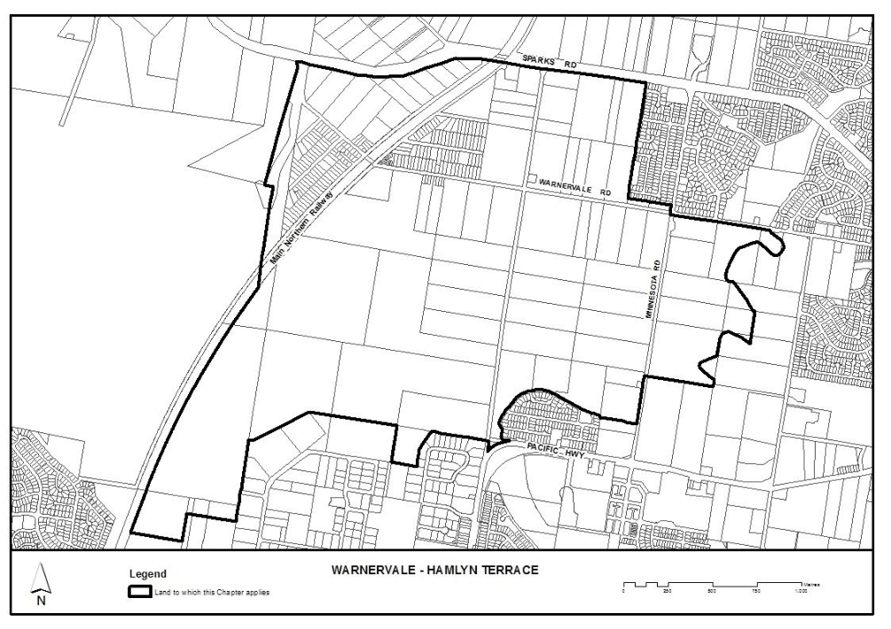

#### 5.25.1 INTRODUCTION

The purpose of this Chapter is to provide guidance in the preparation of proposals to develop the land to which this Chapter applies.

#### 5.25.1.1 Objectives of this Chapter

▪ To provide a high quality and varied residential environment with accessible open space, convenience and community facilities

▪ To provide attractive streetscapes which reinforce the function of a street and enhance the amenity of dwellings

▪ To provide opportunity for a variety of housing types

▪ To provide a safe and efficient system of roads and pathways for vehicular, pedestrian and cycle movements

▪ To provide for the protection and enhancement of the environment

▪ To create a mix of housing promoted with denser development responding to amenity and proximity to local services

▪ To retain and restore flood affected bushland areas to form part of the wider vegetation corridor

▪ To adopt water sensitive urban design that employs best practice in quality and quantity controls

▪ To support public transport initiatives and resultant improved air quality emission/sustainability objectives

▪ To appropriately integrate development with the existing built and natural environment

#### 5.25.1.2 Land to which this Chapter Applies

This Chapter applies to land as shown in Figure 1.

> [Picture on page 2: a picture, saved as a picture (images/ch-05-25-warnervale-south-page-2-1.gif, 150 dpi).]

#### Figure 1 Land to which this plan applies – Warnervale South Area

#### 5.25.1.3 Relationship to other Chapters and Policies

This Chapter should be read in conjunction with other relevant Chapters of this Development Control Plan (DCP) and other Policy Documents of Council, including but not limited to:

▪ Chapter 2.1 – Dwelling Houses, Secondary Dwellings and Ancillary Development

▪ Chapter 2.2 – Dual Occupancies and Multi Dwelling Housing

▪ Chapter 2.13 – Transport and Parking

▪ Chapter 3.5 – Tree and Vegetation Management

▪ Chapter 2.4 – Subdivision

▪ Councils Civil Works Specification
