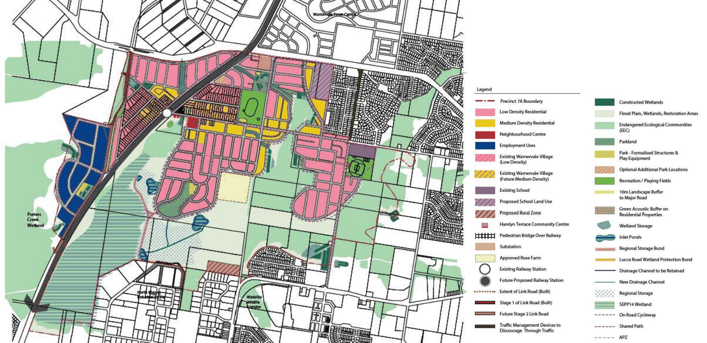
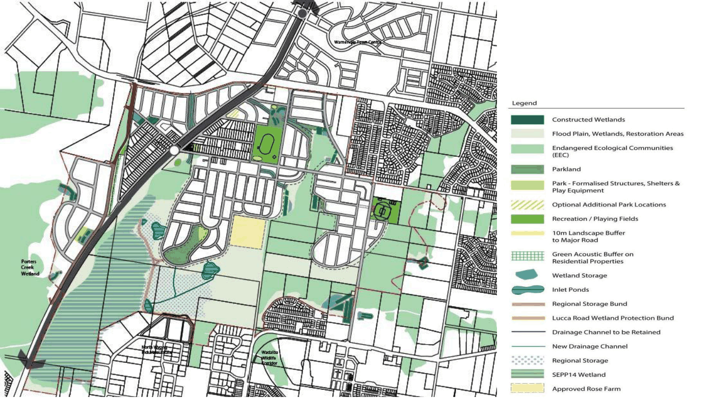
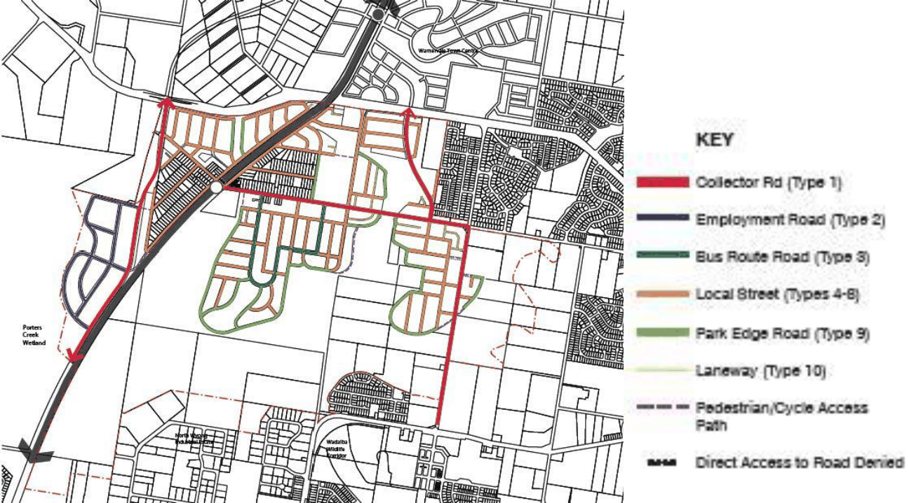
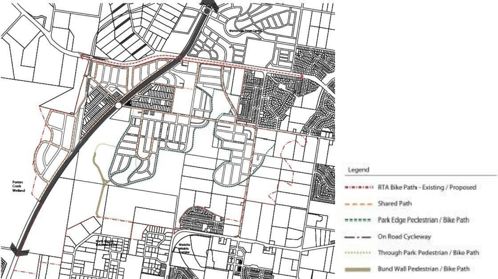
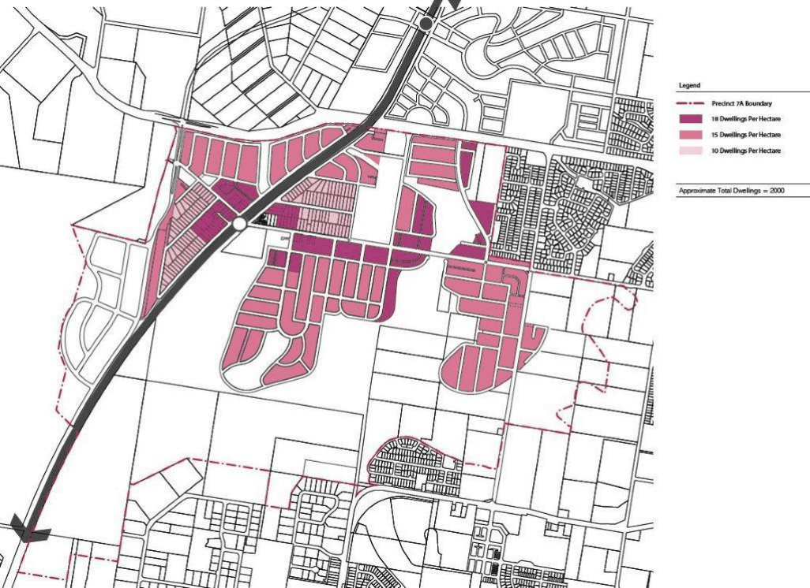
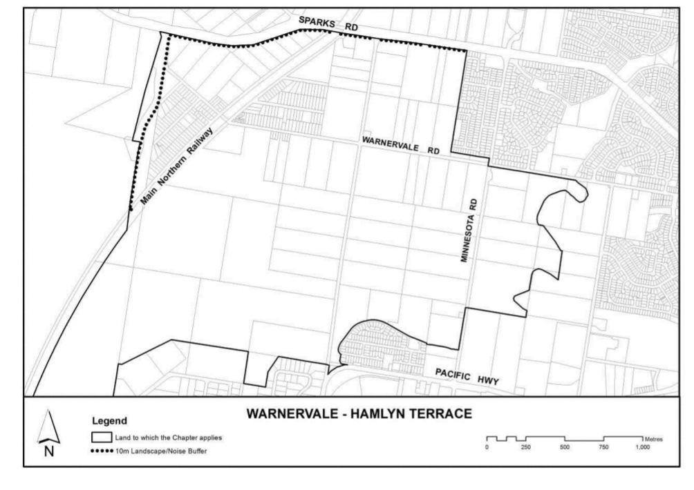
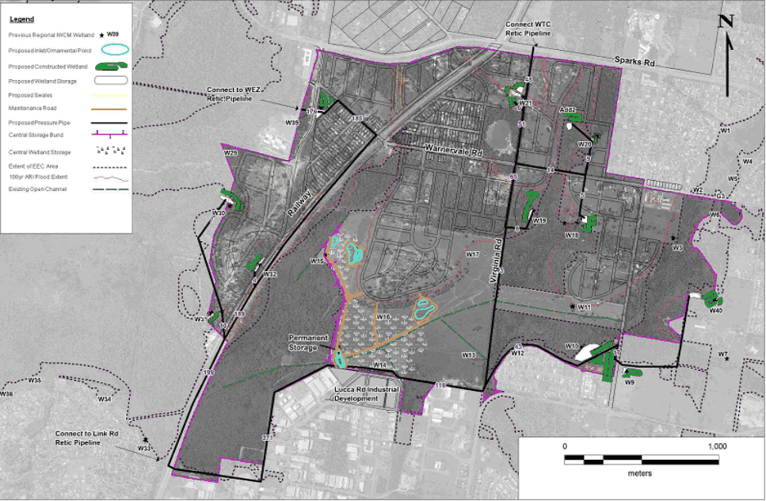

#### 5.25.2 SUBDIVISION DESIGN AND ENVIRONMENTAL CONSIDERATIONS

> [Picture on page 3: a picture, saved as a picture (images/ch-05-25-warnervale-south-page-3-2.gif, 150 dpi).]

#### Figure 2 Structure Plan – Precinct 7A

#### 5.25.2.1 Character Consideration – Subdivision and Provision of Open Space

Appropriate open space and parkland are significant contributors to establishing a distinctive character for a locality. Subdivision design is to consider appropriate open space and parkland in the first instance and not as an afterthought.

Warnervale South is to include a wide range of diverse and interesting open spaces and parks which will together create a unique location for living, working and relaxing. The residential and employment precincts of Warnervale South will be surrounded by nature and landscaping, and will feel part of a healthy living environment.

The parks will range from small more formalised local parks including play equipment, shade structures and seating, to open parkland incorporating grasslands, existing trees and new locally occurring tree planting. A new small community playing field shall be located behind the existing café which will supplement the other community assets and activities occurring in that area, contributing to the development of the Community Hub and Neighbourhood Centre at the Warnervale Station. Larger parks will provide appropriate space to adequately cater for the future development of community gardens.

Local pocket parks are to be located to ensure all residents have a small usable park within 400m walk. Dedicated bicycle and pedestrian paths are to connect the open spaces to add to the accessibility and amenity they provide.

The flood plain and Endangered Ecological Community areas take up a significant portion of Warnervale South. Although much of this area may not be publicly accessible, it will be very visually prominent from much of the developable area with the street grid designed to terminate in views towards these spaces as well as a park edge road skirting the entire development to ensure maximum enjoyment is gained from these attractive open spaces by the community and their visitors. The prominence of these spaces will lead to the development of a new residential area with a unique focus on the natural environment.

The flood plain and the nearby Porters Creek Wetland are key components of the local and regional water management system. The flood plain will include a range of reconstructed wetlands and storm management catchment areas which will attract birds and wildlife to the area and further enhance the visual amenity of Warnervale South.

To the west of the flood plain is a large area of State Environmental Planning Policy (Resilience and Hazards) 2021 Ch.2 Coastal Management wetlands. This is protected and will not be accessible to the public. It will however be bounded to the east by the bund wall which is part of the stormwater management strategy and it is intended that a pedestrian and cycling path along the bund wall will allow appreciation of the State Environmental Planning Policy (Resilience and Hazards) 2021 Ch.2 Coastal Management wetlands.

Appropriate acoustic buffers will be incorporated along busy roads such as Sparks Road and the Link Road in selected locations to ensure the amenity of the properties close to these roads.

#### 5.25.2.2 Subdivision – General

#### OBJECTIVES

▪ To encourage subdivision design of high quality, which controls and mitigates the potential environmental impacts arising from development

▪ To allow for an appropriate mix of lot sizes to provide for a mix of housing types and business opportunities

▪ To ensure that any subdivision design meets the appropriate standards of Council

▪ To ensure that the existing and proposed future character of the area is considered in subdivision works

▪ To ensure the economic and orderly development and servicing of land

#### REQUIREMENTS

a Proposals for the subdivision of land shall be in accordance with Chapter 2.4 –Subdivision and Council’s Civil Works Specification Where there is any conflict between the requirements of this Chapter 2.4 – Subdivision and Council’s Civil Works Specification, the provisions of this Chapter apply.

b Proposals for the subdivision of land shall consider Section 2.1 – Character Consideration - Subdivision and Provision of Open Space.

c Council will consider subdivision/development proposals that involve independent site servicing such as Community Title developments. Any such proposal should be discussed with Council prior to lodgement with specific reference to:

i any impact on the servicing of surrounding land

ii ongoing maintenance

iii the range of services that will be maintained totally independent of Council

#### 5.25.2.3 Open Space

#### OBJECTIVES

▪ To provide a range of public open spaces, sufficient for the active and passive recreation needs of residents

▪ To provide linkages between open space, streets, significant places and drainage features to create a distinguishable public domain

▪ To enhance the appearance, amenity and energy efficiency of urban development through integrated open space and landscape design

▪ To enable multiple use of open space and open space corridors for recreation, conservation, access and drainage without diminishing the recreation or conservation values of that space

▪ To provide safe and convenient pedestrian and cycleway networks with clear internal links and connections to external regional network and nodes of importance within the area such as the rail station, shops, schools and sports fields

#### REQUIREMENTS

a Open Space shall be provided as indicated in Figure 3. Design plans are to be approved by Council as part of the appropriate subdivision application and will occur in accordance with the relevant Section

7.11 Contribution Plan.

b Parks are to be located to retain existing vegetation where possible.

c Residents shall have access to, at a minimum, a formalised small neighbourhood park within 400m of their homes.

d Subdivision design should consider potential sites for the location of community gardens on land that would be easily accessible to residents and as guided by Council

> [Picture on page 6: a picture, saved as a picture (images/ch-05-25-warnervale-south-page-6-1.gif, 150 dpi).]

#### Figure 3 Park and open space locations

#### 5.25.2.4 Road Layout and Hierarchy

#### OBJECTIVES

▪ To establish a hierarchy of streets which maximises convenience, amenity and safety for vehicles, pedestrians and cyclists

▪ To provide a legible, connected and permeable grid of local streets that are sympathetic to the topography terminating with views to open space

▪ To protect conservation areas through the appropriate location of roads, paths and developable area

#### REQUIREMENTS

a The road and intersection layout and hierarchy is to be generally in accordance with Figure 4 above and the diagrams in Appendix A.

b All streets are to have, street trees and foot or shared paths as required in accordance with the diagrams in Appendix A.

c Roads and intersections are to be designed and constructed in accordance with Appendix A and with – Council’s Civil Works Specification.

d Design plans are to be approved by Council as part of the appropriate subdivision application and staging will occur in accordance with the relevant Section 7.11 Contribution Plan.

e Roads and intersection works shall be designed and constructed to Roads and Maritime Services (RMS) requirements where land fronts Sparks Road. Applicants with land seeking access from Sparks Road are to confirm with Council and the RMS design requirements for any Sparks Road intersection to ensure that sufficient land is allocated.

f A 43 metre-wide asset protection zone (APZ) bushfire buffer is provided on park edge roads and to the edge of the Porters Creek wetland adjacent to the employment precinct. A 10 metre building setback requirement will form part of this APZ.

g All park edge streets are to have the cycleway/footpath located on the park side of the road.

h New streets are to connect into the existing street network where possible while minimising four way intersections on busy roads.

i Landscaped buffers are to be provided to create separation for visual and acoustic privacy between residential areas and major roads.

j Provide a safer street environment by ensuring appropriate lighting, and using crime prevention through environmental design principles.

k Incorporate views to open space from terminating streets where possible.

l Provide roads at the perimeter of all open spaces to maximise the public amenity and access to these areas. Ensuring lots do not back onto the open spaces increases amenity and safety within those spaces.

m Any subdivision “entry treatments” are to be approved by Council. No expectation is to be given that Council will take ownership of entry treatments or be responsible for ongoing maintenance.

> [Picture on page 8: a picture, saved as a picture (images/ch-05-25-warnervale-south-page-8-1.gif, 150 dpi).]

#### Figure 4 Indicative road layout and hierarchy -

Note 1: Status of “Link Road” subject to change when the extension to the south (Pacific Highway) is completed.

#### 5.25.2.5 Pedestrian and Cycleway Routes

#### OBJECTIVES

▪ To provide public access along interfaces between the flood plain and the developable area in the form of an off road bike/pedestrian path

▪ To provide linkages between open space, streets and drainage features to create a clearly distinguishable public domain

▪ To provide safe and convenient pedestrian and cycleway networks with clear internal links and connections to external regional network to promote healthy lifestyle choices

#### REQUIREMENTS

a Pedestrian and cycle access is to be located in accordance with Figure 5 above.

b Shared paths/footpaths and cycleways are to be designed and constructed in accordance with Appendix A and with the Council’s Civil Works Specification.

> [Picture on page 10: a picture, saved as a picture (images/ch-05-25-warnervale-south-page-10-1.gif, 150 dpi).]

Figure 5 Pedestrian and cycleway routes -

#### 5.25.2.6 Public Transport

#### OBJECTIVE

To make provision for convenient local transport links and stops

#### REQUIREMENTS

a Bus stops are to be provided along approved bus routes, no greater than 400 metres apart.

b Development proposals are to have regard to the relatively convenient access of the rail network and ensure connectivity to the rail network is considered.

#### 5.25.2.7 Residential Subdivision

In accordance with the Final Structure Plan that informs this document:

▪ an 18 dwelling per hectare target has been established for the land zoned R1 (medium density residential).

▪ a 10 dwelling per hectare target has been established for the existing residential land in areas not immediately adjacent to the train station (i.e. – existing low density residential).

▪ the new release R2 zoned land has a 15 dwelling per hectare target (new low density residential).

#### OBJECTIVES

▪ To provide a range of residential development densities to cater for various and changing demographics

▪ To provide for appropriate densities in proximity to a developing town centre and railway station

▪ To ensure that the residential density targets of the NSW State Government and Council are achieved

▪ To provide for a variety in lot sizes to assist in providing greater housing choice

▪ To ensure that lots are appropriately located to maximise amenity and energy efficiency

#### REQUIREMENTS

a Subdivision Applications are to be prepared in accordance with Central Coast Local Environmental Plan (LEP) 2022  and Chapter 2.4 - Subdivision.

b In order to ensure that population targets listed above are achieved, applicants are required to demonstrate to Council that the density targets will be achieved.

c Where variation to the density target is proposed, the applicant is to demonstrate that the density targets can be achieved on a per hectare basis as a minimum.

d Smaller lot sizes will be encouraged in the R1 Zone. Any proposal that exclusively involves the creation of lots with an area of greater than 450m2 on land zoned R1 will not be encouraged. Any application that proposes to create a majority of lots greater than 450m2 on land zoned R1 must provide adequate justification as to why Council should support relatively large lots in this locality and provide evidence why small lot development would not be viable.

> [Picture on page 12: a picture, saved as a picture (images/ch-05-25-warnervale-south-page-12-4.gif, 150 dpi).]

#### Figure 6 Residential density targets

#### 5.25.2.8 Lot Size and Dimensions – Employment Lands

#### OBJECTIVES

▪ To ensure that sites are appropriate in size to accommodate the forms of development that are considered suitable in the business park including office, light industrial, manufacturing, processing and high technology activities

▪ To ensure the provision of lot size and dimensions that permit the objectives and requirements listed under Section 5 – Development Principles – Employment Lands to be met

▪ To ensure that the land uses encouraged are those that will make best use of the convenient freeway access for heavy vehicles

#### REQUIREMENTS

a Lots are to have a minimum land area of 4,000m2.

b Lots are to have a minimum width at the building line of 45m.

#### 5.25.2.9 Noise Assessment and Mitigation

#### OBJECTIVES

▪ To minimise noise impacts on residential and other noise sensitive land uses located in the vicinity of significant noise generating sources

▪ To establish consistent and appropriate built forms to mitigate noise and vibration impacts

#### REQUIREMENTS

a A landscaped acoustic barrier shall be provided in locations shown in Figure 7. This shall generally take the form of a landscape mound within a 10 metre treatment zone. Other alternative treatments may be appropriate for some sites where the width of the buffer may be reduced or involve fenced treatments. However the applicant will need to demonstrate that visual, noise and/or vibration management issues are effectively managed.

b A report by a suitably qualified acoustic consultant shall be submitted with any development application for subdivision or residential development adjacent to Sparks Road, Link Road and the Great Northern Railway Warnervale Road, Albert Warner Drive or Minnesota Road. The report is to address the following:

i Identify existing and potential future noise sources

ii Identify areas within the precinct where specific development should be restricted due to likely noise

iii Identify mitigation measures to reduce existing or potential noise effects to allow development to occur while meeting appropriate environmental and amenity requirements. This shall involve giving consideration to incorporating setback distances, noise barriers and at-property treatments in the form of architectural treatments, or combinations of these, for noise sensitive developments (e.g. residential developments) fronting major roads;

iv Development Near Rail Corridors and Busy Roads - Interim Guideline, inclusive of a vibration assessment where development is proposed in the vicinity of the railway;

v NSW Roads Noise Policy 2011.

c Details of any physical treatments proposed along property boundaries are to be submitted to Council with the relevant development application to ensure that treatments are consistent with other noise mitigation measures required in the local area. This includes consideration of works required to the north of Sparks Road as required under the Warnervale Town Centre DCP.

Note: Appropriate acoustic treatment for the Employment Lands Development is covered within Section 5.

> [Picture on page 14: a picture, saved as a picture (images/ch-05-25-warnervale-south-page-14-6.gif, 150 dpi).]

#### Figure 7 Landscape / noise buffer locations

#### 5.25.2.10 Water Cycle Management Requirements

This Integrated Water Cycle Management (IWCM) strategy for Warnervale South has been prepared based on the objectives of the broader Porters Creek IWCM scheme (EDAW 2008) in order to develop a more detailed concept for the precinct.

The IWCM strategy for Warnervale South is based on the principles of Water Sensitive Urban Design (WSUD) which aims to incorporate water management measures across the total water cycle in order to minimise the impact of urban development.

#### OBJECTIVES

▪ To minimise the impacts of development on the Porters Creek Wetland and hydrologically sensitive ecosystems

▪ To provide water quality and quantity control measures that are cost effective and affordable, with consideration given to ongoing maintenance costs

▪ To be compatible with the broader Porters Creek IWCM scheme

▪ To safeguard the environment by improving the quality of stormwater run-off to achieve best practice standards

▪ To facilitate the inclusion of WSUD elements into development as an at source treatment of stormwater where possible whilst balancing with end of line water quality treatment devices in order to meet the required targets and satisfy the Regional Stormwater Harvesting Scheme

▪ To preserve the nature of overland flow into the adjacent habitat and Flood Plain

▪ To control the impacts of urban development on channel bed and bank erosion by controlling the magnitude and duration of sediment-transporting flows

▪ To limit changes in flow rate, flow duration and overland flow path areas within the floodplain as a result of development

▪ To limit erosion of watercourses, slopes and banks due to runoff from impervious areas within the development

▪ To maintain and improve water quality in receiving waters and groundwater systems

▪ To reduce flood risk in urban areas and downstream water bodies by adopting requirements for minor and major system flow in accordance with Australian Rainfall & Runoff

▪ To protect and restore aquatic and riparian ecosystems and habitats

▪ To protect the scenic, landscape and recreational values of streams and water bodies

#### REQUIREMENTS

a Any development proposal for this site is to comply with the relevant requirements of Council’s Civil Works Specification, guided by the provisions listed below

b The criteria for Urban Stormwater runoff quality for areas within the Woongarrah Creek/Porter’s Creek Catchments are:

i 85% reduction in the post development mean annual load of Total Suspended Solids (TSS);

ii 65% reduction in the post development mean annual load of Total Nitrogen (TN);

iii 45% reduction in the post development mean annual load of Total Phosphorus (TP);

iv retention of litter greater than 5mm for flows up to 50% of the one-year ARI peak flow;

v no visible oils for flows up to 50% of the one-year ARI peak flow.

Note: Compliance with these standards to be determined through stormwater quality (MUSIC or approved equivalent) modelling.

c WSUD elements must be provided to control suspended solids and nutrients leaving the development area and the drainage system shall ensure that no runoff leaves the development area other than via water quality control structures.

d A Soil and Stormwater Management Plan (SSMP) shall comply with the requirements outlined in Precinct 7A IWCM Strategy March 2012 in addition to the requirements of DCP Chapter 2.4 - Subdivision.

e Where the SSMP varies from the recommendations of the Precinct 7A IWCM Strategy March 2012 supporting documentation, it shall provide justification for the variation and demonstrate to Council’s satisfaction that the objectives and key performance criteria outlined above are met by the revised concept.

f In the interim and prior to operation of the Regional Stormwater Harvesting Scheme, the centralised storage basins shall be designed so as to allow passage of stormwater, up to the one-year ARI flow,

into the adjacent floodplain area. (The storage basins will then be modified at a later date for stormwater harvesting by installing pumps and reticulation). Stormwater overflows during the interim period shall be conveyed in a suitable manner so as to minimise erosion and impacts on floodplain hydrology, geomorphology and ecology.

g Construction of the centralised Stormwater Storages as shown in Figure 8 shall take into account future development within the relevant sub-catchments and the corresponding requirements in accordance with the Regional Stormwater Harvesting Scheme. Future storage requirements shall be included in the storage basins which shall be constructed as part of the Warnervale & Wadalba Urban Release Area.

> [Picture on page 16: a picture, saved as a picture (images/ch-05-25-warnervale-south-page-16-10.gif, 150 dpi).]

#### Figure 8 IWCM scheme

Note1: Constructed Wetlands will not be funded through the relevant Section 94 Contribution Plan and will need to be funded and provided as part of the relevant Development Applications. Location of the Constructed Wetlands shall be consistent with the locations shown in the Precinct7A IWCM Final Report – Cardno (2012).

Note 2: The location of the wetland and water storage required to the south of the employment lands precinct and denoted as W32 may be varied and should be discussed with Council prior to design work being undertaken.

#### 5.25.2.11 Floodplain Management

Sections of the Warnervale South Precinct are located on a floodplain. A Flood Study conducted in conjunction with the IWCM Strategy recognises constraints due to flooding, identifies works to be undertaken to permit development and ensure that development does not have a detrimental impact on surrounding areas.

#### OBJECTIVES

▪ To ensure the orderly staging of the development of the area with regard to flood mitigation measures

▪ To ensure an adequate interface between subdivision infrastructure and the Flood Plain occurs in order to minimise erosion and sediment transport and mitigate impacts on the hydrology, geomorphology and ecology

▪ To regulate development and redevelopment that may reduce the ability of the floodplain to carry water and so increase the flood hazard

#### REQUIREMENTS

a Development Applications are to be consistent with the requirements of Chapter 3.1 Floodplain Management and the Precinct 7A Flood Study by Cardno dated May 2013.

b Provision of two culvert upgrades along Warnervale Road to convey the flow contained within the overland flowpaths. Works are to be undertaken at the appropriate stage of the development of the area in consultation with Council.

c Identified channels are required with a 100 year ARI peak discharge capacity to manage flood risk to an acceptable level within the upper drainage lines. The overland flowpaths are configured with a low flow channel, channel overbanks/floodplain and riparian zone according to guidelines of the NSW Office of Water and Council. Works are to be undertaken at the appropriate stage of the development of the area in consultation with Council.

d Raising and extension of the existing flood levee adjoining the North Wyong Industrial Estate to the south. Works are to be undertaken at the appropriate stage of the development of the area in consultation with Council.

#### 5.25.2.12 Potential Site Contamination

All development proposals are required to consider the potential for any existing site contamination impacting on future land uses. A Preliminary Contaminated Lands Assessment provided as part of the rezoning process for the Warnervale South area has identified sites where historic land uses have increased the potential for site contamination to be present and are likely to require management prior to changes in land use. The identified sites will require further investigation with regard to potential on-site contamination due to historic land use.

#### OBJECTIVE

To provide proponents with information that can be used to supplement the requirement to consider potential site contamination in preparing a development proposal

#### REQUIREMENT

a Consideration of Schedule B – Potential Site Contamination – Areas of Concern in the assessment of development proposals.

Note: This is supplementary information provided for applicants and landowners. All development proposals must consider all relevant Council and State Government Policy including State Environmental Planning Policy (Resilience and Hazards) 2021.

#### 5.25.2.13 Indigenous Heritage

Archaeological Investigation undertaken in association with this project revealed 18 new Indigenous Sites within the study area. A recommendation of this study is to list these sites on the Aboriginal Heritage Information Management System (AHIMS).

#### OBJECTIVE

To provide proponents with information that can be used to supplement the requirement to consider Indigenous Heritage in preparing a development application

#### REQUIREMENT

a Review of the AHIMS to locate any known Aboriginal Sites that may by impacted by the development proposal.

b No development is to be undertaken or approved in the vicinity of identified sites before a Cultural Heritage Management Plan has been prepared by a suitably qualified person.

Note: Consultation of the AHIMS does not assume other cultural or archaeological evidence does not occur within the Study area and does not relieve the applicant of the need to undertake appropriate additional investigations and studies where required.

#### 5.25.2.14 Ecological Issues

#### OBJECTIVES

▪ To protect, restore and enhance the environmental values and functions of watercourses and floodplains

▪ To ensure that future development does not have an adverse effect on the ecology, water quality and hydrology of Porters Creek Wetland

▪ To protect wildlife corridors, threatened species and their habitats within areas identified for protection on conservation and recreation zoned land

#### REQUIREMENTS

a All development will be required to satisfy any requirements which are identified in any ecological management plan or offset strategy which applies to the development precinct.

b A Vegetation Management Plan is to be submitted to Council wherever land is proposed to be transferred to Council for environmental or recreational management, which demonstrates consistency with the actions outlined in the Precinct 7A Conservation Management Plan.

c All development shall be consistent with any requirements for Biodiversity Certification which may (or may not) apply to the site.

d Council or private developers may develop environmental offset strategies external to Precinct 7A which could result in additional natural areas being set aside.
