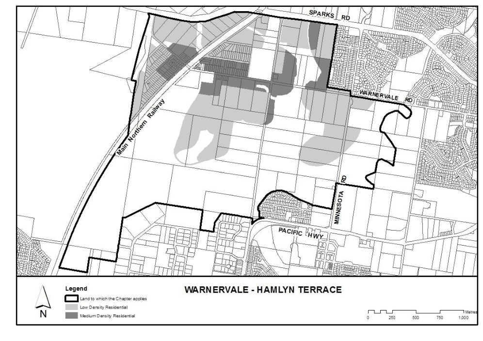
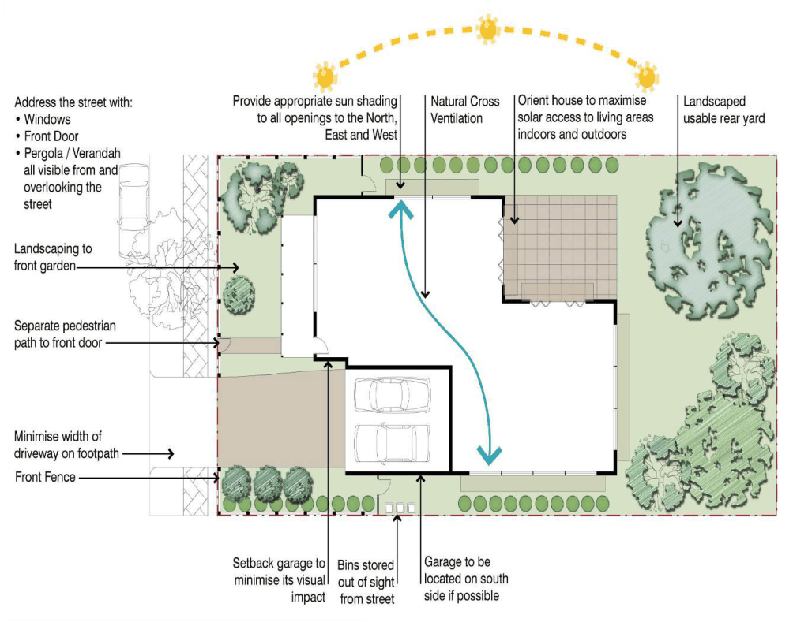
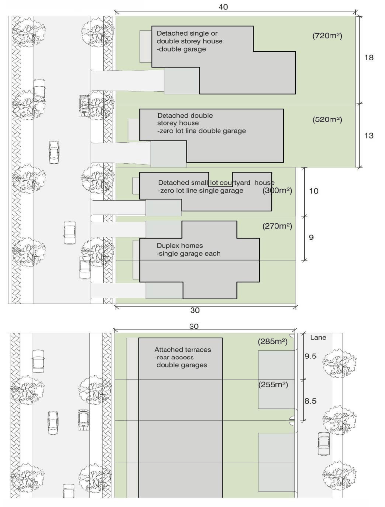

#### 5.25.3 DEVELOPMENT PRINCIPLES – RESIDENTIAL

The location of Warnervale South in the vicinity of significant public transport services, has the potential to reduce car reliance in the area and offers an opportunity to provide a diverse range of housing types to appeal to different demographic groups including families, empty nesters, couples, singles, and older people. Housing within Warnervale South should:

a include adaptable and accessible housing types;

b incorporate detached low density housing on a range of lot sizes with setbacks appropriate to the lot type;

c incorporate low scale medium density housing options including dual occupancies, townhouses, villas or small lot development;

d Provide rear lane access lots such as terraces (where appropriate) to maximise small lot housing and street amenity.

> [Picture on page 19: a picture, saved as a picture (images/ch-05-25-warnervale-south-page-19-13.gif, 150 dpi).]

#### Figure 9 Proposed low and medium residential areas

#### 5.25.3.1 Character Consideration – Residential Areas

Warnervale South is an expansive area that has a variety of landscape characters which will result in a diverse residential precinct. The existing Warnervale Village is built north-east and south-west of Warnervale Road and consists mainly of single storey dwellings on large lots with large setbacks. This area will gradually redevelop as the precinct expands.

New residential development extending the existing village on the northern side of Warnervale Road and to the west of the railway line will have a mixture of densities and will display a more urban and manicured landscape character.

The area south of Warnervale Road on the eastern side of the railway line is closely connected to the conservation areas and floodplain which will result in this area having a much more naturalistic character, intimately linked to the surrounding natural environment.

Development proposals are to consider the following guiding principles:

a A typical dwelling in Warnervale South should be designed to take advantage of the best orientation and views to the street and open spaces beyond.

b Dwelling houses are to be designed in proportion to the land area with enough room for a generous rear yard, a landscaped front garden and enough space between neighbours. Gardens should include quality landscaping with trees of native species in front and rear yards.

c The style of a new dwelling in Warnervale South should be simple and contemporary without inappropriate reference to historic details. Its overall bulk should be broken down into smaller parts that are in proportion to one another and create a balanced and articulated whole.

d The dwellings should be designed to consider all their sides. This is particularly important to consider for corner lots because of their highly visible location.

e Where appropriate, dwellings shall be designed to face out onto the flood plain and conservation areas to provide residents with amenity but also to provide passive surveillance of the paths and edge roads.

#### 5.25.3.2 Residential Development – Low Density Residential (Zone R2)

#### OBJECTIVES

▪ To ensure that development applications for development in low density residential areas are consistent with the relevant plans and polices of Council

▪ To ensure that consideration of the current and future character of the area is adequately considered in the assessment of Development Applications

#### REQUIREMENTS

a Development Applications for detached dwellings houses within Warnervale South shall adopt the provisions of Chapter 2.1 – Dwelling Houses, Secondary Dwellings and Ancillary Development.

b Development Applications for dual occupancy development within Warnervale South shall adopt the provisions of Chapter 2.2 – Dual Occupancies and Multi Dwelling Housing.

c Development Applications are to consider Section 5.25.3.1 Character – Residential Areas.

d A 10 metre building setback requirement forming part of the Bushfire Asset Protection Zone is to apply on property adjoining park edge roads.

> [Picture on page 21: a picture, saved as a picture (images/ch-05-25-warnervale-south-page-21-1.gif, 150 dpi).]

#### Figure 10 Typical house

Note: Any proposed front fencing shall be generally open and lightweight and shall not impact on sight distances for pedestrians/motorists, not impact on services such as sewer/electricity and should consider the impact of any diversion of stormwater flow.

#### 5.25.3.3 Residential Development – General Residential (Zone R1)

Central Coast LEP 2022 does not specify a minimum lot size for subdivision on land zoned R1 – General Residential. As such the area should provide for a diverse range of housing. The location of the R1 zoned land nearby significant public transport links suggests that relatively higher densities of residential development are appropriate on this land.

#### OBJECTIVES

▪ To ensure that consideration of the current and future character of the area is adequately considered in the assessment of Development Applications

▪ To provide for a diverse range of housing types to appeal to a mixture of demographic groups

▪ To provide for medium density housing in area with maximum amenity and public transport access

#### REQUIREMENTS

a Depending on the form of development proposed, applications will be required to consider the:

i provision for Small Lot Housing as defined under Chapter 2.4 – Subdivision;

ii provisions of Chapter 2.1 – Dwelling Houses, Secondary Dwellings and Ancillary Development;

iii provisions of Chapter 2.2 – Dual Occupancies and Multi-Dwelling Housing;

iv provisions for proposals for two-strorey residential flat development as per Chapter 2.3 – Residential Flat Buildings and Shop-Top Housing.

b Any proposal that exclusively involves the creation of lots to cater for individual dwellings on lots with an area of greater than 450m2 on land zoned R1 will not be encouraged. Any application that proposes to create lots greater than 450m2 on land zoned R1 size must provide adequate justification as to why Council should support large lots in this locality and indicate why small lot development would not be viable.

c Development Applications for residential development are to consider Section 5.25.3.1 Character – Residential Areas.

Note: Small Lot Housing is the multi-lot subdivision of five (5) or more lots where overall site planning and development is undertaken to produce completed house and land packages. Multi-dwelling housing means 3 or more dwellings (whether attached or detached) on one lot of land, each with access at ground level, but does not include a residential flat building.

> [Picture on page 23: a picture, saved as a picture (images/ch-05-25-warnervale-south-page-23-1.gif, 150 dpi).]

#### Figure 11 Housing diversity
