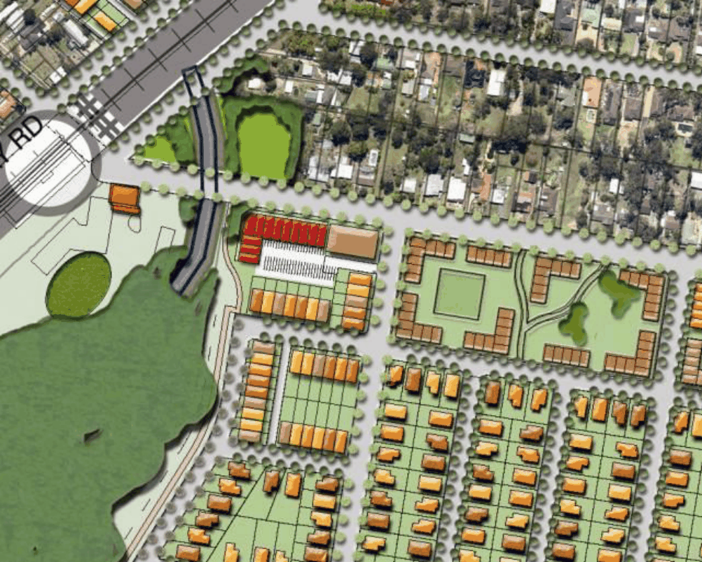
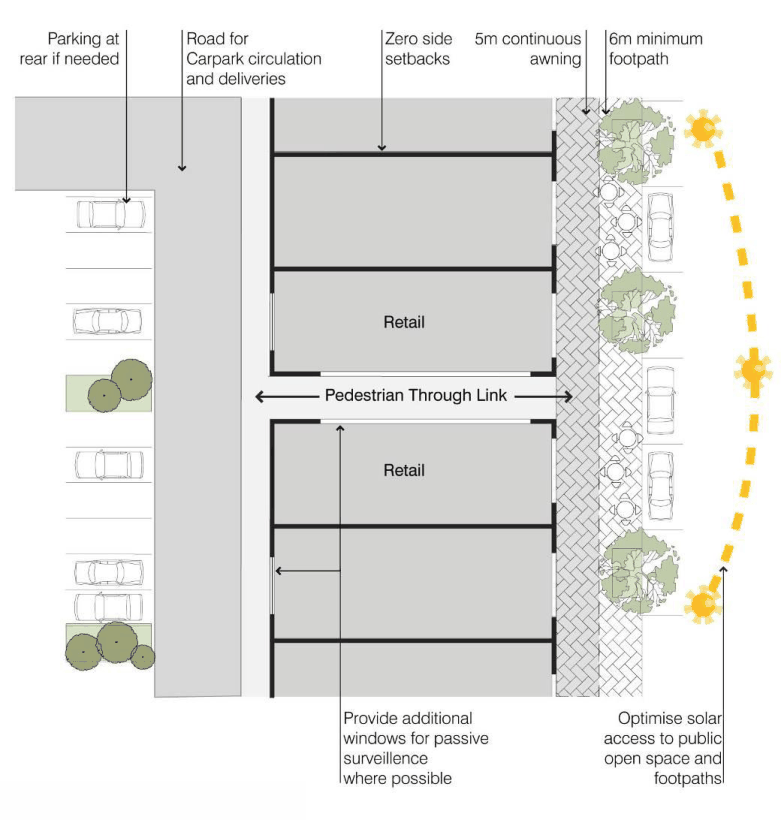

#### 5.25.4 DEVELOPMENT PRINCIPLES – WARNERVALE LOCAL

### CENTRE

#### 5.25.4.1 Character Consideration – Neighbourhood Centre

The neighbourhood centre will become the focus and meeting place of the local community, offering convenience shopping and services in a lively and attractive setting. Essentially a single sided north facing strip of up to 10 local shops and services, the neighbourhood centre will be connected by a quality paved widened footpath overlooking a small park across the road. The footpath will have continuous awnings, street trees and robust street furniture. Tenancies will be encouraged to provide footpath seating if appropriate to the business to further activate the neighbourhood centre. Ideally the businesses will include those which operate in both the day and evening to improve its’ safety and amenity for the community. The existing historic café gives a sense of place to the neighbourhood centre and sets the desired scale and character for the new buildings in the neighbourhood centre.

> [Picture on page 24: a picture, saved as a picture (images/ch-05-25-warnervale-south-page-24-1.gif, 150 dpi).]

#### Figure 12 Neighbourhood centre (indicative layout)

#### 5.25.4.2 Development Provisions Neighbourhood Centre

#### OBJECTIVES

▪ To provide an integrated collection of local convenience shops and services opening onto a pleasant and activated public realm

▪ To enhance the neighbourhood centre with quality landscaping, finishes and street furniture

▪ To ensure any new building in the neighbourhood centre does not diminish the historic integrity of the existing historic café

▪ To ensure that built form establishes a strong relationship with the public open spaces, primarily the footpath and the street

▪ To provide shelter and shade in the form of continuous awnings, and street trees

▪ To orientate neighbourhood centre to maximise solar access and winter sunlight

▪ To maximise views and connections towards open spaces including parks, green space and market area, as well as the conservation areas

▪ To provide a safe well lit pedestrian connection with good passive surveillance between the carpark areas, the neighbourhood centre and the train station

▪ To encourage energy efficient building orientation and envelopes

#### REQUIREMENTS

a General

i Provide an active neighbourhood centre with up to 10 local convenience shops.

ii Design shops and businesses to face the street with access from a widened paved footpath which links them all together.

iii Design the north facing footpath with a continuous awning as the public open space of the neighbourhood centre.

iv Provide the continuous awnings and shade trees for weather and solar protection.

v Maximise amenity by facing shops and footpaths to the north providing the opportunity for outdoor seating if appropriate.

vi Provide quality street furniture including public seating as per the requirements of Council.

vii Retain the existing historic café as a centre piece of the neighbourhood centre and build on this character with new buildings in a modern yet sympathetic manner.

viii Consideration of Section 5.25.4.1 – Character Consideration – Neighbourhood Centre

ix Consideration of the requirements of CCLEP 2022 and Chapter 3.6 – Heritage Conservation with regard to development in the vicinity of a heritage item.

b Building Use

i Provide for mixed use development with the provision of offices and residential spaces above ground floor retail and service providers.

ii Provide for outdoor seating on footpath adjacent to and managed by the provider.

c Built Form

i Development is to be a maximum of two stories in height.

ii Zero side setbacks are encouraged to create a continuous row of shops and services as well as a continuous street wall.

iii Built form on corner lots is to activate both frontages and the continuous awnings is to continue around that corner for the length of the building.

iv Provide a safe and direct pedestrian link to the main street for any rear car parking.

v Rear of building design shall ensure that the presentation of the development to any public area is satisfactory and adequately screen any waste or storage area.

vi New buildings in the neighbourhood centre to be contemporary in design. They may respond to the character of the existing development but not mimic its form or make inappropriate reference to historical details.

d Glazing and Awnings

i At street level on the primary street frontage, a minimum of 80% of the width of the building is to be made up of glazing and/or openings.

ii A continuous solid 5m wide awning over the footpath on the primary street frontage, at the height of the first floor, is to be provided.

iii Awnings must be connected directly to those on buildings on either side.

e Footpaths

i A paved footpath at least 6m wide to be provided in front of all buildings.

ii The footpath and public domain is to be designed with quality landscaping including generous numbers of street trees to provide shade in summer.

f Parking

i Convenience parking is to be provided on-street in front.

ii Ensure adequate on-site convenient parking is provided immediately adjacent to encourage customers and in accordance with Chapter 2.13 – Transport and Parking.

g Landscaping

i A landscape plan is to be prepared by a suitably qualified landscape professional is to be provided with development applications where landscaping works are proposed.

ii Greater than 40% of all plants for public/private open space areas are to be locally native and greater than 90% are native to Australia.

h Sustainable Design

i Buildings are to incorporate measures to optimise energy and water efficiency.

ii Energy efficient lighting to be specified in communal areas for example street lighting and public spaces.

iii Secure bicycle storage areas are to be provided.

> [Picture on page 27: a picture, saved as a picture (images/ch-05-25-warnervale-south-page-27-1.gif, 150 dpi).]

#### Figure 13 Neighbourhood centre (indicative layout)
