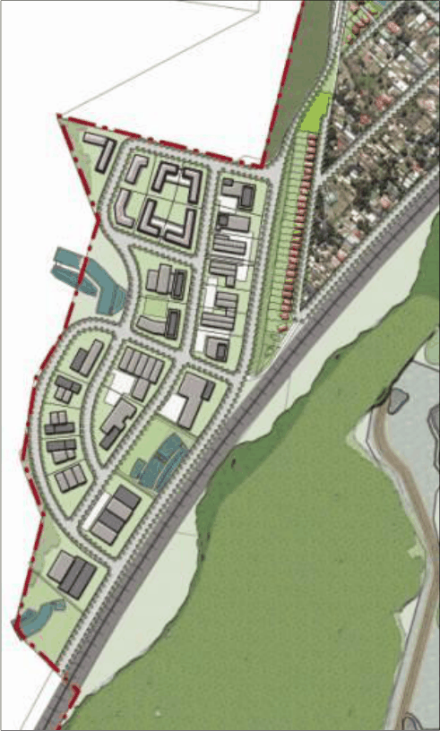
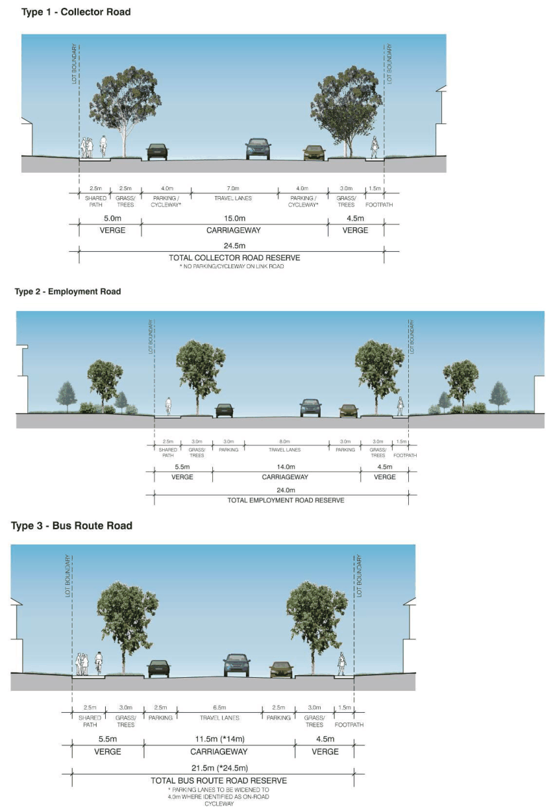
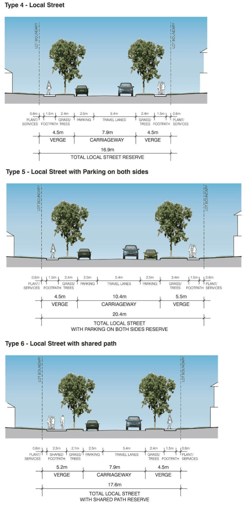
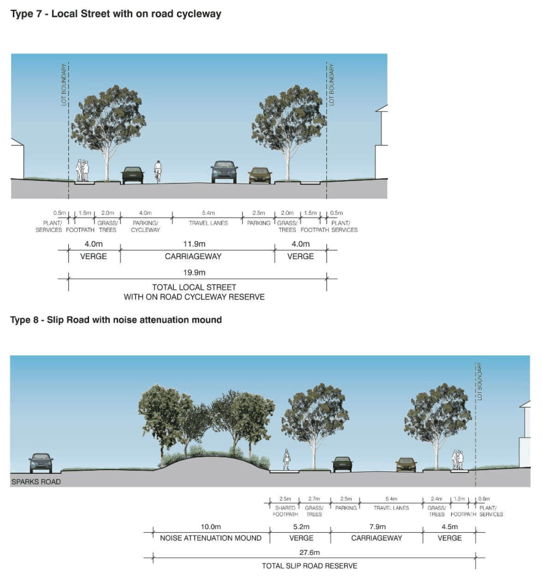
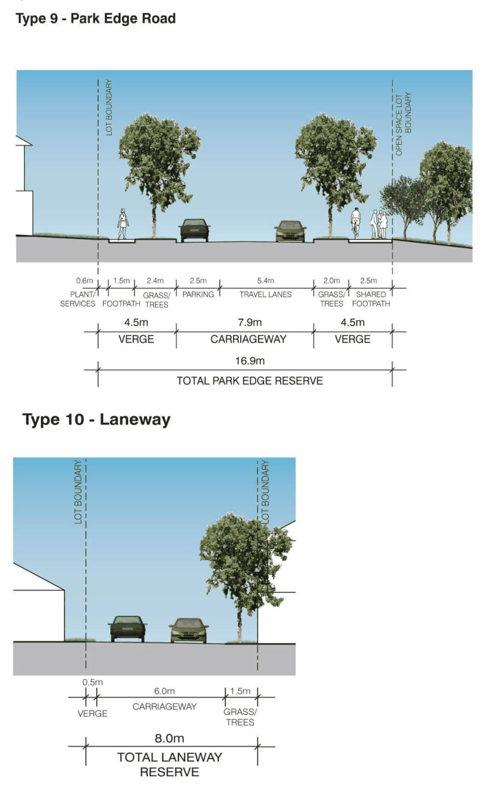
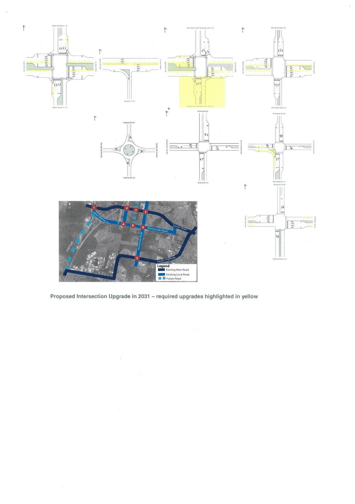
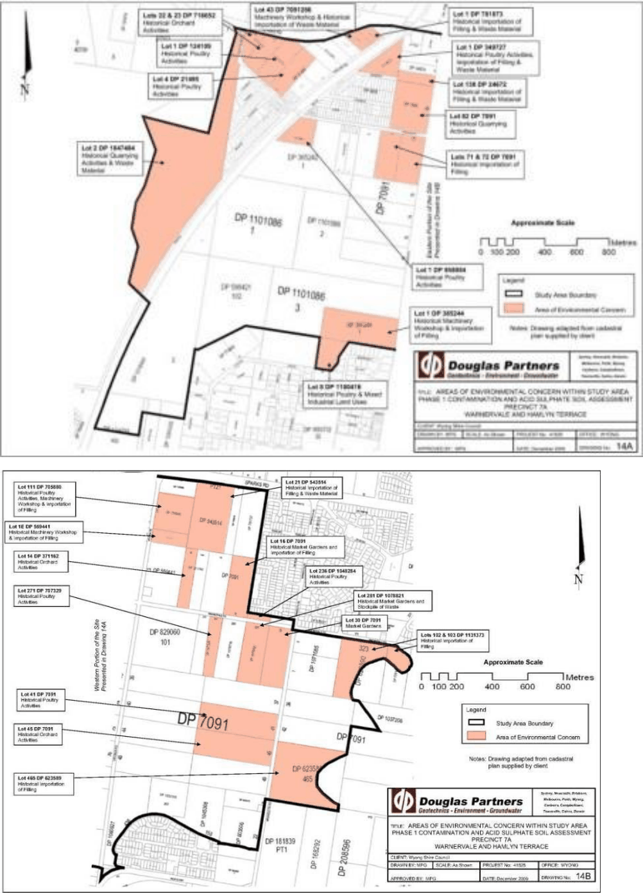

#### 5.25.5 DEVELOPMENT PRINCIPLES – EMPLOYMENT LANDS

#### 5.25.5.1 Character Consideration – Employment Lands

The Warnervale Employment Area will be characterised by high quality built form within a landscape setting that integrates with the natural and conservation values of the Porters Creek Wetland and associated regional green corridor. Streetscapes will have a strong landscape character with street trees and generous frontage setbacks to augment verge landscaping.

> [Picture on page 28: a picture, saved as a picture (images/ch-05-25-warnervale-south-page-28-1.gif, 150 dpi).]

#### Figure 14 Employment lands (indicative layout)

Note: Road layout is indicative and may require modification to accommodate larger vehicles.

#### 5.25.5.2 Development Provisions – Employment Lands

#### OBJECTIVES

▪ To create a high quality, innovative and integrated employment area and ‘business park’, particularly in terms of built form and landscaping

▪ To accommodate a range of business, light industrial, manufacturing, processing and high technology activities suitable for small to medium scale employment area allotments

▪ To encourage high quality design and construction that is clearly superior to development found in traditional industrial areas

▪ To ensure that built form establishes a strong relationship with the surrounding open space and wetlands in order to maximize amenity while minimizing environmental impact on conservation areas and natural water systems in the area

▪ To ensure that development includes cohesive streetscapes and a safe and attractive pedestrian environment

▪ To promote energy efficient buildings through thoughtful building orientation and landscape design as well as through well considered materials and appliance selection

▪ To incorporate best practice environmental planning and design, particularly techniques for conserving the consumption of energy and water in all buildings and the control of noise and emissions

#### REQUIREMENTS

a Character

i All development proposals are to address the Character Considerations above.

b Built Form

i Provide articulated and well detailed elevations including the use of projections and recesses, a variety of quality materials, glazing, sun shade structures, colours and other forms of architectural detailing. Blank building facades facing street frontages are not permitted.

ii Locate activity including offices, entries and pedestrian areas fronting streets and ensure buildings address “all” streets to improve surveillance and visual interest.

iii The office component of any development is to be incorporated into the overall design of the building and located generally along the primary internal street frontage and where possible be oriented away from frontages to the Link Road which might be the source of noise impacts due to traffic.

iv All buildings to provide a well-lit pedestrian entry with a canopy, recess, awning and/or colonnade facing the primary street frontage to distinguish that entry.

v Where an allotment has its primary street frontage towards the Link Road, the presentation of development is to be adequately addressed. A minimum of 60% of the primary building façade at ground level is to be activated by showrooms and the like located to face that road.

vi Buildings located on corner lots need to address both street frontages.

vii Developments shall provide quality outdoor amenity areas for employees to use for lunch and recreation.

viii Building facades to be finished in high quality durable materials, products and colours that complement the natural landscape character of the locality.

ix The use of metal and tilt up cladding is discouraged on front elevations, unless it can be satisfactorily demonstrated that it forms part of an architectural design solution in association with masonry, glass and other high quality materials. Where a side or rear façade is visible from the public domain, the use of metal and tilt up cladding must only comprise a maximum 50% of that wall’s cladding material.

x Development fronting the wetlands is to address relevant Asset Protection Zones and be designed to consider outlook towards Porters Creek Wetlands.

xi Rooftop structures (including plant rooms, air conditioning and ventilation systems) are to be incorporated into the design of the building to create an integrated appearance.

xii The steep topography within the employment area needs to be considered in the design of the building and their car parking and outdoor areas. Cut and fill is to be minimised by adapting the proposed development to the constraints of the site and not unduly modifying the site.

c Floor Space Ratio

i Maximum Floor Space Ratio of 0.8:1

d Site Coverage

i A maximum site coverage of 60% applies unless it can be demonstrated to the satisfaction of Council that greater site coverage will not adversely impact upon amenity of the streetscape or adjoining allotments

e Minimum Lot Size and Dimensions

i Lots are to have a minimum land area of 4,000sqm.

ii Lots are to have a minimum width at the building line of 45m.

f Front Setback

i Setback to be 25m from Link Road of which 12m in from the front boundary must be utilised for landscaping.

ii Setback to be 12m from the alignment of other roads of which 6m in from the front boundary must be utilised for landscaping.

iii In both cases, the remainder of the setback may be used for an access driveway or car parking.

iv For sites adjoining the perimeter road adjoining Porter’s Creek Wetland, the first 10m of the front setback is to be treated as a bushfire asset protection zone.

v Building frontages on adjoining allotments are to be aligned, located on the setback line.

vi Storage of any kind is not permitted within the front setback area.

g Side Setbacks

i Setbacks on corner lots must allow for Austroads sight lines for vehicular traffic.

ii Buildings may be constructed with nil setback to one side boundary, subject to approval by Council and where the applicant demonstrates that a superior urban design, building presentation, site maintenance and fire rating requirements will be achieved.

h Setbacks and Open Space

i The utilisation of setback areas for Asset Protection Zones (APZ’s) is to be as per the requirements of ‘Planning for Bushfire Protection’ legislation published by the Rural Fire Services.

ii A minimum setback of 5m from the boundary is required to all other public open spaces.

i Parking

i Parking requirements are to be calculated in accordance with Chapter 2.13 – Transport and Parking.

ii The main parking areas are to be located behind, beside and/or under the building to reduce visibility from the street.

iii All car parking outside the building footprint to be integrated with landscaping to provide shade and visual amenity.

iv Car parking areas in the front setback are to be designed to have minimal visual impact on the streetscape.

v Provide secure bicycle parking areas.

vi Loading docks, loading areas and external storage areas are not permitted facing the Link Road.

vii There shall be no direct vehicular access to the Link Road.

j Environmental Impacts

i Provide effective sunshading for windows and building entries (other than loading docks) by the use of design elements such as overhanging eaves and awnings, undercrofts, colonnades and external sunshading devices including screens.

ii Design buildings to promote cross flow ventilation.

iii Glazing is not to exceed 20% reflectivity.

iv Limit light and noise pollution post construction i.e. ensuring lights are not directed beyond the site boundary or upwards (excluding illuminated place names).

v Ensure built form, car parking areas and landscaping contribute to effective management of stormwater, biodiversity and energy efficiency.

k Landscape Design

i A landscape plan prepared by a suitably qualified landscape professional is to be provided with all development proposals.

ii Greater than 40% of all plants for public/private open space areas are to be locally native and greater than 90% are to be native to Australia or productive. Planting in the front setback is to be 100% landscaped with locally occurring species.

iii Front setbacks are to be landscaped generally with ground cover and trees ensuring the views between development and the street are not totally obscured. Minimum landscaping requirements are for one tree per 25m2 of front setback area.

iv Landscaping is required in the side and rear setbacks if visible from the public domain.

v The perimeter of open storage areas is to be landscaped to provide screening from public view.

vi Low water demand drought resistant vegetation to be used in landscaping areas, including native salt tolerant trees to high saline affected areas.

vii Mulching cover to be incorporated in landscaped areas (excluding drainage corridors).

viii All landscaped areas are to be separated from vehicular areas by means of a kerb, dwarf wall or other effective physical barrier.

ix Planting of vegetation must consider passive surveillance. Excessively dense vegetation that creates a visual barrier is to be avoided.

x Embankments are not to be steeper than 1:4.

l Fences and Walls

i No fencing is permitted within the landscaped component of the front setback.

ii In general no fencing other than a low feature wall may be erected on any site at the entry driveway. Low feature walls should be utilised for retaining walls, garden beds and the like.

iii No pre-finished and pre-coloured corrugated metal (e.g. Colorbond) or lapped and capped fencing is permitted to any public area.

iv The use, design and materials of fences and walls are to be compatible with well-designed fences and walls in the public domain.

v Side and rear fences and walls can be built to a maximum height of 1.8m to screen the rear of the allotment from adjacent sites.

vi Side fencing is not be located forward of the landscape zone of the front setback.

vii Side and rear fencing is to allow cross ventilation by the use of open chain wire or metal picket fencing.

viii Fencing is to utilise dark colours to reduce visibility.

ix No fencing or other structures that restrict safe fauna movement are to be used in public spaces.

x The steep topography within the employment area needs to be considered in the design of the building and their car parking and outdoor areas. Cut and fill is to be minimised by adapting the proposed development to the constraints of the site and not unduly modifying the site.

xi Retaining walls where viewed from the street or public places shall be of a decorative masonry product complementing the landscape design and integrating with the development.

### APPENDIX A STREETS AND INTERSECTIONS

> [Picture on page 33: a picture, saved as a picture (images/ch-05-25-warnervale-south-page-33-2.gif, 150 dpi).]

> [Picture on page 34: a picture, saved as a picture (images/ch-05-25-warnervale-south-page-34-1.gif, 150 dpi).]

> [Picture on page 35: a picture, saved as a picture (images/ch-05-25-warnervale-south-page-35-1.gif, 150 dpi).]

> [Picture on page 36: a picture, saved as a picture (images/ch-05-25-warnervale-south-page-36-1.gif, 150 dpi).]

Note 1: Where the width for plant and services is noted as 0.5m in any of the diagrams above, this may need to be increased to 0.6m in some circumstances. Contact Council to discuss.

Note 2: Park Edge and Employment Roads may require a greater area of land than that shown to accommodate Asset Protection Zones where required.

> [Picture on page 37: a picture, saved as a picture (images/ch-05-25-warnervale-south-page-37-1.gif, 150 dpi).]

### APPENDIX B POTENTIAL SITE CONTAMINATION – AREAS OF

### CONCERN

> [Picture on page 38: a picture, saved as a picture (images/ch-05-25-warnervale-south-page-38-3.gif, 150 dpi).]

### APPENDIX C RELEVANT STUDIES

AEC Group, Economic Viability Assessment, August 2012

Archaeological Surveys and Reports, Archaeological Heritage Assessment - Precinct 7A Warnervale, February 2010

Archaeological Surveys and Reports, The Archaeological Investigation for site of Indigenous Cultural Significance in Precinct 7A, Warnervale, September 2009

Architectus, Structure Plan with Master Plan Principles Report, September 2012

Douglas Partners, Stage 1 Contamination Assessment and Preliminary Acid Sulphate Soil Assessment, December 2009

Cardno, Precinct7A IWCM Final Draft Report, March 2012

Cardno, Precinct 7A Flood Study, May 2013

Hyder, Precinct 7A Traffic and Transport Study, September 2012

Peak Land Management, Bushfire Management Plan Warnervale Precinct 7A, March 2012

Renzo Tonin & Associates, Noise and Vibration Impact Assessment Final, March 2012

Umwelt, Ecological Assessment – Precinct 7A, September 2012

Umwelt, Conservation Management Plan –Precinct 7A, March 2012

Wyong Shire Council Precinct 7A Social Analysis and Human Services Study, March 2012

Wyong Shire Council, Precinct 7A – Open Space and Recreation Strategy, March 2012

Wyong Shire Council, Addendum Precinct 7A Traffic and Transport Study, April 2013
