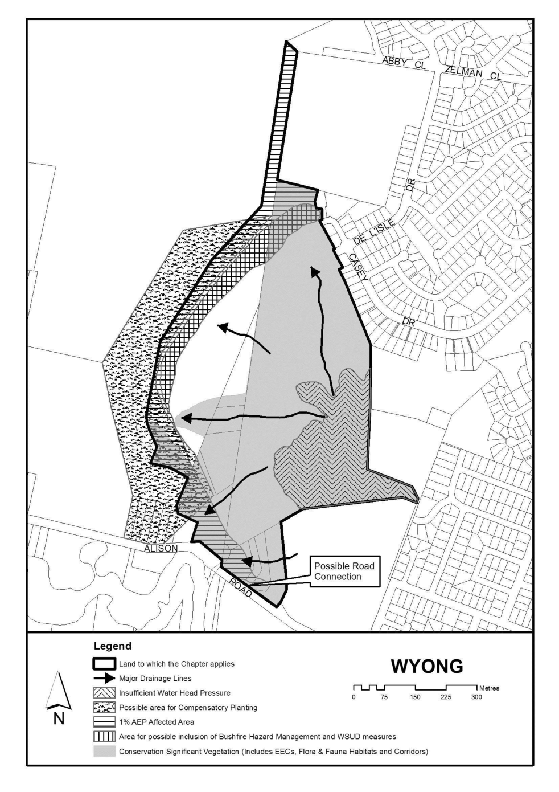

#### 5.27.1 INTRODUCTION

The purpose of this Chapter is to provide specific development guidelines for the West Wyong Area. This land is located within the catchment of the Porters Creek Wetland which acts as the natural flood storage area for Porters Creek, the Wyong River and the Tuggerah Lakes System. Porters Creek Wetland is the largest freshwater wetland on the Central Coast. Development of the land to which this plan applies must acknowledge this context and be designed appropriately.

Future development of the area must also have regard for its relationship with the unique visual character of the area.  The elevated portions of the area are relatively heavily vegetated and visually prominent from a number of important vistas in the locality. The vegetated skylines and slopes of the area provide a visually significant backdrop which is considered an important aesthetic element in the character of Wyong.

Vegetation in the area comprises locally and State significant communities, a number of threatened flora species and habitat for various threatened fauna species. The vegetation in the area forms a significant corridor that connects part of Porters Creek Wetland to riparian habitats along Wyong River and to vegetation communities and habitats to the south.  Future development must ensure that the integrity of these vegetation communities, natural habitats and vegetation connectivity are not compromised

The presence of high conservation vegetation communities and threatened species, as well as the visual prominence and topography of the area present challenges to investigate and ultimately will influence an appropriate development design.

#### 5.27.1.1 Objective of this Chapter

This Chapter aims to provide provisions for the future development of the site that achieves an appropriate development pattern and yield which recognises and respects the significant constraints, attributes and the desired future character of the area

#### 5.27.1.2 Land to which this Chapter Applies

The Chapter applies to land in West Wyong area as shown edged heavy black in Figure 1.

> [Picture on page 2: a picture, saved as a picture (images/ch-05-27-west-wyong-area-page-2-1.gif, 150 dpi).]

Figure 1 Land to which this chapter applies showing site constraints and opportunities

#### 5.27.1.3 Relationship to other Chapters and Policies

This Chapter should be read in conjunction with other relevant Chapters of this Development Control Plan and other Policy Documents of Council, including but not limited to:

▪ Chapter 2.1 – Dwelling Houses, Secondary Dwellings and Ancillary Development

▪ Chapter 2.3 – Dual Occupancy Development

▪ Chapter 2.13 – Transport and Parking and Access

▪ Chapter 3.1 – Floodplain Management

▪ Chapter 5.47 –Northern Conservation Areas

▪ Chapter 3.5 – Tree and Vegetation Management

▪ Chapter 3.6 – Heritage Conservation

▪ Chapter 2.4 – Subdivision

▪ Council's Civil Works Specification

▪ Flora and Fauna Guidelines for Development

#### 5.27.1.4 Relationship to other Legislation

This Chapter is to be read in conjunction with Central Coast Local Environmental Plan (LEP) 2022 and any other relevant legislation.

Land within the West Wyong Area is subject to State Environmental Planning Policy (Resilience and Hazards) 2021 Ch.2 Coastal Management. A Masterplan may be required to be prepared and adopted by the Minister prior to Council considering an application for subdivision on this land. This Masterplan would need to be considered as part of any development application for this land.

#### 5.27.1.5 Application Requirements

It is recommended that applicants consult with Council prior to lodgement of any Development Application (DA). Prior to any DA being lodged for development of a dwelling on this land, the subdivision is to be registered and all services are to be constructed.

#### 5.27.1.6 Development Contributions

The site is affected by Section 7.11 Contributions Plan for Wyong District.
