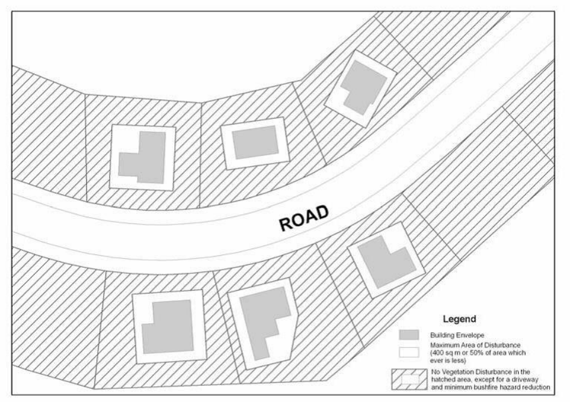
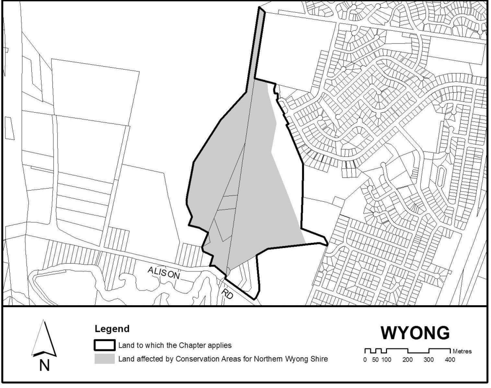
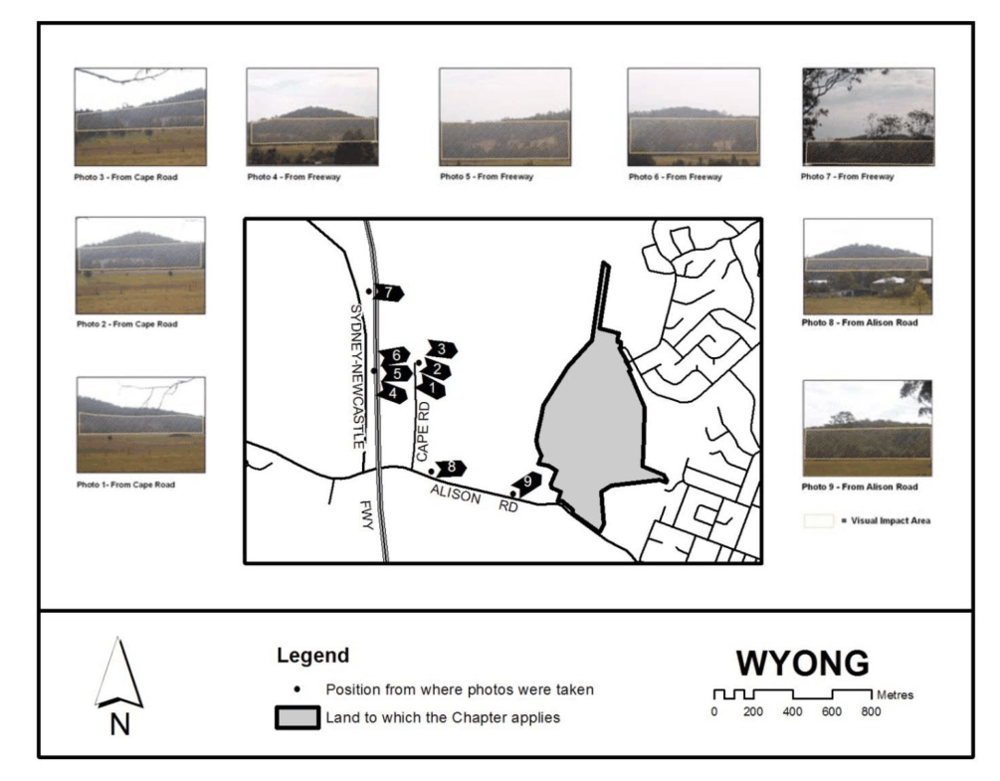
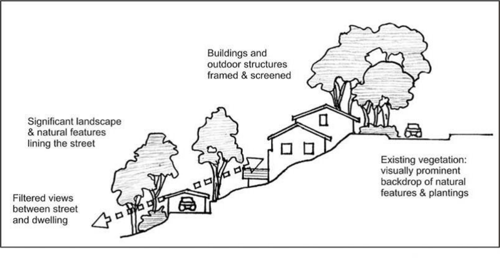
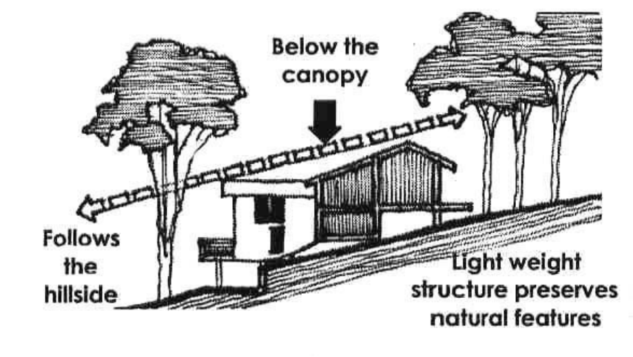

#### 5.27.2 DEVELOPMENT PROVISIONS

It is desirable that the land covered by this chapter be developed in a coherent and integrated manner. Whilst more than one application could be prepared for land covered by this Chapter, due to separate ownership, such applications must demonstrate that development of the land will not adversely affect the environmental, landscape or scenic values of the subject or neighbouring lands or compromise the development potential of these lands, by indicating the potential layout on adjoining lands. Applications for subdivision of land held in individual ownership are not to be submitted without appropriate prior consultation with other affected landowners.

#### 5.27.2.1 Subdivision Design

Conventional subdivision designs on steep slopes, featuring small rectangular lots, visually prominent retaining walls and battered slopes for roads, often result in visually prominent layouts. Due to the steep topography of the land to which this Chapter applies, it is considered that conventional subdivision design is inappropriate.

Community title or conservation design subdivision incorporate visually or environmentally constrained areas into public spaces with pockets of development being surrounded by these environmental or visually sensitive areas. These types of subdivision would be more appropriate for the land to which this Chapter applies. Design should also provide opportunities for residents to enjoy natural areas of open space.

Due to the significance of the landscape and environmental constraints, applicants are encouraged to consult with Council, State Government agencies and any other relevant authorities, during the design process

#### OBJECTIVES

▪ To ensure that the subdivision and open space design is sympathetic to the topography, scenic qualities and environmental attributes of the area

▪ To provide high level residential amenity

▪ To provide linkages within the area, to surrounding areas and community facilities

▪ To retain a visually attractive area when viewed from important viewpoints

#### REQUIREMENTS

Any application for subdivision of land in the West Wyong Area must:

a have regard for any relevant provisions of State Environmental Planning Policy (Resilience and Hazards) 2021;

b have regard for the requirements of Central Coast LEP 2022 and Chapter 2.4 – Subdivision, in addition to any requirements of this Chapter;

c have regard for any other relevant Council Policies;

d respect the prominent location and visual significance of the area from important viewpoints.

e ensure that development is staged appropriately to minimise the extent of disturbance and facilitate remediation;

f ensure subdivision layouts are designed generally in accordance with the principles contained within “Safer by Design NSW Policy 2001”, unless modified by this Chapter;

g ensure subdivision layouts respect the natural topography and attributes of the area by minimising the need for:

i site excavation for  roads and housing construction;

ii features such as road  cuttings and retaining walls;

which could cause adverse visual impact or land instability;

h encourage the provision of larger irregular shaped lots on steeper slopes in accordance with Chapter

2.4 of DCP 2022, to provide the opportunity for:

i retaining significant stands of vegetation in strategic locations to mitigate visual intrusion in the landscape and maintain environmental values;

ii mitigating visual impact caused by the usual straight lines of typical rectangle shaped lots;

i identify a maximum area of disturbance (e.g., 400 m² or 50% of the area of each lot, whichever is less) in which development, such as buildings, bushfire defendable spaces (APZs), landscaping and construction activity can occur.  These would normally only be building footprints, building envelopes, removing vegetation within 3 metres of buildings and driveways (refer Figure 2);

j ensure that there is to be no disturbance to vegetation outside the maximum area of disturbance (referred to in j above) for each allotment without the approval of Council (except for a driveway of a specified width) between the street and the front of the building or for bushfire hazard management purposes (refer Figure 2);

k provide for adequate, useable and accessible open space or reserve areas; and

l provide for community facilities (such as post boxes and the like) at locations within four hundred metres to houses and open space areas

> [Picture on page 5: a picture, saved as a picture (images/ch-05-27-west-wyong-area-page-5-20.gif, 150 dpi).]

#### Figure 2 Maximum areas of disturbance and no disturbance areas

#### 5.27.2.2 Access and Movement

#### OBJECTIVES

▪ To provide for an attractive, safe and efficient internal road network with links to the external system

▪ To provide links to viable public transport

▪ To provide a safe, coordinated and accessible pedestrian and cycle circulation system through interconnected streets and pathways integrated with the existing road and pedestrian networks aimed at reducing private car dependency and facilitating connected communities and healthy living

#### REQUIREMENTS

a Public pedestrian accessways should be provided to connect the major areas of residential use with recreational areas, and other community facilities and services such as Wyong’s CBD, TAFE, schools, Watanobbi playing fields and community centre, and Wyong Train station. Pedestrian Road crossings should coincide with slow points designed to limit the travel speed of vehicles.

b The design of the road and pathway network must comply with the requirements of Part 4 Subdivision of this DCP and Councils Civil Works Specification.

c The design and construction of roads, vehicular access and egress, and the shared pedestrian/cycleway shall be in accordance with relevant Austroads standards.

d Effective links (road, cycle, pedestrian) to and between neighbouring land and areas are to be considered, in particular through the West Wyong area between Alison Road and De Lisle Drive, Watanobbi.

e The design of road layouts are to be of a geometry that is able to cater for safe and efficient access for general (garbage collection) and emergency service vehicles.

f Subdivisions should be designed to ensure that public transport is accessible to all persons in the locality. This may include the provision of bus stops, appropriate road widths to cater for buses or other viable and/or innovative public transport.

#### 5.27.2.3 Biodiversity Protection and Management

The area to which this chapter applies contains high biodiversity values. The vegetation communities that occur on the low lying parts, qualify as either the Swamp Sclerophyll or River-Flat Eucalypt Forest on Coastal Floodplains, or Swamp Oak Floodplain Forest Endangered Ecological Community (EEC), as listed under the Biodiversity Conservation Act 2016. The vegetation community occurring on the hillface and skyline, is the locally significant Narrabeen Dooralong Spotted Gum – Ironbark Forest. On the flatter parts, individuals of the threatened species Melaleuca biconvexa occur. The area has been assessed as containing Squirrel Glider habitat ranging from low to very high significance. Some of this habitat has been nominated as part of a wildlife corridor and the DCP Chapter 5.47 – Northern Conservation Areas applies to this area, as shown in Figure 3. Potential owl roost trees and potential habitat for Yellow-bellied Gliders and Bats are also known to be present.

#### OBJECTIVE

To ensure that development protects and improves significant vegetation communities, threatened species, threatened species habitats and vegetation corridor connectivity and long-term viability, while also protecting the landscape and scenic qualities of the area

#### REQUIREMENT

A comprehensive Flora and Fauna Assessment must be prepared in accordance with Council’s ‘Flora and Fauna Guidelines for Development’. The assessment must recommend appropriate strategies and/or requirements to ensure the protection of all significant habitats and communities. The comprehensive Flora and Fauna Assessment must:

a identify the location of any vegetation communities, threatened flora and fauna species, threatened flora and fauna habitat of Federal, State and local significance in the area;

b include a Squirrel Glider habitat assessment in accordance with Council’s ‘Squirrel Glider Conservation Management Plan: Wyong Shire’ (Smith, 2002);

c include a conservation assessment in accordance with Council’s DCP Chapter 5.47 Northern Conservation Areas

d identify strategies for the design of the development to first avoid impacts on biodiversity using prevention and mitigation measures. Where significant modification of the proposal to minimise impacts is not possible then compensatory strategies should be considered. To determine an adequate biodiversity offset either one of the following methodologies should be used as a guide: State Government BioBanking Assessment Methodology or ‘Principles for the Use of Biodiversity Offsets in NSW’. The offset must counterbalance the development impacts to improve or maintain biodiversity values. A compensatory strategy could include a comprehensive program of on-site and/or off-site compensatory plantings and regeneration works. Council encourages consideration of a compensation strategy that restores functional wildlife corridors on the abutting Porters Creek Wetland, in accordance with the no net loss vegetation provisions of Chapter 5.47 Northern Conservation Areas. Compensatory plantings would have to include indigenous vegetation and preferably be capable of screening future development of visually prominent areas. Figure 1 identifies an area which may be suitable for compensatory plantings provided landowner’s agreement is obtained. Any compensation strategy proposed, other than through the Biobanking Scheme, must be discussed with Council and an agreement must be reached regarding the vegetation type, location, mechanism for conservation in perpetuity, management regime and financial security with respect to ongoing management;

Note:  This is a Council initiative and is not associated with any NSW State conservation program.

e fulfil requirements of the Commonwealth Department of Sustainability, Environment, Water, Population and Communities in relation to any relevant requirements of the Environmental Protection and Biodiversity Conservation Act 1999;

f include a Vegetation Management Plan (VMP), prepared by a suitably qualified and experienced person. The VMP must comply with Chapter 3.5 Tree and Vegetation Management, and provide strategies for retention and protection of trees within the area and the long-term effective monitoring and management of any vegetation included in a compensation strategy, including how this will be funded.

> [Picture on page 8: a picture, saved as a picture (images/ch-05-27-west-wyong-area-page-8-1.gif, 150 dpi).]

#### Figure 3 Land subject to this Chapter within the Northern Conservation Areas

#### 5.27.2.4 Drainage, Stormwater and Water Cycle Management

The land to which this Chapter applies is upstream of and drains to Porters Creek and Wyong River, which are part of a major wetland system, which feeds into the Tuggerah Lakes System. Development within the Porters Creek and Tuggerah Lakes catchments has the potential to adversely affect the health of these systems and the water supply.

Some of the land that is zoned for residential purposes is within 40 metres of Porters Creek and includes steep terrain with slopes ranging 9% to 22%. Works within 40 metres of a watercourse may require a Controlled Activity Approval under the Water Management Act 2000.

Figure 1 identifies known major drainage lines and slopes and an area which may be suitable for Water Sensitive Urban Design (WSUD) measures.

#### OBJECTIVE

To manage drainage and stormwater flows within and off the site to minimise the impact on adjoining or downstream vegetation and functional systems

#### REQUIREMENTS

a A stormwater Management Plan and integrated water Management Plan is to be prepared by a suitably qualified professional which addresses the following:

i. the location of existing drainage lines and features;

ii. water quality and quantity modelling;

iii. WSUD measures (as guided by Council’s Civil Works Specification) and guided by pre-development or natural flow volumes, nutrient and sediments loads.

b Appropriate design measures need to be incorporated to ensure that development is sympathetic to this sensitive location and does not promote degradation of Porters Creek wetland health.

c Subdivision design is to incorporate WSUD measures in accordance with Council’s Civil Works Specification.

#### 5.27.2.5 Flood Management

Areas currently identified as being affected by a 1% AEP Flood are shown on Figure 1. Applicants should contact Council prior to lodgement of any development applications for land identified in this chapter to ensure that the most up to date data on flooding is used in the preparation of any development proposal.

#### OBJECTIVES

▪ To maintain the continued functionality of the floodplain

▪ To protect existing and future residences and infrastructure from damage resulting from flood events

#### REQUIREMENT

Any future subdivision and development of the subject site is to comply with the requirements of Chapter 3.1– Floodplain Management, and the Porters Creek Floodplain Risk Management Study.

#### 5.27.2.6 Land Stability Management

Patonga Claystone soils occur on the land. These soils are highly erodible and contain large sandstone boulders.  The land slopes down to the west and a deeply incised gully has formed on this west facing slope.

#### OBJECTIVE

To avoid potential erosion of unstable soils, movement of any large sandstone boulders and/or potential landslip through appropriate development design, construction techniques, mitigation and management techniques, while also protecting the biodiversity values, landscape and scenic qualities of the area

#### REQUIREMENT

A satisfactory geotechnical report is to be prepared by a suitably qualified professional that includes consideration of the potential effects of heavy rainfall, disturbance in medium to high hazard zones, and vegetation clearing on slopes. Such strategies and/or requirements must:

a indicate the location of medium and high risk areas;

b identify appropriate siting and design of buildings, structures and other works to minimise cut and fill (and avoid where possible) particularly on areas of the site that have medium to high risk of slope instability and/or dispersive soils by utilising design features such as drop edge beams and split levels. The visual impact of any cut and fill must also be considered and addressed (Refer Section 2.9- Visual Significance);

c minimise the need for site excavation for road and housing construction to minimise potential for landslip, soil erosion and need for visually prominent retaining walls;

d stage development and  construction works to minimise the area of the land subject to disturbance at any one point in time;

e locate development away from steep gully areas with an appropriate buffer and manage and/or rehabilitate such steep areas by planting vegetation indigenous to the area;

f require all development and/or construction works are carried out in accordance with Council’s Erosion and Sediment Control requirements

g require geotechnical investigation and reporting, particularly in medium and high hazard areas and on steep slopes, to accompany development applications. Such investigations and reporting must be carried out by a suitably qualified and experienced engineering geologist and/or geotechnical engineer and include mitigation and management measures appropriate for the conditions on the land.

#### 5.27.2.7 Heritage

#### OBJECTIVE

To identify and conserve any sites, objects and/or items of cultural heritage and/or archaeological significance

#### REQUIREMENT

For any areas of heritage significance or with potential heritage significance applications must comply with the requirements of Central Coast LEP 2022 and Chapter 3.6 – Heritage Conservation.

#### 5.27.2.8 Bushfire Management

#### OBJECTIVE

To provide adequate bushfire protection to buildings and occupants, without unreasonably compromising biodiversity values, landscape and scenic qualities of the area

#### REQUIREMENTS

a Comply with the NSW Rural Fire Service ‘Planning for Bushfire Protection 2019’ as revised and Australian Standard 3959:2009.

b Address the potential conflict from the provision of Asset Protection Zones (APZs) in areas where vegetation must be retained to maintain the current biodiversity, landscape and scenic quality of the area.

c Identify development design that incorporates adequate defendable spaces (i.e., Asset Protection Zones) to protect human life, property and valued public assets from damage by bushfire.  All APZs must be generally contained on the land tenure it is to protect (i.e., public land must not be used for providing APZs to protect private development and private land is not to be utilised for providing APZs for protection of public assets) unless mutual benefit can be demonstrated.

d Road reserves, dwelling setbacks, service infrastructure, perimeter roads / tracks and measures are to minimise ground fuel hazard and adequately separate it from tree canopy to be included in APZs.

Note: Minimising ground fuel hazard involves reducing the amount of vegetation in a forest or woodland understorey to levels that will minimise opportunity for the canopy to catch fire.  It does not mean removing all vegetation, of which some can remain to provide for amenity, screening, land stability, etc.

e Any development application is to demonstrate how the proposed development complies with an approved bushfire hazard management plan.

#### 5.27.2.9 Visual Significance

The land to which this Chapter applies is heavily vegetated and/or visually prominent from a number of important viewpoints. Some of those viewpoints are shown in Figure 4 below. The visual prominence of the vegetated hill-faces and skyline is considered to make a significant contribution to the character of the Wyong landscape.

#### OBJECTIVES

▪ To protect the scenic quality of the area and ensure development will be unobtrusive when viewed from important viewpoints on the Central Coast

▪ Future development is to be unobtrusive when viewed from adjacent streets and important local, mid-ground and distant viewpoints  on the Central Coast

#### REQUIREMENT

A Landscape and Visual Impact Assessment that identifies visually sensitive areas is to be prepared by a suitably qualified and experienced person and submitted to Council. The landscape and visual impact assessment must:

a identify and consider the impact of development on the land from all important viewpoints;

b identify and specify locations on the land for residential development that are not visually prominent;

c consider various development scenarios (including the ‘no development’ scenario) for the hill-face slopes and skyline of the area to protect the visual quality and vegetated character of the area;

d consider and specify planting, retention and protection of existing vegetation on the hill-face slopes and skyline to maintain the visual quality and vegetated character of the area and assist in screening proposed development from important local, mid-ground and distant viewpoints.

> [Picture on page 12: a picture, saved as a picture (images/ch-05-27-west-wyong-area-page-12-1.gif, 150 dpi).]

#### Figure 4 Known important viewpoints of the site

#### 5.27.2.10 Open Space and Reserves

The elevation and topography of the site requires special consideration to be given to the location, function and provision of open space and reserve areas, particularly at the initial design stages of subdivision and development.

The steep topography and terrain of the site will constrain access to open space areas and parks, for some potential users, particularly the elderly and those with disabilities. Consequently, careful consideration will need to be given to locating open space areas so that as many as possible are accessible by these users.

#### OBJECTIVES

▪ To provide open space areas that are appropriately located to provide easy access for all potential users and easily identified

▪ To provide for protection of important vegetation, visually sensitive areas, property and the safety and health of residents and visitors

#### REQUIREMENTS

a Open space areas are to comply with the Wyong Open Space Principles Plan 2005.

b Local parks are to comply with Council’s Local Parks Strategy.

c Open spaces are to comply with Healthy-by-Design principles.

d Adequate shared access (footpath and cycleway) are to be incorporated into open space areas by locating them in relatively flat areas and/or grading pathways/tracks.

e Incorporate connective vegetative corridors along path/cycle ways which link open space and/or residential nodes to assist with providing, amenity, screening and land stability.

f The retention or planting of suitable shade trees to sitting and play areas are to be provided.

g Open space design is to incorporate visual screening if viewed from identified important viewpoints and visual impact assessment identifies an unacceptable impact without screening.

#### 5.27.2.11 Landscaping

#### OBJECTIVES

▪ To provide landscaping that integrates the development with the surrounding landscape, ensuring the current environmental and visual character and quality is maintained

▪ To include the retention of native vegetation as a dominant element of the landscape

#### REQUIREMENTS

a All applications for subdivision must be accompanied by a landscape plan prepared by a suitably qualified landscape professional, which demonstrates that potential visual impacts are resolvable. The landscape plan must indicate:

i the extent of vegetation retention;

ii the location, form and types of species to be planted. Only indigenous species must be used as they have low nutrient and water requirements;

iii the areas to be landscaped, paved areas, retaining walls and types of fencing;

iv continuity of existing tree canopy to complement existing environmental and landscape qualities;

v minimal opportunity for weed invasion;

vi that proposed development will not be visually prominent from important viewpoints and that screening is provided to reduce the visual impact of development.

b Areas shown on the subdivision plan as being outside disturbance areas are to be retained as bushland, except for a driveway between the street and frontage of a building.

c Existing vegetation is to be retained and additional planting undertaken where appropriate in the road reserves to screen future development and provide streetscape amenity. An example of this is shown in Figure 5.

> [Picture on page 14: a picture, saved as a picture (images/ch-05-27-west-wyong-area-page-14-11.gif, 150 dpi).]

Figure 5 Example of how landscaping and retained vegetation can be used to limit the visual

impact of the development

#### 5.27.2.12 Building

#### OBJECTIVE

To achieve quality urban design which takes into consideration the constraints of the land

#### REQUIREMENTS

a Where permissible under Central Coast LEP 2022 dwelling houses are to comply with the requirements of Chapter 2.1 – Dwelling Houses, Secondary Dwellings and Ancillary Development or SEPP Exempt and Complying Development.

b Dwelling design is to take into consideration the slope of the land. Figure 6 provides an example of development that ‘steps-down’ the slope below the forest canopy.

c On steeper slopes there is preference for split level designs that follow the slope of the land and/or lightweight construction designs with suspended floors and decks, which are demonstrated defendable in a bushfire.

> [Picture on page 15: a picture, saved as a picture (images/ch-05-27-west-wyong-area-page-15-13.gif, 150 dpi).]

#### Figure 6 Dwelling below the canopy following contours to limit visual impact

#### 5.27.2.13 Noise

The most likely source of noise is traffic travelling along the M1 Pacific Motorway, located approximately 750 metres west of the site, and Alison Rd, adjoining the site to the south.

#### OBJECTIVE

To ensure future residents are protected from noise emanating from M1 Pacific Motorway or Alison Road that exceeds Leq 55dBA (24 hours)

#### REQUIREMENT

a Applications for subdivision are to be supported by a satisfactory noise study and report prepared by a suitably qualified and experienced acoustic consultant. The report is to address the following:

i. any necessary acoustic control measures to be incorporated into the design of future development to achieve the noise levels specified in Chapter 2.1 Dwelling Houses and Ancillary Development, that do not compromise the integrity of the overall development design or the landscape values of the land to which this Chapter applies.

#### 5.27.2.14 Water Supply Pressure

Some upper-portions of the site (i.e., those at and above the 40 metre contour) currently have insufficient water pressure for domestic use and/or bushfire fighting. Figure 1 indicates the approximate boundaries of the area which has insufficient water pressure.

#### OBJECTIVE

To ensure that the health and safety of future residents is not compromised by insufficient water and pressure

#### REQUIREMENT

a All proposed residential lots are to be located as to ensure sufficient water supply at an adequate pressure for domestic use and bushfire fighting, particularly in areas identified as having insufficient water pressure (i.e., those at and above the 40 metre contour) as shown in Figure 1.

#### 5.27.2.15 Acid Sulphate Soils

#### OBJECTIVE

To provide for adequate assessment and treatment of land identified as having acid sulphate soils

#### REQUIREMENTS

a Any application must comply with Clause 7.1 of Central Coast LEP 2022 and Council’s Acid Sulphate Soils Assessment Guidelines.

b A Geotechnical report is to be submitted outlining the possibility of encountering acid sulphate soils on each proposed site.
