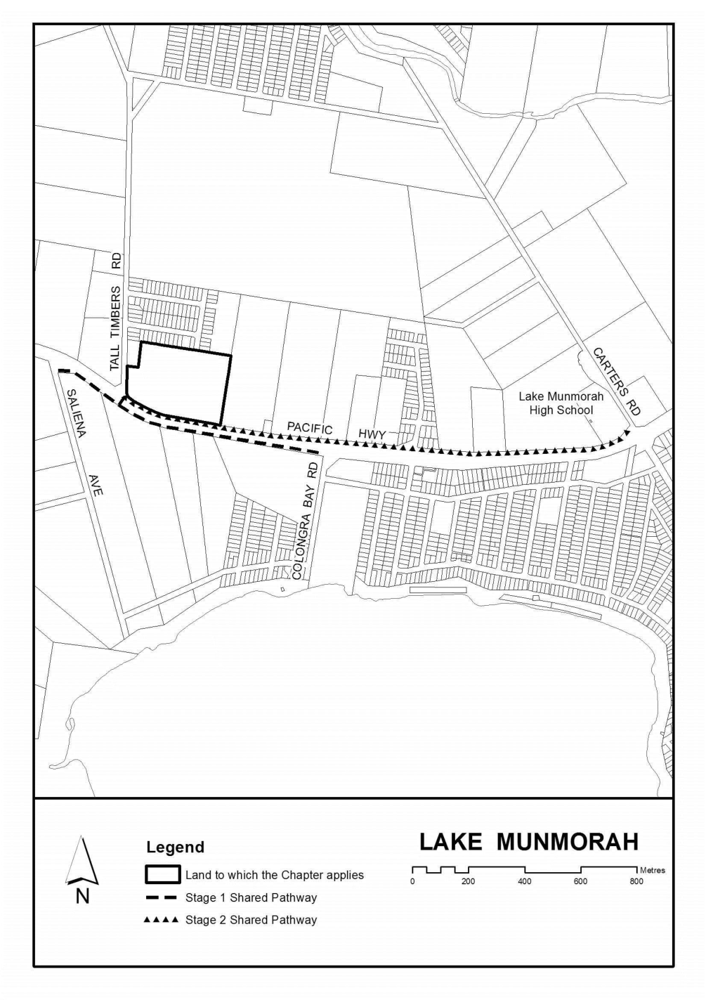

#### 5.28.1 INTRODUCTION

The purpose of this Chapter is to provide an overall land use structure and policy framework for the carrying out of village centre development on land to which this Chapter applies.

The site is located at the intersection of Tall Timbers Road and the Pacific Highway at Lake Munmorah. The site will perform the role of a village centre for Lake Munmorah and will service the Northern Lakes/Budgewoi area.

The shopping centre will contain a mix of facilities which include a supermarket, a comprehensive range of food and non-food specialty shops and a limited range of non-retail services and community facilities.

#### 5.28.1.1 Staging of Development

The development of the shopping centre is to be constructed in stages, with Stage 1 providing up to 5,000m2 gross retail floor space by 2011/2012, and Stage 2 providing up to an additional 5,000m2 gross retail floor space in the future. The maximum total gross retail floor space for the site is 10,000m2. Gross retail floor space means the floor space for the leasable retail component of the shopping centre, including both general retail floor space and bulky goods floor space.  Additional non-retail floor space may be permitted where it provides a supporting role to strengthening the overall viability and vitality of the centre.

The timing of expansion of the retail floor space beyond the 5,000m2 provided in Stage 1 would need to be determined by a retail capacity and impact assessment report which demonstrates:

a that the expansion of the Lake Munmorah Village Centre would not have an overall adverse impact on the extent and adequacy of services and facilities available within existing centres within the Northern Lakes trade area

b Development of the site is to be undertaken in a manner which:

i. provides optimal access, service and consumer choice for residents of Lake Munmorah and the Northern Lakes trade area;

ii. integrates with adjoining lands;

iii. provides adequate opportunities for expansion;

iv. provides a high standard of retail development for present and future residents within the Northern Lakes trade area;

v. encourages and facilitates the use of modes of transport other than the private car.

#### 5.28.1.2 Objectives of this Chapter

▪ To provide a site specific framework for the assessment of a development application for a village centre on the land at Lot 2 DP 520220, Corner Tall Timbers Road and Pacific Highway, Lake Munmorah, as identified by heavy black edging in Figure 1

▪ To ensure development includes a high quality architectural design and consistency with the principles of ecologically sustainable development

▪ To ensure adequate transport and traffic arrangements are in place to establish a safe and efficient transport and traffic service is provided for the development

▪ To encourage the orderly and economic development of the land for the purposes permitted under Zone B2 (Local Centre Zone)

▪ To control the scale and density of land use and associated activities on the land

▪ To enable development of the land to proceed in a manner that is sensitive to the environmental characteristics of the area

▪ To encourage and facilitate the use of modes of transport other than the private car

▪ To ensure adequate internal and external safety, efficiency and traffic management arrangements are in place for motorists, cyclists, motorised scooters and pedestrians

▪ To ensure that the land is adequately serviced

▪ To provide and facilitate landscaping

▪ To ensure that the buildings are designed by an architect in association with a landscape architect (to ensure that the buildings are well designed)

▪ To ensure that any development on the land complies with the principles of water sensitive urban design

▪ To encourage the use of energy efficiency principles in the design of all buildings on the land

#### 5.28.1.3 Land to which this Chapter Applies

The land to which this Chapter applies is shown edged heavy black in Figure 1.

#### 5.28.1.4 Relationship to other Chapters and Policies

This Chapter should be read in conjunction with other relevant Chapters of this Development Control Plan and other Policy Documents of Council, including but not limited to:

▪ Chapter 2.11 – Transport and Parking

▪ Chapter 2.14 –Waste Management

▪ Chapter 3.5 – Tree and Vegetation Management

▪ Council’s Civil Works Specification

> [Picture on page 3: a picture, saved as a picture (images/ch-05-28-lake-munmorah-village-centre-page-3-1.gif, 150 dpi).]

#### Figure 1 Land to which this Chapter applies
