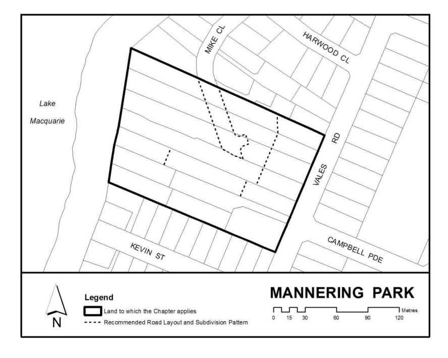

#### Chapter 5.29 Mannering Park Residential

### CHAPTER 5.29 MANNERING PARK RESIDENTIAL

#### 5.29.1 INTRODUCTION

#### 5.29.1.1 Land to which this Chapter Applies

This Chapter applies to the land known as Lots 200, 201, 202 & 203 DP 1005985, Lot 22 DP 877487, Lot 3 DP 23968, Lots 4 & 5 DP 804679, and Lots 1 & 2 DP 381700 in Mannering Park, shown edged heavy black in Figure 1.

> [Picture on page 1: a picture, saved as a picture (images/ch-05-29-mannering-park-residential-page-1-10.gif, 150 dpi).]

#### Figure 1 Land in Mannering Park to which Chapter 5.29 applies

#### 5.29.1.2 Relationship to other Chapters and Policies

This Chapter should be read in conjunction with other relevant Chapters of this Development Control Plan and other Policy Documents of Council, including but not limited to:

▪ Chapter 2.1 – Dwelling Houses Secondary Dwellings and Ancillary Development

▪ Chapter 3.5 – Tree and Vegetation Management

▪ Chapter 2.4 – Subdivision

▪ Council’s Civil Works Specification

Central Coast Development Control Plan 2022

Part 5

Location Specific Development Controls
