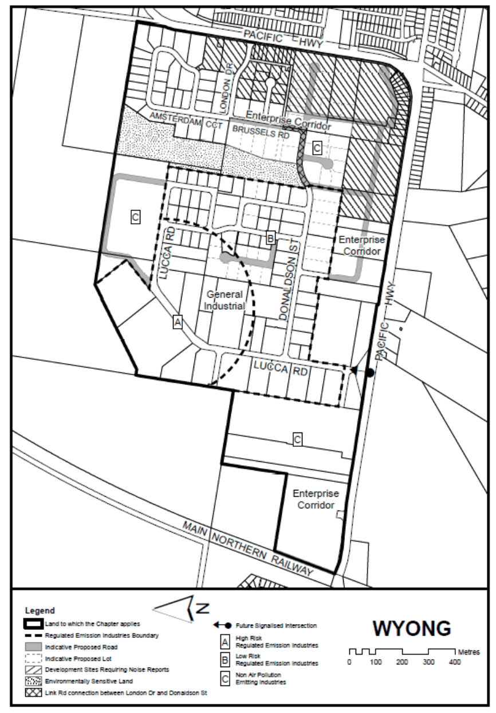
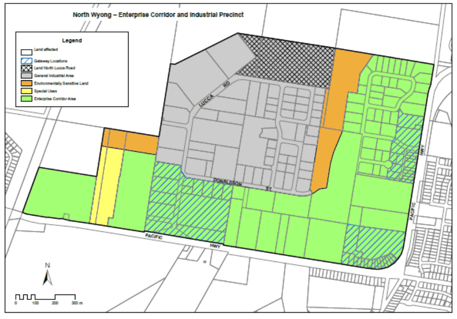

#### 5.31.1 INTRODUCTION

The purpose of this Chapter is to provide specific development assessment guidelines for land within the North Wyong Industrial and Enterprise Corridor Precinct.

#### 5.31.1.1 Objectives

▪ To provide direction and guidance for the orderly development of land

▪ To allow for a range of uses provided that new development does not present unacceptable risks to residential areas or other land by way of pollution, hazards or otherwise

▪ To ensure development visible from the Pacific Highway is of a high architectural standard and landscape amenity

▪ To intensify development in specific “gateway” locations within the estate

▪ To encourage the renewal and development of underutilised land within the B6 – Enterprise Corridor Zone

▪ To provide for a mixture of business and industrial land uses that are compatible with each other and adjoining residential areas

▪ To enhance the economic strength of the Wyong-Tuggerah Economic Zone without detrimentally impacting core industrial, retail and commercial functions

#### 5.31.1.2 Land to which this Chapter Applies

The land to which this Chapter applies is shown edged heavy black in Figure 1.

#### 5.31.1.3 Relationship to other Chapters

This Chapter should be read in conjunction with other relevant Chapters of this Development Control Plan and other Policy Documents of Council, including but not limited to:

▪ Chapter 2.9 – Industrial Development

▪ Chapter 2.13– Transport and Parking

▪ Chapter 2.14 – Site Waste Management

▪ Chapter 3.1 – Floodplain Management

▪ Chapter 3.5 – Tree and Vegetation Management

▪ Council’s Civil Works Specification

> [Picture on page 2: a picture, saved as a picture (images/ch-05-31-north-wyong-industrial-and-enterprise-precinct-page-2-1.gif, 150 dpi).]

#### Figure 1 North Wyong Industrial and Enterprise Precinct

> [Picture on page 3: a picture, saved as a picture (images/ch-05-31-north-wyong-industrial-and-enterprise-precinct-page-3-1.gif, 150 dpi).]

#### Figure 2 North Wyong Industrial and Enterprise Precinct
