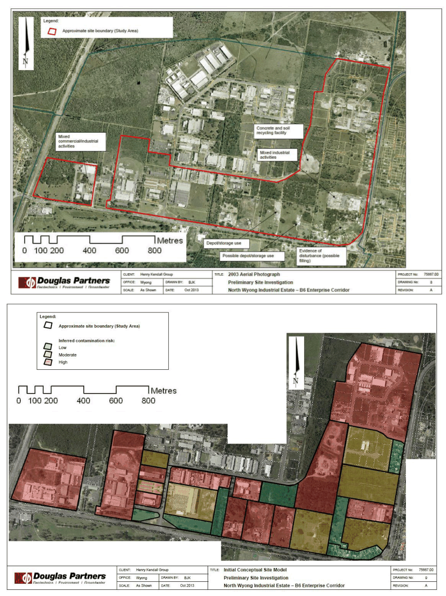

#### 5.31.3 SPECIFIC DEVELOPMENT REQUIREMENTS

#### 5.31.3.1 Road Hierarchy and Layout

#### OBJECTIVES

▪ To limit the visual, noise, air and traffic impacts of development within and external to the North Wyong Enterprise area

▪ To help ensure satisfactory vehicle circulation in the locality

▪ To ensure the safe and efficient movement of traffic on the road system and within the site

▪ To ensure satisfactory access to public transport

#### REQUIREMENTS

a Road reserves shall be located generally in the position shown in Figure 1 and shall have a minimum width of twenty (20) metres. Preliminary engineering details are to be provided to demonstrate the suitable location of services, footpaths, streetscape plantings and Water Sensitive Urban Design infrastructure as appropriate.

b Variations to road patterns may be considered to permit large lot development provided the extension to the main thoroughfare (Donaldson Street / Brussels Road / London Drive) is implemented, as generally indicated in Figure 1, subject to future acquisition and adoption by Council.

c All through roads or roads servicing adjoining properties are to be constructed to the property boundary at Stage 1 of any development.

d Future development of the site will require the upgrading of the intersection of Pacific Highway and Lucca Road to Traffic Control Signals, however the construction of the proposed road link between Donaldson Street and Brussels Road will delay the need for these works.

e Some land fronting the Pacific Highway may be required for future road widening by the Roads and Maritime Services (RMS). The RMS should be consulted to confirm the whether the property is affected by road widening and exclude any improvements from these areas.

#### 5.31.3.2 Pacific Highway Setbacks

#### OBJECTIVES

▪ To promote development of a visually attractive form, integrating the built and natural environments

▪ To encourage a high visual standard and operational compatibility between the industrial enterprise precinct, public lands, major transport corridors and adjoining residential areas

#### REQUIREMENTS

a A 5 metre building line from the Pacific Highway shall apply to all development. No development is permitted in this area other than landscaping and driveway accesses. This area shall be landscaped in accordance with Section 2.6. No development shall be permitted in this area other than landscaping and driveway access.

Note: Setback requirements may also be affected by any sight line or road acquisition areas requirements of the RMS or Council.

b Where development exceeds 10 metres in height and fronts the Pacific Highway, the development application shall identify measures to reduce the visual impact of the development on the Pacific Highway corridor and surrounding residential area.

#### 5.31.3.3 Future Residential Amenity and Residential Uses

#### OBJECTIVES

▪ To encourage a high visual standard and operational compatibility between the industrial enterprise precinct, public lands, major transport corridors and adjoining residential areas

▪ To limit the visual, noise, air and traffic impacts of development within and external to the North Wyong Enterprise area

▪ To provide for the amenity of existing and future residential occupants

#### REQUIREMENTS

a All development shall be designed to ensure that noise levels at the nearest residential boundary are to the satisfaction of the Council (and the NSW EPA) where appropriate). Noise levels are to be consistent with the requirements of the EPA Industrial Noise Policy and RMS Environmental Criteria for Road Traffic Noise.

b Development applications for new developments within the area identified in Figure 1 as Development Sites Requiring Noise Reports, must consult Council development staff prior to lodging an application, to determine whether a noise report from a certified acoustic consultant is required at development application stage. The noise report shall identify appropriate noise amelioration measures to achieve the above noise goals.

c Industrial buildings proposed on land adjoining existing residences shall be required to be set back 20 metres from the common boundary, with a minimum 10 metre landscape buffer required along the common boundary. A suitable solid fence (minimum 2.1 m high) along the common boundary is to be erected, with details provided at development application stage.

d Development with the potential to emit odours shall submit a statement on amelioration methods which prevent any adverse impacts on adjacent residential areas.

e Any Shop-top housing proposal is to comply with the requirements of Chapter 2.4 - Residential Flat Buildings and Shop-Top Housing.

Note: Central Coast LEP 2022- details the floorspace restrictions for shop top housing on land in B6 - Enterprise Corridor Zone

#### 5.31.3.4 Land North of Lucca Road

Refer to Figure 2 to identify where this section applies.

#### OBJECTIVE

To ensure that stormwater is appropriately managed in this locality, specifically with regard to Water Sensitive Urban Design and flood water management

#### REQUIREMENTS

#### 5.31.3.4.1 Water Quality

All developments shall comply with Council’s Civil Works Specification and Chapter 3.1 – Floodplain Management.

#### 5.31.3.4.2 Levee Bank and Pump System

a Stormwater is to be managed in accordance with the Water Cycle Management Plan, Central Coast Business Park – Warnervale by Young Consulting Engineers (August 2003). A proposed levee bank is to be provided for the development site, designed to a minimum of RL 6.5m AHD. The levee bank is to provide protection from the 1% AEP flood with a minimum 300mm of freeboard for the subject land north of Lucca Road and existing properties in Pavitt Crescent.

b The construction of the levee bank, filling and associated works on the subject site and Lot 19 DP 250522 will detain the local runoff should the water level in the receiving water (i.e. water in floodplain) be level with or higher than the local ponding level. In situations where the receiving water level is higher, a pump system is required to discharge the water.

c Water collected in the proposed storage pond is to be circulated through the constructed wetland system. Recirculation can be achieved by either:

i pumping to the rock lined channel through use of a solar powered pump; and/or

ii recirculation through the wetland by the use of the discharge pumps.

d It is imperative that the pumps be maintained and operational at all times. One of the routine maintenance procedures would be monthly operation of the pumps. During this routine maintenance of the pumps, the water in the pond is recirculated through the wetland. Details of the maintenance of these pumps, including pumps and the required standby capacity of the pumps, are to be provided with any development application that is lodged for the land.

e The storage pond shall also be available for an adequate firefighting water supply for the subject site and local area. The total minimum storage capacity required will be developed in accordance with Council and relevant fire authorities. Details are to be provided to ensure that water is available for firefighting at all times including drought conditions.

f Any development application is to be supported by a suitable levee bank risk and failure analysis, including suitable ongoing monitoring and maintenance access arrangements.

#### 5.31.3.5 Development Adjacent to Environmentally Sensitive Land

#### OBJECTIVES

▪ To ensure the incorporation of ESD principles into development design and construction

▪ To necessitate the incorporation of measures for the treatment/reuse of stormwater and mitigation of environmental impacts on adjoining sensitive lands

#### REQUIREMENTS

a Development of certain land within the industrial estate will need to have regard for the sensitive nature of adjacent/adjoining land noted as environmentally sensitive lands and depicted on the map (see Figure 1). This land has been identified as containing vegetation consistent with Endangered Ecological Communities, has significant ecological values and drains to a major floodplain. In particular, the existing dam on Lot 8 DP 1100416 provides a likely habitat for the endangered Green and Golden Bell Frog.

b Development adjacent to this area will need to ensure that appropriate measures are implemented to minimise potential environmental impacts on this area, with a particular focus on stormwater management, edge effects, pollution prevention and bushfire management.

#### 5.31.3.6 Land Use Controls for Regulated Emissions Industries

Some types of industry, or scales of industry expansion, may be such that their presence within the North Wyong Industrial and Enterprise Corridor Precinct may represent unjustifiable risk to adjacent residential uses, properties, public uses or to other occupants of the industrial/ enterprise area. The following standards aim to minimise the risk associated with emissions generating industries on the biophysical environment and human health through land use controls.

#### OBJECTIVES

▪ To provide requirements for industry or scales of industry expansion, that may by their presence within the North Wyong Industrial and Enterprise Corridor Precinct represent unjustifiable risk to adjacent residential uses, properties, public uses or to other occupants of the industrial area

▪ To minimise the risk associated with emissions generating industries on the biophysical environment and human health through land use controls

#### REQUIREMENTS

#### 5.31.3.6.1 High Risk Regulated Emissions Industries

High risk regulated emissions industries will be restricted to Area A, as shown in Figure 1. Proposed activities outlined below may be characterised as high risk air polluting industries and applicants must consult Council development staff prior to lodging an application to clarify the current regulatory process. These are industries:

a licensed for air emissions by Office of Environment and Heritage (Environment Protection Authority) - Protection of the Environment Operations Act 1997 (Schedule 1);

b that are designated development - Environmental Planning and Assessment Regulation 2000 (Schedule 3);

c listed under National Environment Protection Measures Ambient Air Quality - National Environmental Protection Council Act 1994.

#### 5.31.3.6.2 Low Risk Regulated Emissions Industries

Lower risk regulated emissions industries shall be located in Area B (see Figure 1). These are industries which may have venting of emissions for occupational health purposes, or may have fugitive emissions, but are not categorised as high risk air polluting industries as detailed above.

#### 5.31.3.6.3 Other Industries

The balance of the North Wyong Industrial and Enterprise Corridor Precinct (Area C) shall be occupied by non-air polluting industries.

#### 5.31.3.6.4 Prohibited Industries

Industries classified as offensive and hazardous in accordance with the provisions of State Environmental Planning Policy (Resilience and Hazards) 2021.are prohibited in the North Wyong Industrial Estate, in accordance with the requirements of Central Coast LEP 2022.

#### 5.31.3.6.5 Risk Assessment

a Any development application for a new or expanding regulated emission industry within the North Wyong Industrial and Enterprise Corridor Enterprise Precinct will be required to be accompanied by a full risk assessment, undertaken by a suitably qualified person, as it relates to human health, cumulative impacts and the biophysical environment.

b This risk assessment will be reviewed by Council's independent environmental consultant and the cost of this review will be at the applicant's expense. This risk assessment exercise will assist in determining the suitability of industries within the estate's identified areas.

#### 5.31.3.7 Land Contamination with B6 - Enterprise Corridor Zone

All development proposals are required to consider the potential for any existing site contamination impacting on future land uses. A Preliminary Contaminated Lands Assessment was provided as part of the rezoning process for the B6 - Enterprise Corridor rezoning which identified sites where historic land uses have increased the potential for site contamination to be present and are likely to require management prior to changes in land use. The identified sites will require further investigation with regard to potential on-site contamination due to historic land use.

#### OBJECTIVE

To provide proponents with information that can be used to supplement the requirement to consider potential site contamination in preparing a development proposal

#### REQUIREMENT

a Consideration of Appendix A – Potential site contamination risks where there is a potential risk of site contamination.

NOTE: This supplementary information was provided for applicants and landowners. The information was prepared by Douglas Partners in 2013 to support the B6 – Enterprise Corridor Planning Proposal. All development proposals must consider all relevant Council and State Government Policy including State Environmental Planning Policy (Resilience and Hazards) 2021.

### APPENDIX A – SITES IDENTIFIED WITH POTENTIAL SITE CONTAMINATION HISTORY

(Source Potential Site Investigation – Rezoning on the North Wyong Industrial Estate – B6 - Enterprise Corridor Zone (October 2013)

> [Picture on page 14: a picture, saved as a picture (images/ch-05-31-north-wyong-industrial-and-enterprise-precinct-page-14-5.gif, 150 dpi).]
