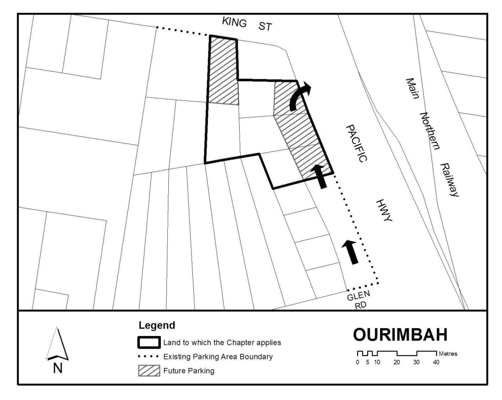

#### Chapter 5.32 Ourimbah Commercial Area

### CHAPTER 5.32 OURIMBAH COMMERCIAL AREA

#### 5.32.1 INTRODUCTION

#### 5.32.1.1 Objective of this Chapter

To provide for the orderly and economic development of certain land in the Ourimbah Commercial Area

#### 5.32.1.2 Land to which this Chapter Applies

This Chapter applies to Lots 20 and 21 DP 1064048, Lot 9 DP 20723 and Lot 24 DP 1064049 Pacific Highway, Ourimbah, as shown by heavy black edging on Figure 1.

> [Picture on page 1: a picture, saved as a picture (images/ch-05-32-ourimbah-commercial-area-page-1-11.gif, 150 dpi).]

#### Figure 1 Land to which this Chapter applies

#### 5.32.1.3 Relationship to other Chapters and Policies

This chapter is to be read in conjunction with other relevant Chapters of this Development Control Plan, including, but not limited to:

▪ Chapter 2.13 – Transport and Parking

▪ Council’s Civil Works Specification

Central Coast Development Control Plan 2022

Part 5

Location Specific Development Controls
