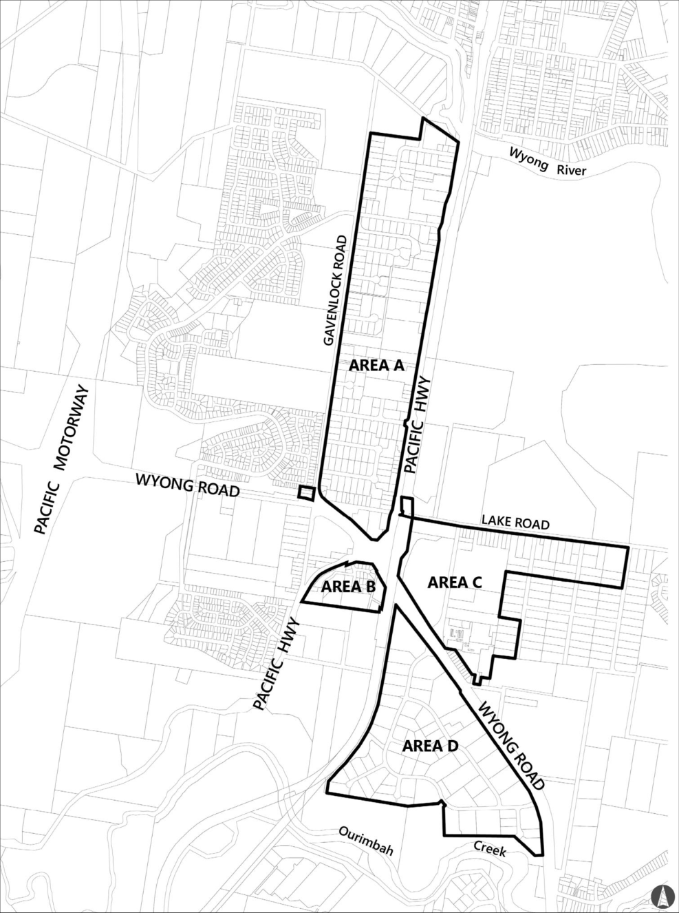

#### 5.34.1 INTRODUCTION

The purpose of this Chapter is to provide specific guidelines for development within the Tuggerah Precinct.

#### 5.34.1.1 Objectives of this Chapter

▪ To strengthen and promote the Tuggerah Precinct as an integral component of the Tuggerah/Wyong Regional Centre

▪ To establish a clear identity and image for the Precinct as the primary focus of economic activity in the Shire and the Central Coast Region

▪ To promote the orderly use of Tuggerah development land in accordance with its status and development potential as a Regional Centre

▪ To encourage high quality urban design as appropriate to the presentation, perception and development of a multi-functional Regional Centre

▪ To provide appropriate controls and incentives to attract investment in the centre

▪ To promote employment generation in the Tuggerah Regional Centre

▪ To maintain and reinforce the Precincts existing competitive advantage centred on accessibility

▪ To encourage higher density development within the Precinct adjacent to the main public transport facilities

▪ To manage the traffic and parking for the benefit of the residents, business people, service personnel and visitors

▪ To encourage a well-designed, safe and active public domain which contributes to the wellbeing of the community

▪ To encourage mixed use development (incorporating appropriate retail and commercial uses), which can include residential development where it is attached to other permitted buildings only

▪ To encourage a high quality building stock which can adapt over time to a range of uses

▪ To ensure that the built form defines a spatial hierarchy with a human scale which contributes to the legibility of the centre

▪ To protect, rehabilitate and manage significant environmental features located within the Precinct

▪ To reduce the impact of development on ecological systems and processes that sustain life

▪ To allow development that is compatible with the flood hazard of the land

#### 5.34.1.2 Land to which this Chapter Applies

The land to which this Chapter applies is shown edged heavy black in Figure 1.

> [Picture on page 2: a picture, saved as a picture (images/ch-05-34-tuggerah-precinct-page-2-3.gif, 150 dpi).]

#### Figure 1 Land to which this Chapter Applies

#### 5.34.1.3 Using this Chapter

#### 5.34.1.3.1 Relationship to other Chapters and Policies

This Chapter should be read in conjunction with other relevant Chapters of this Development Control Plan and other Policy Documents of Council, including but not limited to:

▪ Chapter 2.4 – Subdivision

▪ Chapter 2.9 – Industrial Development

▪ Chapter 2.13 – Transport and Parking

▪ Chapter 3.1 – Floodplain Management

▪ Chapter 3.5 – Tree and Vegetation Management

▪ Council’s Civil Works Specification

#### 5.34.1.3.2 Area Plans

For the purposes of this Chapter, the Tuggerah Precinct is divided into four areas. Section 3 of this document contains controls that are specific to each of these areas. The information contained in Section 2 below applies across all, or more than one of the four areas. Both Sections 2 and 3 are to be considered as part of any development proposal.
