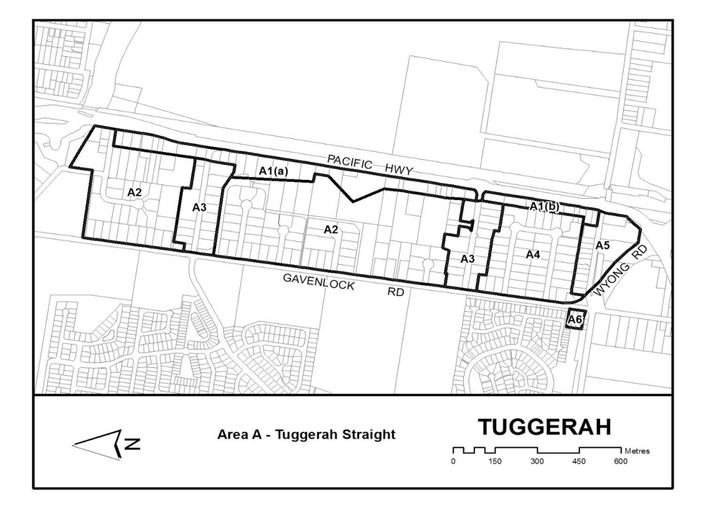
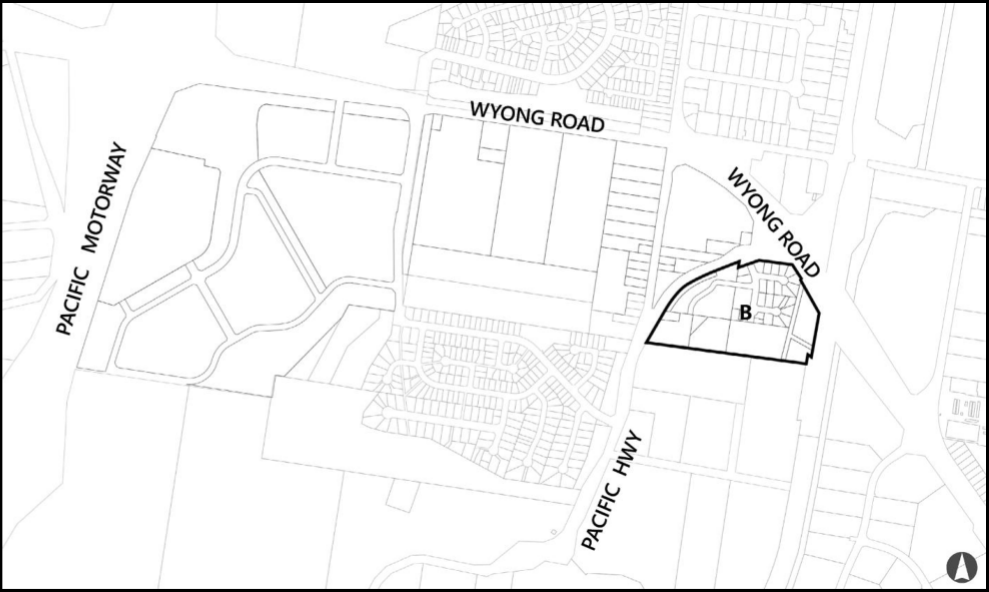
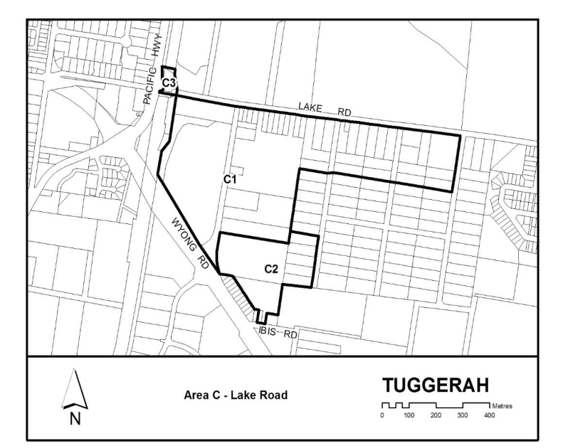
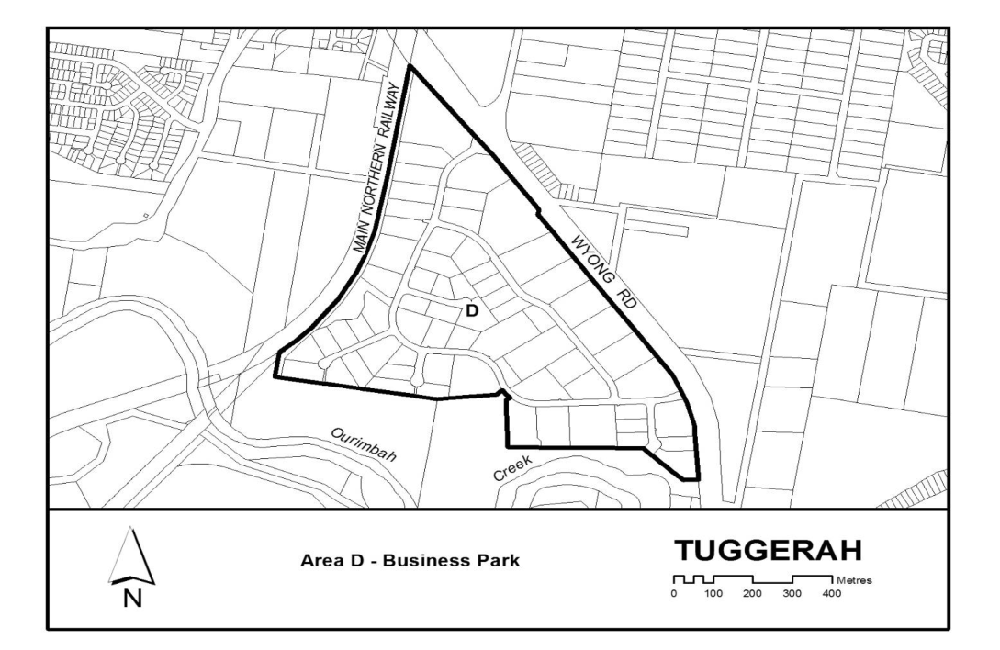
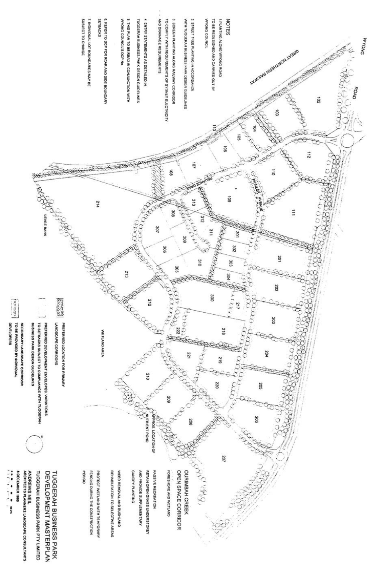

#### 5.34.3 DEVELOPMENT PRINCIPLES AREA SPECIFIC

### CONTROLS

#### 5.34.3.1 Area A – Tuggerah Straight

#### OBJECTIVES

▪ To guide the transformation of the existing industrial development of the Tuggerah Straight into a viable business corridor which links the Wyong Town Centre to the business developments along Wyong Road, Tuggerah

▪ To encourage mixed use development

▪ To provide for the protection, rehabilitation and ongoing management of the Tuggerah wetland

#### REQUIREMENT

a Floor Space Ratio and Site Coverage - Tuggerah Straight;

b maximum floor space ratio = 0.8:1 (excludes bonus provisions identified below);

c maximum site coverage (building only) = 50%.

> [Picture on page 8: a picture, saved as a picture (images/ch-05-34-tuggerah-precinct-page-8-14.gif, 150 dpi).]

#### Figure 2 Area A – Tuggerah Straight

#### 5.34.3.1.1 Area A1 – Land fronting the Pacific Highway

A maximum of one (1) vehicular access point per existing allotment is permitted.

New development is required to rationalise vehicular access to the Pacific Highway by means of shared access with existing adjoining developments, where practical.

A Floor Space Ratio bonus of 0.05 shall apply to the new development securing shared access.

Adjoining development providing shared access receives a Floor Space Ratio bonus of 0.05 available upon future redevelopment.

Consolidation of three or more existing allotments, rationalising access to the Pacific Highway to one entry and one exit point and a 0.1 Floor Space Ratio bonus shall apply to the consolidated development site.

Development obtaining access other than via the Pacific Highway qualifies for an additional 0.05 Floor Space Ratio bonus.

Special Note:  The maximum bonus available to development relating to access shall not exceed 0.20 FSR.

#### 5.34.3.1.1.1 Area A1(a) – North of Mildon Road

Lots fronting McPherson Road must obtain access via that road.

No service access to the Pacific Highway is permitted if rear service lane access is available.

A maximum height of two (2) storeys or seven (7) metres applies.  If the site is a corner allotment and/or development bonus provisions relating to access are satisfied, one (1) additional storey or a maximum height of nine (9) metres is permitted.

#### 5.34.3.1.1.2 Area A1(b) – North of Anzac Road

a Development should reinforce this concentration of commercial and retail uses creating a consistent block edge urban form.

b No car parking is permitted in the 5 metre landscaped setback area and development should reinforce the emerging street wall.

c In assessing any application, Council will consider the visual impact of the height, bulk and scale of a proposed building to ensure that a high quality appearance is achieved.  The determination of the height of buildings shall have regard to the backdrop of surrounding landscape and mountains, particularly as viewed from the Pacific Highway, Wyong Road and the Great Northern Railway. Buildings should not dominate the skyline and should include roof lines and facades which provide visual interest and an appropriate sense of scale.

d Any floors exceeding two (2) storeys must be setback seven (7) metres from the front and rear boundaries.

e Car parking between the property frontage and the building is to be avoided where possible.

#### 5.34.3.1.2 Area A2 – Tuggerah Industrial Area

This area is overlooked by residential areas.  Landscaping of western boundaries fronting Gavenlock Road is very important in providing visual relief.

#### REQUIREMENTS

a Development on sites fronting Gavenlock Road are to recognise the interface with residential land on the western side of the road.  In particular:

ii major openings in buildings are to be directed to the side or rear boundaries;

iii outdoor storage and activity areas, including car parking and loading / unloading facilities, must be located at the rear of the building and suitably screened; and

iv development sites fronting Gavenlock Road reserve shall incorporate medium height avenue trees with straight symmetrical boles and high crowns in landscaping proposals, to contrast the proposed dense screen planting on the western side of the road.

b No access is permitted to the Pacific Highway.

c In assessing any application, Council will consider the visual impact of the height, bulk and scale of a proposed building to ensure that a high quality appearance is achieved.  The determination of the height of buildings shall have regard to the backdrop of surrounding landscape and mountains, particularly as viewed from the Pacific Highway, the Great Northern Railway, Areas A1 (a), A1 (b), A4 and the Mardi Urban Release Area. Buildings should not dominate the skyline and should include roof lines and facades which provide visual interest and an appropriate sense of scale.

#### 5.34.3.1.3 Area A3 – Mildon and Johnson Roads

As this area is potentially overlooked by residential areas and provides important visual connections to the surrounding urban patterns, a maximum height of two (2) storeys or seven (7) metres applies.  If the site is a corner allotment and/or development bonus provisions relating to access are satisfied, one (1) additional storey or a maximum height of nine (9) metres is permitted.

#### 5.34.3.1.4 Area A4 – Ace Crescent

a Development fronting Gavenlock Road must recognise the interface with residential land on the western side by ensuring:

i Major openings in buildings are directed to the side or rear boundaries;

ii Outdoor storage and activity areas, including car parking and loading / unloading facilities, are located at the rear of the building; and

iii Gavenlock Road reserve in front of development sites is to be planted with medium height avenue trees with straight symmetrical boles and high crowns, to contrast the proposed dense screen planting on the western side of the road.

#### 5.34.3.1.5 Area A5 – Anzac Road

A Floor Space Ratio bonus of 0.05 shall apply to adjoining developments that provide a single shared access to parking areas at the rear.

Buildings should not dominate the skyline and should include roof lines and facades which provide visual interest and an appropriate sense of scale.

Setbacks:

i any floors exceeding two (2) storeys must be setback seven (7) metres from the front and rear boundaries;

ii car parking is not permitted between the property frontage and the building; and

iii the whole of the five (5) metre set-back is to be landscaped except for vehicle access. Suitable landscaping would comprise low shrubs and/or flower beds displaying annuals with accent tree plantings selected to complement street trees.

Note: This area is heavily constrained by the potential for flooding and it is advisable that this issue be thoroughly investigated as part of any development proposal

#### 5.34.3.1.6 Area A6 - Gavenlock West

Development shall address Gavenlock Road as the primary frontage.

The reflectivity of external cladding and/or glazing treatments utilised on the proposed development shall not create a traffic hazard for vehicles travelling on adjoining roadways.

Dense landscaping/screening shall be planted along the southern boundary adjoining Wyong Road (West) road reserve.

Suitable landscaping presenting to Anzac Road, will comprise low shrubs and/or flower beds displaying annuals with accent tree plantings selected to complement street trees.

No vehicle or pedestrian access is permitted to Wyong Road (West). In this regard:

i access is to be obtained from Gavenlock Road.  A Traffic Report assessing proposed access and manoeuvring arrangements shall be submitted with a development application on this site;

ii no access shall be obtained from the pedestrian walkway to any existing or proposed development; and

iii any proposed pedestrian and/or vehicle access constructed over the drainage channel must incorporate suitable safety fencing.

f Lot 1 DP 258430:  Development shall be preferably single storey in height complementing the scale of adjoining residential development, however a maximum of two (2) storey height may be permitted if impacts such as bulk scale, privacy, landscaping and overshadowing can be minimised in respect to adjoining residential development.

g Lot 1 DP 1011332 - Maximum two (2) storey development.

h Car parking is not permitted between the property frontage and any proposed building.

i The whole of the five (5) metre front set-back is to be landscaped except for vehicle access.

J The setback from the Wyong Road (west) frontage is to be a minimum of three (3) metres and should be landscaped in accordance with the aforementioned requirements.

k Car parking adjoining residential areas must be suitably landscaped and/or screened.

l The placement of security lighting must not adversely impact on adjoining residential properties.

m Proposals to alter the existing drainage channel (such as pedestrian, vehicular bridge access or any other use) must demonstrate no adverse impacts upon drainage function and flood levels on properties within the local catchment.

#### 5.34.3.2 Area B – Wyong Road (West)

#### OBJECTIVES

▪ To set controls for development in this Area which acknowledge that this area represents the gateway to the Tuggerah Station and that development should be of a high standard

▪ To provide for mixed land use within this area

▪ To discourage the development of pad sites fronting Wyong Road (West)

> [Picture on page 12: a picture, saved as a picture (images/ch-05-34-tuggerah-precinct-page-12-7.gif, 150 dpi).]

#### Figure 3 Area B – Wyong Road West

#### 5.34.3.2.1 Area B – Medium Density Residential

No direct access to the Pacific Highway.

Development proposals to comply with other relevant chapters of this Development Control Plan.

#### 5.34.3.3 Area C – Lake Road

#### OBJECTIVES

▪ To encourage high quality design and construction

▪ To provide for development which takes advantage of the high accessibility of this area to public and private transport

> [Picture on page 13: a picture, saved as a picture (images/ch-05-34-tuggerah-precinct-page-13-1.gif, 150 dpi).]

#### Figure 4 Area C – Lake Road

#### 5.34.3.3.1 Area C1 – Lake Road South and Supa Centre Complex

a No access to Wyong Road.

b Maximum floor space ratio = 0.8:1

c Maximum site coverage (building only) = 50%

d Council will consider the visual impact of the height, bulk and scale of a proposed building to ensure that a high quality appearance is achieved, particularly as viewed from Bryant Drive and Wyong Road.

e Landscaping is to pay particular attention to providing an appropriate scale for the development. Buildings should not dominate the skyline and should include roof lines and facades which provide visual interest and an appropriate sense of scale.

#### 5.34.3.3.2 Area C2 – Mariners Complex

Development is to comply with the requirements of Section 5.34.3.3.1 above and any other requirements of this Development Control Plan.

Commercial premises will be considered on this land, but only if the total gross floor area of the development does not exceed 3,500 square metres.

#### 5.34.3.3.3 Area C3 – Tuggerah Station

a Any future redevelopment of the Tuggerah Railway Station should seek to improve facilities for pedestrian movements between the Tuggerah Straight and Lakes Road Area. It is also considered highly desirable for a sensitively designed, multi-level car parking station to be constructed, providing an asset for the use of commuters and visitors to the regional centre.

b Redevelopment of Tuggerah Station would require a Master Plan and would be exempt from generic setbacks applying to development adjoining the Great Northern Railway.

#### 5.34.3.4 Area D – Business Park

#### OBJECTIVES

▪ To create a "business park" environment that will provide an attractive entry into the Tuggerah Regional Precinct and will provide for investment and employment opportunities

▪ To encourage high quality design and construction that is clearly superior to development found in traditional industrial areas

▪ To accommodate a range of business, light industrial, warehousing and high technology activities within the business park

▪ To provide for ancillary commercial, community and recreational facilities as part of an integrated employment environment

▪ To provide for reasonable areas of linked landscaped space that are compatible with the built environment and to ensure that the landscape design guidelines detailed in the Visual Assessment and Design Guidelines for Wyong Road are implemented to a high standard

▪ To preserve the adjoining wetlands and significant vegetation and to minimise the environmental impacts of development

#### REQUIREMENTS

#### 5.34.3.4.1 General

a The Tuggerah Business Park Development Master Plan shall generally guides development of the business park site.  A copy of the current Development Master Plan is attached as Appendix A.

b For the development of offices and commercial uses in the Business Park:

i office space and showrooms ancillary to manufacturing, processing, storage or distribution functions of a use and located on the same site as that use may be carried out with Council's consent in the B7 - Business Park Zone;

ii Council being satisfied that the office component of a proposed development is ancillary to the functions carried out in the factory or warehouse;

iii the office area not being leased to a separate firm or firms; and

iv the provision of on-site parking facilities adequate to cater for the size of the office component.

c Business and Office Premises will be considered, but only where they are a single tenant or firm occupying a minimum gross floor area of 200 square metres.

d Retailing and display in association with goods manufactured or processed on site may be carried out within that zone subject to Council consent and where Council is satisfied that such retailing is an ancillary use.

e Employer provided recreational facilities for employees of businesses within the business park (such as tennis courts, cycleway/running track network) are encouraged.

f Only one directory board will be permitted at each entrance from Wyong Road to the Business Park.

g No signs will be permitted in the building setback to Wyong Road or to the Great Northern Railway.

#### 5.34.3.4.2 Individual Site Development

a Maximum floor space ratio = 0.8:1

b Maximum site coverage (building only) = 50%

c In assessing any application, Council will consider the visual impact of the height, bulk and scale of a proposed building particularly as viewed from Wyong Road. Buildings should not dominate the skyline and should include roof lines and facades which provide visual interest and an appropriate sense of scale.

d The following setbacks shall apply for side boundaries and rear boundaries (where that boundary is not to Wyong Road or the Great Northern Railway):

i a minimum of 5 metres where primary landscape corridors are shown in the Tuggerah Business Park Master Plan (See APPENDIX A);

ii a minimum of 3 metres where secondary landscape corridors are shown in the Tuggerah Business Park Master Plan (See APPENDIX A); and

iii where the site has frontage to land adjoining Ourimbah Creek and/or the wetland (i.e.: Lots 207- 214 DP 873983) the setback shall, in addition, satisfy the provisions of Chapter 5.46 – Northern Wetlands Management and have regard to the potential for bushfires.

e In all other cases, zero boundary setbacks may be considered where the applicant demonstrates that a superior urban design, building presentation and site maintenance outcome will be achieved.

> [Picture on page 15: a picture, saved as a picture (images/ch-05-34-tuggerah-precinct-page-15-19.gif, 150 dpi).]

#### Figure 5 Area D – Tuggerah Business Park

### APPENDIX A TUGGERAH BUSINESS PARK MASTERPLAN

> [Picture on page 16: a picture, saved as a picture (images/ch-05-34-tuggerah-precinct-page-16-2.gif, 150 dpi).]
