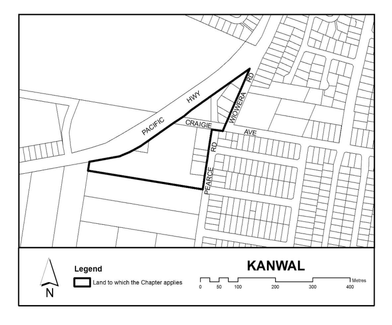

#### 5.35.1 INTRODUCTION

The purpose of this Chapter is to provide specific guidelines for development within the Craigie Avenue Precinct.

#### 5.35.1.1 Objectives of this Chapter

▪ To appropriately integrate development with the existing built and natural environment

▪ To ensure development includes a high quality of architectural design and consistency with the principles of ecological sustainable development

▪ To enable development of the land to proceed in a manner that is sensitive to the environmental characteristics of the area

▪ To ensure that the land is adequately serviced

▪ To ensure that any development on the land complies with the principles of water sensitive urban design

#### 5.35.1.2 Land to Which the Plan Applies

The land to which this Chapter applies is shown edged heavy black in Figure 1.

> [Picture on page 1: a picture, saved as a picture (images/ch-05-35-kanwal-craigie-avenue-precinct-page-1-17.gif, 150 dpi).]

#### Figure 1 – Land in Kanwal to which this Chapter applies

#### 5.35.1.3 Using this Chapter

This Chapter should be read in conjunction with other relevant Chapters of this Development Control Plan (DCP) and other Policy Documents of Council, including but not limited to:

▪ Chapter 2.11– Transport and Parking

▪ Chapter 2.14 - Waste Management

▪ Chapter 3.1 – Floodplain Management

▪ Chapter 3.5 – Tree and Vegetation Management

▪ Council’s Civil Works Specification
