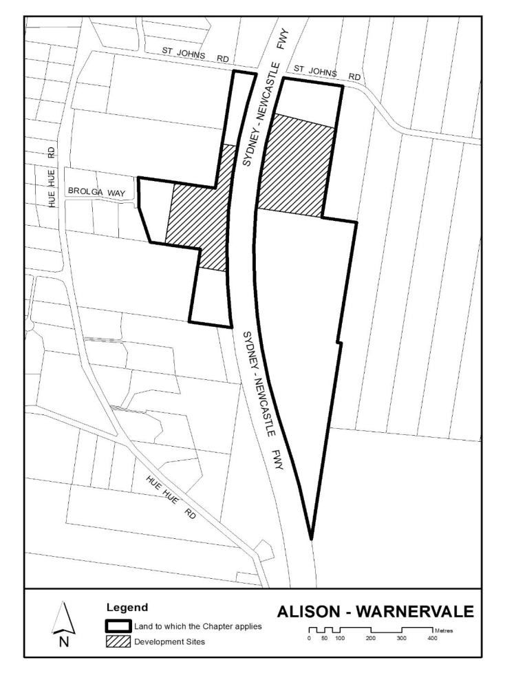

#### 5.36.1 INTRODUCTION

This Plan provides the development concepts, standards and design requirements for the direct access service centres located on the M1 Pacific Motorway.

#### 5.36.1.1 Land to which this Chapter Applies

This Chapter applies to all land shown in Figure 1. The land denoted as development sites in Figure 1, being part of Lot 41 DP 814963 and Lot 32 DP 814964, are considered the sites appropriate for the development of service centres on the M1 Pacific Motorway within Wyong Shire.

> [Picture on page 1: a picture, saved as a picture (images/ch-05-36-warnervale-m1-pacific-motorway-service-centres-page-1-10.gif, 150 dpi).]

#### Figure 1 Land in Warnervale to which this Chapter applies

#### 5.36.1.2 Relationship to other Chapters and Policies

This Chapter should be read in conjunction with other relevant Chapters of this Development Control Plan and other Policy Documents of Council, including but not limited to:

▪ Chapter 2.13– Transport and Parking

▪ Chapter 3.1 – Floodplain Management

▪ Chapter 3.5 – Tree and Vegetation Management

▪ Council’s Civil Works Specification
