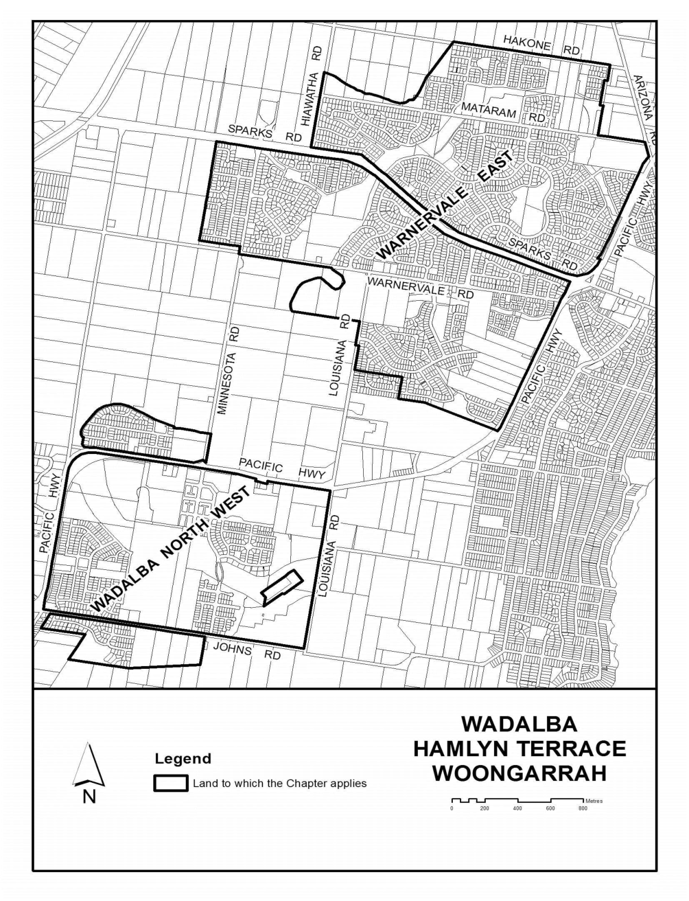
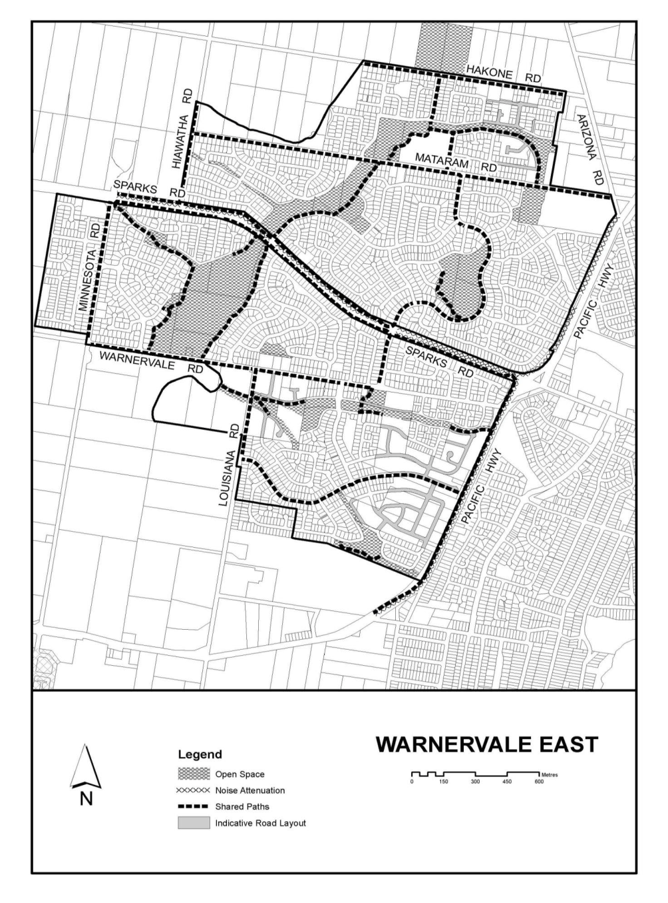
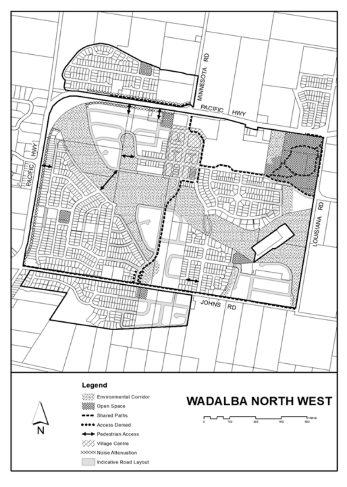

#### 5.37.1 INTRODUCTION

The purpose of this Chapter is to provide specific development guidelines for the former

Warnervale/Wadalba Urban Release Areas. The majority of land suitable for development within the Warnervale East/Wadalba North West area has

either been developed or approved for development. The area now comprises the suburbs of Woongarrah,

Hamlyn Terrace and Wadalba.  The area has evolved over the past decade with market forces and changes in

development standards resulting is some variation from the original plans detailed in Wyong Shire Council

Development Control Plan No. 49 (now superseded). This chapter has been prepared to provide guidance for the development of the remaining lands, consistent

with current development standards and the desired and likely future character of the area.

#### 5.37.1.1 Objectives of this Chapter

To provide a high quality and varied residential environment with accessible open space, retail and

community facilities To provide attractive streetscapes which reinforce the function of a street and enhance the amenity of

dwellings To provide opportunity for a variety of housing types To provide a safe and efficient system of roads and pathways for vehicular, pedestrian and cycle

movements To provide for the protection and enhancement of the environment

#### 5.37.1.2 Land to which this Chapter Applies

This Chapter applies to land as shown edged heavy black on Figure 1. Figures 2 and 3 on the following pages

show in greater detail the land described as Warnervale East (Figure 2) and the land described as Wadalba

North West (Figure 3).

> [Picture on page 2: a picture, saved as a picture (images/ch-05-37-warnervale-east-wadalba-north-west-urban-release-page-2-1.gif, 150 dpi).]

Figure 1 Land in Wadalba Hamlyn Terrace and Woongarrah to which this Chapter applies

> [Picture on page 3: a picture, saved as a picture (images/ch-05-37-warnervale-east-wadalba-north-west-urban-release-page-3-1.gif, 150 dpi).]

#### Figure 2 Warnervale East - Subdivision layout

> [Picture on page 4: a picture, saved as a picture (images/ch-05-37-warnervale-east-wadalba-north-west-urban-release-page-4-1.gif, 150 dpi).]

#### Figure 3 Wadalba North West subdivision layout

#### 5.37.1.3 Relationship to other Chapters and Policies

This Chapter should be read in conjunction with other relevant Chapters of this Development Control Plan

(DCP) and other Policy Documents of Council, including but not limited to: Chapter 2.1 – Dwelling Houses Secondary Dwellings and Ancillary Development Chapter 2.13 – Transport and Parking Chapter 3.5 – Tree and Vegetation Management Chapter 2.4 – Subdivision Chapter 5.22 – Hamlyn Terrace – Louisiana Road Infill Precinct (LRIP) Council’s Civil Works Specification
