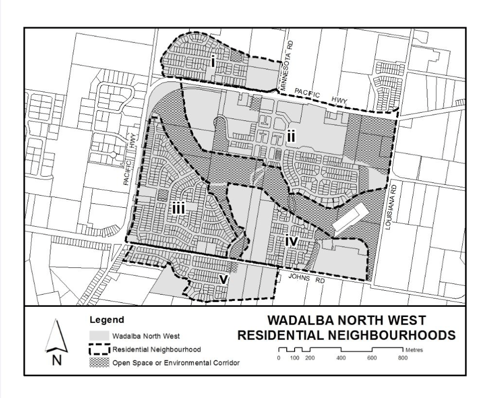
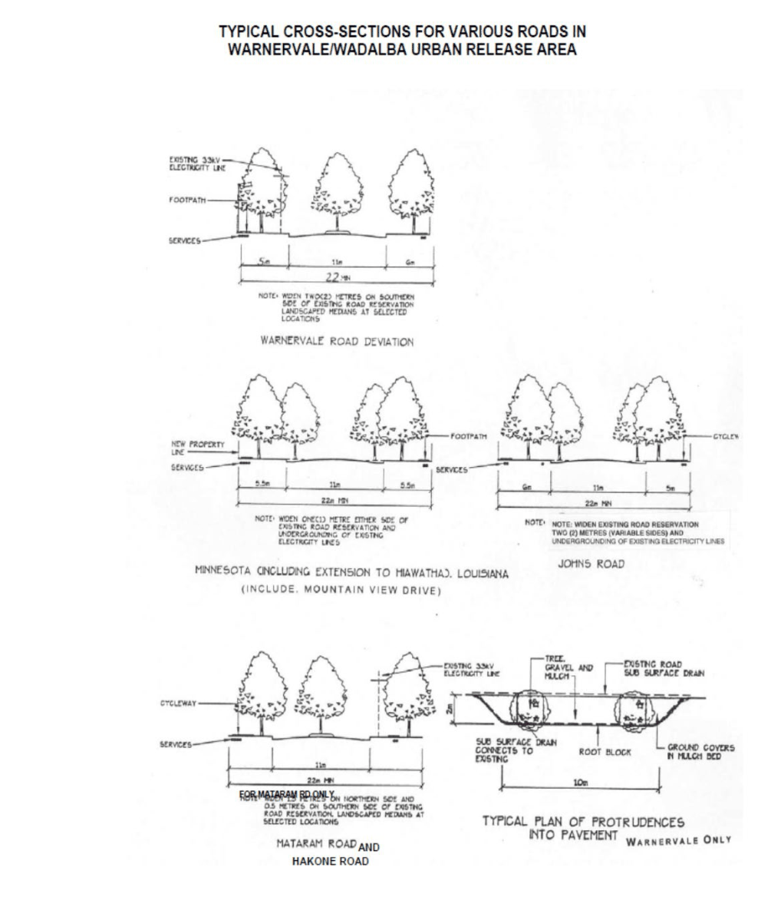

#### 5.37.3 DEVELOPMENT PRINCIPLES

#### 5.37.3.1 Wadalba - Residential Neighbourhoods/Precincts

> [Picture on page 12: a picture, saved as a picture (images/ch-05-37-warnervale-east-wadalba-north-west-urban-release-page-12-3.gif, 150 dpi).]

#### Figure 4 Wadalba Residential Neighbourhoods

Note: Indicative plans – refer to Central Coast LEP 2022 for land zoning

#### OBJECTIVE

To provide for a range of suitable housing opportunities taking advantage of the surrounding natural

environment and the proximity to services

#### REQUIREMENTS

a As shown in Figure 4, five distinct neighbourhoods are to be created within the Wadalba North West

area. These neighbourhoods are physically separated by the Pacific Highway, the drainage or

environmental corridor or Johns Road. These neighbourhoods should be distinguished by variety in

the architectural character and building materials used while being related to the whole Wadalba

Village through the use of a consistent palette of street landscaping.  The five neighbourhoods include: i land north of the Pacific Highway. Small scale neighbourhood of two sub-precincts on either

side of Minnesota Road (refer to Chapter 5.22 regarding controls that apply to the east);

ii neighbourhood surrounding the local centre and school. Maximum residential densities

permitted under the provisions of the Central Coast LEP 2022 are encouraged within this

neighbourhood (with the exception of steeply sloping and elevated sites adjoining the

Environmental Corridor);

iii neighbourhood bounded by the Pacific Highway, Johns Road and the drainage corridor.  This

neighbourhood is to be developed to maximise surveillance of and views to the drainage

corridor.  Higher density development is encouraged in those areas in close proximity to the

proposed bus route;

iv neighbourhood on the southern side of the Environmental Corridor, east of the drainage

corridor and bounded by Johns Road to the south. Development is to maximise views to the

environmental corridor and views out of the site to the south;

v land south of Johns Road Development is to maximise views to the proposed environmental

corridor within Wadalba.  Larger allotments are to be created as the elevation increases and

slope increases at the southern boundary of this neighbourhood.

b Residential development within the Wadalba North West area will achieve a high standard of urban

form through: i a variety of lots sizes and opportunities to increase housing choice; ii balconies, planters, verandas, steps in the roofline and other architectural features to provide

visual relief and individual identity;

iii a variety of finishes used on external materials; iv building designs which encourage neighbourly communication and surveillance of streets and

public spaces;

v garages and parking structures are to be sited and designed to reduce their impact on the

street.

#### 5.37.3.2 Wadalba Local Centre

The Wadalba Local Centre is proposed to have an integrated mix of retail, commercial, community and

residential uses.  In order to maximise the utilisation of local services and to provide a high degree of

surveillance, a minimum gross density of 25 dwellings per hectare is to be achieved within the Local Centre,

#### OBJECTIVES

To provide for appropriate residential development in the proximity of the Wadalba Local Centre To provide for other appropriate commercial and community based development in the locality

#### REQUIREMENTS

a The development of land for residential purposes in the Wadalba Local Centre is to be for Small Lot

Residential Development as described in Chapter 2.4 Subdivision.

b The development of non-residential uses at the entrance to the Wadalba North West Estate should

meet the following criteria: i development is to be at a similar scale and bulk to the local centre.  In this regard development

shall be a maximum of two storeys;

ii no access/egress provided to the Pacific Highway.

c Movement of pedestrians through sites with frontage to the Pacific Highway is to ensure that all

pedestrian movements across the Pacific Highway are channelled to the signalised intersection with

Minnesota Road.

d Landscaping plans for sites fronting the Pacific Highway are to include the continuation of the

landscaping treatment along the Pacific Highway frontage.

#### 5.37.3.2.1 Lot 195 DP 1006789 OBJECTIVE

To provide specific design requirements for any non-residential uses of Lot 195 DP 1006789

#### REQUIREMENTS

a Any proposed access or egress to/from the site to/from Figtree Boulevard is to be designed to the

satisfaction of both Council and the Roads and Maritime Service (RMS) and are to retain the integrity

of the visually important tree lined entrance to the Wadalba Village. The location of proposed

intersections are required to have due consideration for the efficiency of the existing roundabout

and signalised Pacific Highway / Figtree Boulevard / Minnesota Road intersection. b Any proposed development will be required to undertake a revised Traffic Impact Study to identify

the likely traffic impacts and subsequent road upgrade requirements. The study is to be prepared in

accordance with the Roads and Maritime Guide to Traffic Generating Developments 2002 and is to

include, but not be limited to the following: i Current traffic counts for the Pacific Highway/Figtree Boulevard/Minnesota Road and Figtree

Boulevard/Orchid Way intersections, inclusive of all proposed and approved developments. ii The anticipated additional vehicular traffic generated from the proposed development. iii The distribution on the road network of the trips generated by the proposed development.

Predicted traffic flows are to be shown diagrammatically. iv Consideration of the traffic impacts on existing and proposed intersections and the capacity

of the local and classified road network to safely and efficiently cater for the additional

vehicular traffic generated by the proposed development. The study is to also give

consideration to the cumulative traffic impacts of other proposed and approved

developments in the area. v Identifying the necessary road network infrastructure upgrades that are required to maintain

existing levels of service and road safety on both the local and classified road network. This is

to be demonstrated by preliminary concept drawings. Any upgrades are required to be to

the satisfaction of Roads and Maritime Services and Council. vi Traffic analysis of any major/relevant intersections using SIDRA or similar traffic model,

including: Current traffic counts and 10 year traffic growth projections (inclusive of proposed and

approved developments in the area) With and without development scenarios considered 95th percentile back of queue lengths

Submission of electronic input/output data files.

c Appropriate access arrangements to the site over Council’s drainage reserve (Lot 198 DP 1006789)

are to be resolved prior to the lodgement of a development application for the site. d Any access arrangement which proposes a permanent ‘bridge’ structure over Council’s drainage

reserve is to be designed so that the structure is at least 600mm above the 1% AEP flood level.

Structures are to be designed and constructed in accordance with Council’s Civil Works Specification.

No further encroachment onto Lot 198 DP 1006789 will be accepted. e Due to increased flooding potential resulting from development of the site, upgrade works will be

required to be undertaken on the adjoining drainage reserve, including but not limited to channel

deepening and vegetative plantings, in accordance with any requirements of Council. f Documentation in the form of an acoustic assessment is required to be submitted with any

development application for the site which identifies the compliance of the noise impacts from

building operation (including but not limited to loading vehicles, plant or other machinery) with

relevant noise standards for the nearby school and residential areas. g As part of any development application for the site, a design feature for the intersection of the

Figtree Boulevard and Pacific Highway is to be provided.  This feature is to act as an entry treatment

for the Wadalba village and not contain corporate or commercial designs or logos. This may be

located on the road reserve of Figtree Boulevard, provided it does not restrict pedestrian/vehicular

visibility. h Setbacks from Figtree Boulevard are to be consistent with other setbacks for existing development

which have frontages to Figtree Boulevard. i The internal site layout is to be designed so as to avoid conflict between service vehicles, customer

vehicle parking and movement areas and pedestrian movement paths. Pedestrian access and egress

routes are to be clearly defined.  A site operational management plan is to be submitted which

documents how this will be achieved. j Public areas (including car parking, footpaths/thoroughfares, site accesses, building entries etc.) are

to have focused lighting for safety and surveillance. k Suitable architectural features (including surface relief or surface patterns) are to be incorporated in

the building design to provide visual relief and minimise the bulk and scale of the development. l Awnings are to be provided on all building frontages. m A variety of architectural forms and roof shapes are to be used to create visual interest. A flat

monotonous roof profile will not be accepted. n Items of plant or equipment located on roofs are to be suitably screened. o Buildings adjacent to the Pacific Highway are to be constructed of high quality materials and are to

incorporate significant architectural features such as those identified in ‘k’ to break up the building

bulk. p Developments are to be designed, constructed and operated having regard for available energy

efficient materials, lighting, heating and cooling. q All outdoor storage areas, including areas for waste and bulk bins, are to be located in areas which

not visible from public areas and screened by fencing and landscaping.

r Any hazardous material on site is to be stored in compliance with relevant health and safety

requirements and construction specifications. s A landscape plan is to be prepared by a suitably qualified landscape professional. The plan is to

provide for a consistent theme or image which has regard for the context of the site, utilisation of

local endemic native species and existing adjoining development and landscaping themes. t Landscaping is to be provided within setbacks and adjoining pedestrian movement paths where

located on/adjoining the site. Strategic localities within the car parking area are to be planted with

species which will provide shading. u Landscaping is to be used in preference to fencing to delineate public/private area and site

boundaries; however any fencing required for protection of property or plant from vandalism is to be

minimalistic. v Signage is to be a unifying part of the local centre as well as overall building design. It is to

incorporate similar elements as utilised elsewhere in the centre. Building signage is to be consistent,

utilising standard formats and colours.

#### 5.37.3.3 Wadalba Environmental Corridor

The former Department of Environment and Conservation (now OEH) has issued Council with a deemed

concurrence to deal with subdivision proposals which have “significant” impacts on a number of threatened

species listed.  A copy of this information is available within Appendix 1 of the Wadalba Wildlife Corridor

Management Plan 2006 (D00641790, or download the document using the following link:

http://www.wyong.nsw.gov.au/DownloadDocument.ashx?DocumentID=95). Areas identified as part of the Wadalba Environmental Corridor are shown in Figure 3.

#### 5.37.3.3.1 Restriction on Works and Occupation OBJECTIVE

To ensure that development and future interaction within and in the vicinity of the Wadalba Wildlife

Corridor does not interfere with the integrity of the Corridor

#### REQUIREMENTS

a Any facilities within the environmental corridor including, but not limited to roads, drainage works,

small parks should: i not result in the clearing or significant fragmentation of the area; ii services such as water, power and telecommunications that are unavoidably required to be

within the wildlife corridor are to be sensitively placed so as to avoid, protect or retain

known habitat features (e.g. hollow bearing trees, dams, drainage lines, etc.); iii retain corridors of woodland around, and where possible over, the proposed facilities; iv not impact on the necessary glide angles and widths in relation to the squirrel glider; and v not compromise the value and connectivity of the environmental corridor.

b No fencing which would prevent movement of ground dwelling mammals, including ground

dwelling medium sized mammals, should be erected within the identified environmental corridor.

c There is to be minimal use of overhead lighting within the environmental corridor (to ensure

nocturnal movements of native species along fauna corridors are maintained and native species are

not disturbed by lighting). d All necessary fire protection measures (asset protection zones, fuel free and fuel reduced zones) are

not to impact on the wildlife corridor area. e Placement and construction of any detention/water treatment structures required within the wildlife

corridor are located sensitively and designed and landscaped to enhance habitat values for

threatened amphibians and mitigate Identified Key Threatening Processes (e.g. Gambusia and frog

chytrid). f Properties adjoining, abutting or adjacent to the wildlife corridor (including those separated by only

a roadway) are to be provided with a restriction as to user covenant to restrict and control cat

ownership.

#### 5.37.3.3.2 Reservoirs and Communication Tower

a Vehicle access to the reservoirs and the adjoining communication tower(s) must be maintained at all

times.

b The street drainage of that land south of the reservoirs must be designed and constructed to

accommodate overflow from the reservoirs. The applicant must liaise with Council’s Water and

Sewerage section in this regard.

c The water mains from reservoirs are to be located on land that is dedicated to Council as part of the

road reserve. The mains must not be located on privately owned land requiring the formalisation of

easements.

#### 5.37.3.4 Warnervale/Wadalba - Community and Local Centres

#### OBJECTIVE

To provide adequate land and facilities to support the development of local communities and

appropriate services

#### REQUIREMENTS

a A total of 3.7 hectares of land shall be provided for the establishment of community centres. b The sites shall be generally located in the areas shown by the plan and shall accommodate community

facilities such as a child care centre and neighbourhood centre, plus associated car-parking and public

toilets; and: i be located on a pedestrian route; ii be near a school; iii be easily accessible by both bus and car; iv be adjacent to an area of open space.

### APPENDIX A

> [Picture on page 18: a picture, saved as a picture (images/ch-05-37-warnervale-east-wadalba-north-west-urban-release-page-18-2.gif, 150 dpi).]
