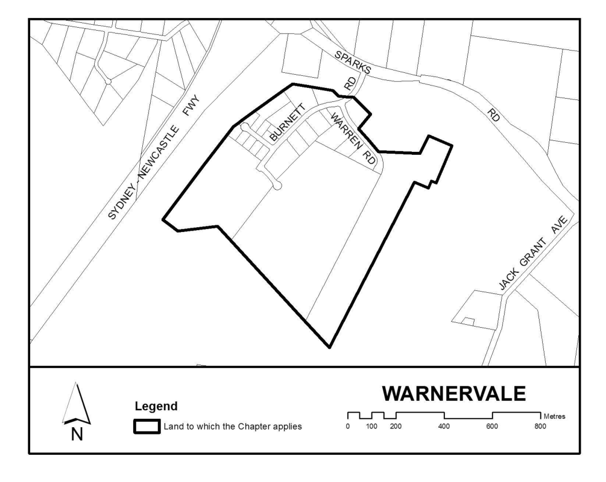

#### 5.38.1 INTRODUCTION

#### 5.38.1.1 Chapter Objective

To provide specific development guidelines for development within Warnervale Business Park

#### 5.38.1.2 Land to which this Chapter Applies

This plan applies to all applications for development, including subdivision, for land within Warnervale Business Park as shown edged heavy black in Figure 1.

The land falls within the Warnervale Employment Zone and is the first Stage of development within this area.

> [Picture on page 1: a picture, saved as a picture (images/ch-05-38-warnervale-business-park-page-1-8.gif, 150 dpi).]

#### Figure 1 Land in Warnervale to which this Chapter applies

#### 5.38.1.3 Relationship to other Chapters and Policies

This Chapter should be read in conjunction with other relevant Chapters of this Development Control Plan and other Policy Documents of Council, including but not limited to:

▪ Chapter 2.4 – Subdivision

▪ Chapter 2.5 – Tree and Vegetation Management

▪ Chapter 2.9 – Industrial Development

▪ Chapter 2.11 –Transport and  Parking

▪ Council’s Civil Works Specification
