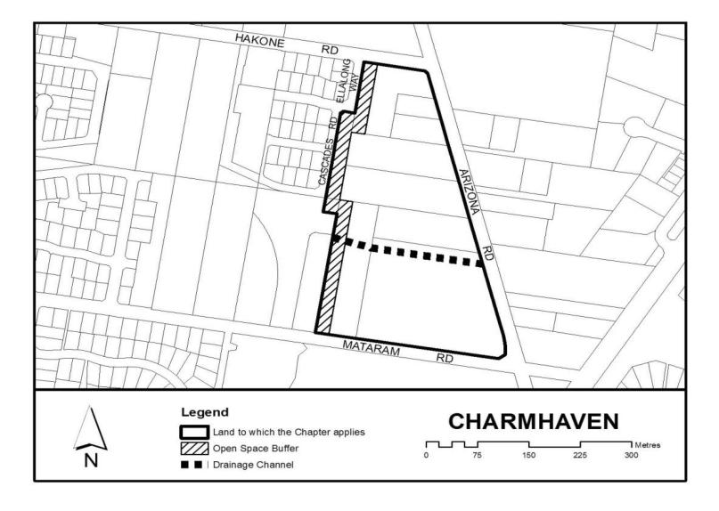

#### Chapter 5.39 Charmhaven West – Industrial Area

### CHAPTER 5.39 CHARMHAVEN WEST –

### INDUSTRIAL AREA

#### 5.39.1 INTRODUCTION

#### 5.39.1.1 Land to which this Chapter Applies

This Chapter applies to all land shown by heavy edging on the map in Figure 1.

> [Picture on page 1: a picture, saved as a picture (images/ch-05-39-charmhaven-west-industrial-area-page-1-9.gif, 150 dpi).]

#### Figure 1 Land in Charmhaven West Industrial Area to which this Chapter applies

#### 5.39.1.2 Relationship to other Chapters and Policies

This Chapter should be read in conjunction with other relevant Chapters of this Development Control Plan and other Policy Documents of Council, including but not limited to:

▪ Chapter 2.9 – Industrial Development

▪ Chapter 2.13 – Transport and Parking

▪ Council’s Civil Works Specification
