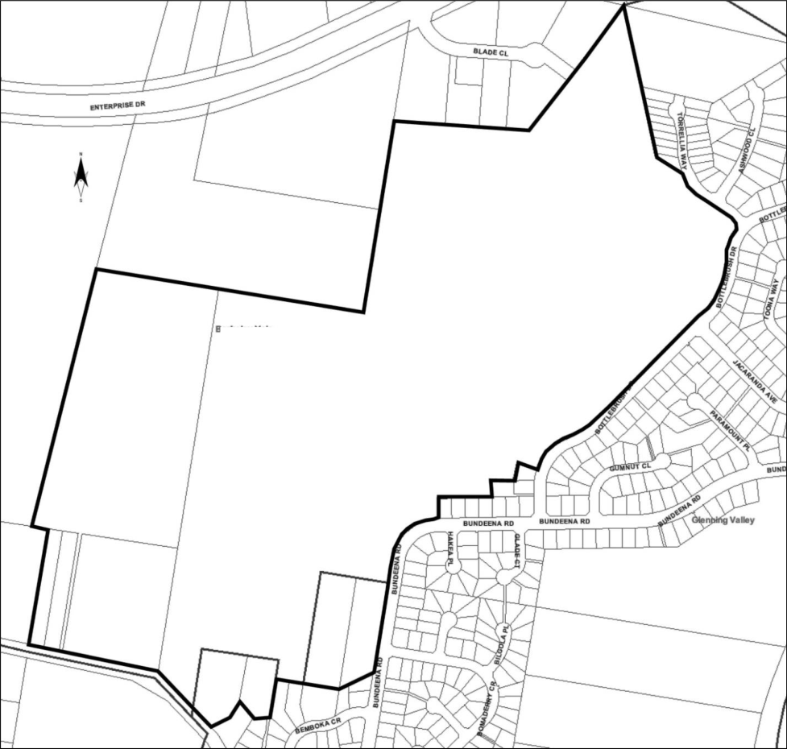

#### 5.41.1 INTRODUCTION

The purpose of this Chapter is to provide development requirements for land within the Glenning Valley, specifically, land identified within Figure 1.

The site comprises a ridge line which circumnavigates existing residential development located east of Bundeena Road and Bottlebrush Drive. It is bounded to the north by wetlands, the Enterprise Drive Light Industrial estate, whilst defined by part of Berkeley Road to the south.

Vegetation in the area comprises a number of threatened flora communities and individual species, and, in addition provides habitat for state and federally protected fauna, including the White-bellied sea eagle. As well as consisting of Endangered Ecological Communities (EECs), the central portion of the site connects to a state significant wetland.

The development of the site is to be sympathetic to the significant environmental, topographic and visual attributes of the site. Development is to be undertaken in a manner that will enable the integration of the site with adjoining land and land uses, and provide a high standard of residential development for present and future residents of the area.

#### 5.41.1.1 Objectives

▪ To specify requirements for the integrated and orderly development of the site, whilst responding and being sympathetic to its environmental, topographical and visually significant features.

▪ To appropriately integrate development with the existing built and natural environment.

▪ To provide a high quality and varied residential environment with access to open space, and community facilities.

▪ To provide attractive streetscapes which reinforce the functions of a street and enhance the amenity of dwellings and the neighbourhood

▪ To provide an efficient system of roads and pathways for vehicular, pedestrian and cycle movements that integrates road safety principles.

▪ To adopt water sensitive urban design that employs best value in quality and quantity controls.

▪ To support and encourage various transport initiatives, including public transport.

#### 5.41.1.2 Land to which this Chapter applies

The land to which this Chapter applies is shown edged heavy black in Figure 1.

> [Picture on page 2: a picture, saved as a picture (images/ch-05-41-glenning-valley-page-2-3.gif, 150 dpi).]

#### Not to Scale

Figure 1 Land within the Glenning Valley Urban Release Area to which Chapter 5.41

applies

#### 5.41.1.3 Using this Chapter

This Chapter should be read in conjunction with other relevant Chapters of this Development Control Plan and other Policy Documents of Council, including but not limited to:

▪ Chapter 2.1 – Dwelling Houses Secondary Dwellings and Ancillary Development

▪ Chapter 2.4 – Subdivision

▪ Chapter 2.13 – Transport and Parking

▪ Chapter 3.5 – Tree and Vegetation Management

▪ Council’s Civil Works Specification
