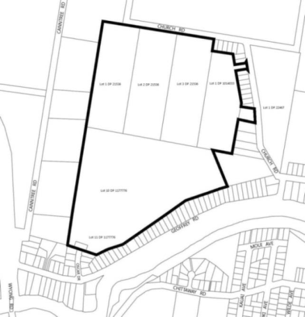

#### 5.43.1 INTRODUCTION

The purpose of this Chapter is to provide subdivision and development requirements for certain land within Chittaway Point, specifically, land identified within Figure 1.

#### 5.43.1.1 Objectives of this Chapter

▪ To provide guidance for the orderly subdivision and development of the site.

▪ To appropriately integrate development with the existing built and natural environment.

▪ To enable development of the land to proceed in a manner that is sensitive to the existing natural environmental characteristics and constraints.

▪ To ensure that the land is adequately serviced.

▪ To ensure that any development on the land complies with the principles of water sensitive urban design.

▪ To ensure ‘Safer by Design’ principles are implemented for personal and property safety and security.

▪ To provide a serviceable and efficient system of roads and pathways for vehicular, pedestrian and cycle movements that integrates road safety principles.

▪ To support and encourage various transport initiatives, including public transport.

#### 5.43.1.2 Land to which this Chapter Applies

This Chapter applies to land as shown edged heavy black in Figure 1.

> [Picture on page 1: a picture, saved as a picture (images/ch-05-43-chittaway-point-page-1-20.gif, 150 dpi).]

#### Figure 1 Land in Chittaway Point to which this chapter applies (Not to Scale)

#### 5.43.1.3 Using this Chapter

This Chapter should be read in conjunction with other relevant Chapters of this Development Control Plan (DCP) and other Policy Documents of Council, including but not limited to:

▪ Chapter 2.1 – Dwelling Houses, Secondary Dwellings and Ancillary Structures

▪ Chapter 2.4 – Subdivision

▪ Chapter 2.11 – Transport and Parking

▪ Chapter 3.1 – Floodplain Management

▪ Chapter 3.5 – Tree and Vegetation Management

▪ Council’s Civil Works Specification

Where any inconsistencies arise with the provisions contained in this Chapter, this Chapter shall prevail.
