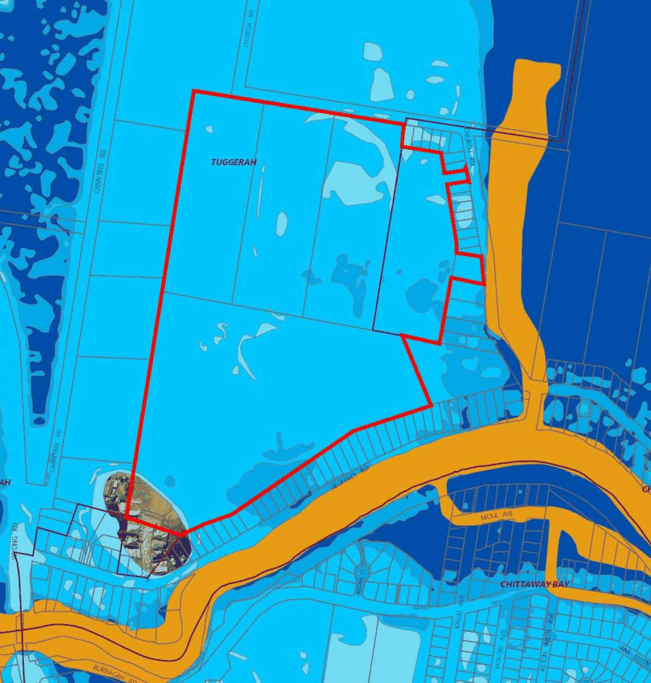

#### 5.43.2 DEVELOPMENT PRINCIPLES

Supplementary to the submission requirements of Chapter 2.4 Subdivision, the following is required to be addressed and/or provided with any subdivision application for land to which this plan applies.

#### 5.43.2.1 Subdivision Design

#### OBJECTIVES

▪ To ensure that any future development of the site is sympathetic to site constraints.

▪ To encourage subdivision design of high quality, which controls and mitigates potential environmental impacts arising from development.

▪ To ensure that subdivision layout and road design incorporates relevant considerations for the safety of road users and pedestrians alike.

▪ To provide for appropriate servicing and avoid negative amenity impacts for staged subdivisions.

▪ To ensure that any subdivision design meets the appropriate standards of Council.

#### REQUIREMENTS

a Applications for subdivision of the site must demonstrate how the application addresses the provisions of Chapter 2.4 Subdivision, in addition to any other requirements of this Chapter.

b For road safety purposes, the following elements are to be considered and incorporated during the preparation of any future subdivision design or layout to enable improved road safety. Other elements that improve road safety which are not identified below should also be considered and incorporated.

| Design Element | Requirement |
|---|---|
| Intersections | i Four way uncontrolled cross intersections should be avoided to reduce vehicular conflict points. Signage is not considered to be an appropriate control. |
| Road hierarchy and layout | i Lot accesses onto collector roads as well as pedestrian and cycle conflicts should be limited ii Modified grid systems with staggered T-intersections should be utilised where practicable iii Cul-de-sacs and layouts that promote or encourage ‘rat runs’ are to be avoided. |
| Road design | i Street leg lengths should be limited to a maximum of 200- 250m between controlled intersections, changes in direction or other speed control mechanism ii Steep grades are to be avoided, particularly on longer street leg lengths iii Wider road widths and areas that do not define travel paths are to be avoided. iv Combination of geometric design elements such as crests and bends should be avoided |
| Landscaping & Lighting | v Location and placement of street trees should consider sight distances for all road users, including pedestrians and cyclists vi Location, placement and type of street trees should consider proximity and speed of adjacent vehicles vii Location and placement of landscaping features should seek to reduce needs for ongoing maintenance, particularly where such works are required to be undertaken close to travelling vehicles viii Lighting categories should be increased to assist more vulnerable road uses (pedestrians, cyclists, motorcyclists, elderly, children etc.) and reduce the likelihood of incidents |

#### Table 1 – Road Safety Considerations

c In addition to the above, Road Safety Audits will be required to be undertaken to identify potential road hazards for all road users. These audits are required to be undertaken (at minimum) at the feasibility and detailed design stage of the subdivision planning.  A pre-opening audit may be required, subject to the scale of the proposed development.

d Applications for subdivision are to provide supporting designs, plans, layouts and specifications for any additional water, sewer, stormwater and/or traffic infrastructure required to service the development. Any such infrastructure is to be provided in accordance with Council’s Civil Works Specification, at the expense of the developer.

e Applications for subdivision must be supported by a staging plan (if applicable) which:

i nominates selected routes for construction traffic access which minimises impacts upon completed stages where possible; and

ii enables the provision of services for completed stages, including provision of turning circles for road based services (e.g. garbage trucks).

#### 5.43.2.2 Flooding and Flood Risk Management

The site is known to experience mainstream flooding associated with Ourimbah Creek and Tuggerah Lakes during the 1% Annual Exceedance Probability Event (AEP).

> [Picture on page 4: a picture, saved as a picture (images/ch-05-43-chittaway-point-page-4-6.gif, 150 dpi).]

#### Figure A Flood Planning Area (not to scale)

Additionally, extreme conditions may arise due to the limited waterway area under Lees Bridge on Ourimbah Creek leading to floodwaters potentially building up and overtopping Wyong Road north of the bridge. This may occur either during extreme floods, high intensity rainfall events or due to blockage of the bridge by large debris.

#### OBJECTIVES

▪ To recognise and plan for the differing level of flood potential and hazard across the site associated with both overland flooding associated with Ourimbah Creek and Tuggerah lakes

▪ To manage the risk to human life, damage to property and provision of essential services by ensuring development on all areas of the site is appropriately sited and designed such that it is compatible with the flooding potential and hazard.

▪ To ensure negligible flood impacts on adjoining property or infrastructure as a result of any development or work on site.

▪ To ensure that the future residents of the site have the capacity during flood events to access critical emergency services via low hazard evacuation routes.

▪ To minimise the reliance on emergency rescue services during flood events.

#### REQUIREMENTS

a Any application for the subdivision of land must meet the requirements of Chapter 3.1 Floodplain Management of this DCP

b Any application for the subdivision of the site must demonstrate that the subdivision design incorporates measures to mitigate against potential extreme floodway hazard conditions, flowing west to east through the southern portion of the site.

c Any development application for the subdivision of the site must be supported by flood modelling which demonstrates that the mitigation strategy adopted to address the overtopping event caused during more extreme flood events will have a negligible impact (less than 20mm) on adjoining and/or downstream properties.

d Any development proposal or subdivision of the site is to be supported by a performance based assessment demonstrating that the proposed development is compatible with the flood characteristics at all locations within the site.

e A detailed site-specific overland flood study and flood impact assessment of any proposed development is required. The flood study and flood impact assessment must:

i Be based on recently acquired ground survey data acquired via traditional ground survey or GPS (less than 2 years from date of lodgement of a development application)

ii Be produced from a two-dimensional (2D) flood model (such as TUFLOW, SOBEK or MIKE-21)

iii Assess various flood sizes, including at least 10% AEP, 1% AEP, 0.5% AEP and PMF

iv Assess various flood durations to determine critical duration for flooding at various locations; include longer duration flood events as part of the consideration of any retarding basins

v Be prepared consistent with the most recent NSW Office of Environment & Heritage Consultant Flood Study Brief, the Floodplain Development Manual (2005) and related Guidelines, Australian Rainfall and Runoff (2001), and Council’s Civil Works Specification unless directed otherwise by this Chapter or any other Chapter of Central Coast DCP 2022.

vi Be inclusive of a written report with mapping, plans and figures detailing:

▪ All data, parameters, and any assumptions

▪ Hydrologic results from at least two methods, including sub-catchment layout, including contribution of the area from the farms south of Yarramalong Road, and peak flow comparisons at several locations.

▪ Figures and tables (showing comparisons of results at several locations) of Flood extents, velocities, depths, and hazards for each sized flood, both for pre-development and post-development, and for the relative differences, both on the site and beyond.

▪ Flood planning area (1% AEP + 0.5m freeboard) both pre-development and post-development

▪ All mapping to be also provided for Council’s ongoing use in GIS Shp file format for inclusion on Council’s GIS

vii Address the following for pre and post development scenarios:

▪ Pre development:

o Evaluation of site conditions: natural water courses, constructed channels, soil type, groundwater, vegetation, stormwater quality

o Assessment of flood hazard, access & evacuation, and consideration of constraints and opportunities for development

o Discussion of the hydrology of the site: flow patterns, velocity distribution, sedimentation and erosion potential, flood storage areas, points of discharge from the site, including peak flows and discharge volumes.

▪ Post Development:

o Evaluation of changes to site conditions: natural water courses, constructed channels, soil type, groundwater, vegetation, stormwater quality

o Assessment of changes to flood hazard, access & evacuation, and the compatibility of various types of development to the flood hazard at specific locations, including impacts at properties beyond the site

o Discussion of changes to the hydrology of the site: flow patterns, velocity distribution, sedimentation and erosion potential, flood storage areas, points of discharge from the site, including peak flows and discharge volumes.

f Any development application for subdivision must include:

i Identification of relevant objectives (including but not limited to water quality, public safety, serviceability and biodiversity preservation) and demonstration through modelling results using Council’s MUSIC link as to how these objectives have been satisfied.

ii Concept plans and associated calculations for any proposed:

▪ Alterations to existing watercourse (demonstrate a suitable sizing, predominantly low hazard, low erosion potential, appropriately shaded and vegetated, including details of adjacent riparian zones).

▪ Riparian zones (whether modified or constructed, including widths, depths and typical cross sections).

▪ Water quality control measures which seek to manage gross pollutants and sediments, nutrients.

▪ Concept details and sizing of stormwater piped systems, pits, road crossings / culverts, detention basins, overland flow paths

▪ Earthworks (cut and fill plan)

▪ Other infrastructure (roads, footpaths, building footprints, water, sewer, telecommunications, public buildings and community facilities),

▪ Access and evacuation routes (for pedestrians and vehicles) from the site to flood free ground

▪ Sedimentation and erosion control

▪ Landscaping plan

▪ Vegetation management plan

▪ Details of the proposed staging and sequencing of any works

▪ Maintenance Management Plan for all asset components including: maintenance access, procedures, frequency, safety issues, equipment required, and whole-of-life cost estimates.

#### 5.43.2.3 Drainage, Stormwater and Water Cycle Management

#### OBJECTIVE

▪ To reduce flood risk in urban areas and downstream water bodies.

▪ Preserve pre-development hydrology regimes to ensure the protection and maintain the integrity of significant ecosystems, vegetation and fauna habitats within and adjoining the site.

▪ To ensure the integrity and functionality of existing stormwater management devices and systems within the vicinity of the site.

▪ To provide water quality and quantity control measures that are cost effective and affordable, with consideration given to ongoing maintenance costs.

#### REQUIREMENTS

a Any application for subdivision is to include a Stormwater Management Plan. The plan is to be included in a written report with plans detailing stormwater quality control measures, management of stormwater runoff, hydrology management measures, waterway stability management measures and potable water saving measures that are to be implemented on the

site. Such measures and management techniques/routines are to be designed and sized to a standard acceptable to Council.

The report is to include the following:

i details and hydraulic assessment of the pre-development site, including existing drainage pattern, identify receiving environments, flow details, all natural water courses and channels on site;

ii description and illustration of the proposed development. If considered a large water user, details of expected usage, peak visitation periods etc.;

iii the location of all points of discharge from the site, overflows and pipes;

iv evaluation of site conditions e.g. soils, groundwater, vegetation etc. and documentation of constraints and opportunities;

v the extents of 1% ARI flood affectation from internal or external waterbodies, gullies, creeks and waterways;

vi relevant objectives that apply and demonstrate through modelling results and/or other means how these objectives have been satisfied;

vii modelling and concept design of stormwater quality, hydrology and waterway stability measures. Location, size and configuration of stormwater treatment elements are to be specified together with the proposed or altered drainage pattern. Areas bypassing treatment are to be clearly identified;

viii identification of maintenance requirements for the components including: maintenance frequency, safety issues, equipment required, vehicular access and maintenance cost estimates;

ix modelling, design and construction of any stormwater management systems is to be in accordance with Council’s Civil Works Specification; and

b Details of any proposed detention basins which may incorporate pollution retention systems provided it is demonstrated that the basin is sized appropriately and achieves the minimum

pollutant reduction targets of stormwater as determined by Council.

#### 5.43.2.4 Biodiversity Protection and Management

#### OBJECTIVE

▪ To ensure the protection and maintain the integrity of native vegetation and fauna habitats on land zoned C2 Environmental Conservation and C3 Environmental Management within and adjoining the site.

▪ To minimise the impacts of construction and occupation of future developments on native vegetation and fauna habitats within and adjoining the site.

#### REQUIREMENTS

a Any application for subdivision of the subject site is to be accompanied by the relevant requirements set out within any Voluntary Planning Agreement relating to or affecting the land.

b A Conservation Management Plan (CMP) is required to be submitted with any application that includes land zoned C2 Environmental Conservation or C3 Environmental Management which is not subject to a Biobanking Agreement of Biocertification. The plan is to:

i Describe the existing ecological features of the land, including but not limited to topography and soils, drainage, flora and fauna (including threatened species and their habitats, populations and/or ecological communities);

ii Establish the operational framework, legal protection, funding mechanisms and review mechanisms for its operation;

iii Establish the management strategies for (but not limited to) the following matters:

▪ Key threatening processes

▪ Vegetation clearing

▪ Weed management

▪ Bushfire management

▪ Feral and domesticated fauna

▪ Rubbish dumping

▪ Firewood collection

▪ Prohibited uses, public access, fencing and signage

▪ Stormwater management structure management

▪ Habitat enhancement

▪ Revegetation and rehabilitation of cleared land

▪ Habitat tree retention;

iv Detail the monitoring program and reporting framework to assess the adequacy of the adopted management strategies.

NOTE: If a “significant” impact on threatened species, populations, ecological communities, or its habitat is likely to occur, the application will be required to be supported by a Species Impact Statement and will require the concurrence of the Office of Environment and Heritage which may result in the modification of the proposal.

#### 5.43.2.5 Traffic and Transport

#### OBJECTIVES

▪ To provide an efficient internal road network addressing safe system principles that responds to the topography of the site and integrates with the external road network system, including the existing road network’s environmental capacity.

▪ To provide for alternate transport including viable links with existing public transport services and collection points.

▪ To provide appropriate access for larger and special purpose vehicles including construction traffic, garbage trucks, emergency service vehicles, delivery vehicles and busses.

▪ To establish a road layout which maximises convenience, connectivity, transportation amenity and road safety for vehicles, pedestrians and cyclists whilst minimising congestion, and traffic amenity for all users, including existing road networks. To promote ‘Healthy by Design’ principles in subdivision design, in accordance with the guidelines issued by the Premiers Council for Active Living (PCAL), the NSW Heart Foundation and NSW Health.

#### REQUIREMENTS

a Any application for subdivision of the site is to include a street and lot layout plan consistent with the requirements of Chapter 2.4 Subdivision of this DCP and Council’s Civil Works Specification.

b Any application for subdivision of the site must be supported by a Traffic Study prepared in accordance with the Roads and Maritime Services (RMS) ‘Guide to Traffic Generating Developments 2002’, and RMS Supplement TDT 2013/04a, which is to include, but is not limited to:

i Current traffic counts for the Wyong Road I Geoffrey Road intersection inclusive of all proposed and approved developments.

ii The anticipated additional vehicular traffic generated from the proposed development.

iii The distribution on  the  road  network  of  the  trips  generated  by  the  proposed development. It is requested that the predicted traffic flows are shown diagrammatically to a level of detail sufficient for easy interpretation.

iv Consideration of the traffic impacts on existing and proposed intersections and the capacity of the local and classified road network to safely and efficiently cater for the additional vehicular traffic generated by the proposed development. The study shall also give consideration to the cumulative traffic impacts of other proposed and approved developments in the area.

v Identifying the necessary road network infrastructure upgrades that are required to maintain existing levels of service and road safety on both the local and classified road network. In this regard, preliminary concept drawings shall be submitted with the development application for any identified road infrastructure upgrades. However, it should be noted that any upgrades will need to be to the satisfaction of Roads and Maritime Services and Council.

vi Traffic analysis of any  major / relevant  intersections, using SIDRA or similar  traffic model, including:

▪ Current traffic counts and 10 year traffic growth projections (inclusive of proposed and approved developments in the area),

▪ With and without development scenarios considered 95th percentile back of queue lengths,

▪ Electronic input/output data files for Roads and Maritime Services review.

c Subdivision layouts are to be designed to ensure that road/street lengths and intersections:

vii provide for adequate site distances;

viii incorporate appropriate safety and speed management controls;

ix discourage unsafe vehicle manoeuvres;

x discourage the use of any proposed access from the site to Church Road as a thoroughfare for non-resident traffic; and

xi Provide for efficient servicing by busses and promote pedestrian connectivity.

d Any application for subdivision of the site is to:

i identify and assess impacts on local, state and regional road networks in the vicinity of the development (addressing both the movement of people and goods), and

ii Identify how it is intended to encourage people from the proposed development to walk, cycle and use Public Transport in lieu of the private motor vehicle and if possible reduce the demand for travel by private and commercial vehicle. Documentation is to be provided which demonstrates consultation with the local Bus Company has been undertaken and the proposed network is serviceable by busses.

e Cycleways and/or shared pathways and footpaths are to be located to provide logical and coherent linkages to adjoining residential areas, internal and external community and open space facilities and public transport connection routes or stops.

f The design and construction of roads, drainage, cycleways and or shared pathways and pedestrian paths is to be in accordance with Chapter 2.4 Subdivision of this DCP, Council’s Civil Works Specifications and any relevant Austroads Standards. Documentation is required which demonstrates how overland flows and drainage associated with roadworks will be managed to a standard acceptable to Council.

#### 5.43.2.6 Open Space and Landscaping

#### OBJECTIVE

▪ To provide open space for the active and passive recreational needs of residents

▪ To maintain the environmental and visual character of the existing landscape.

▪ To retain native vegetation.

#### REQUIREMENTS

a Any application for subdivision of the site is to address the requirements of Chapter 2.4 Subdivision of this DCP and Council’s Civil Works Design Specification.

Open space is to be provided within the locality at no cost to Council in accordance with the following requirements:

| Type of open space | Requirement |
|---|---|
| Park | i 0.5 hectares minimum ii to be located in an accessible area of the site on land which is: o flood free, o has two (2) road frontages, |

| Type of open space | Requirement o is accessible by residents from adjoining development areas, and o connected to nearby pedestrian and cycle linkages. o Is appropriately landscaped with low maintenance species retains existing trees where possible and includes playground and seating facilities. |
|---|---|

#### Table 2 – Open Space Requirements

#### 5.43.2.7 Potential Site Contamination

#### OBJECTIVE

To ensure that land proposed for development does not present a risk to future occupants and is of suitable quality for the intended purpose.

#### REQUIREMENTS

a Any application for the subdivision of the land to which this plan applies is to be accompanied by a Stage 1 Preliminary Site (Contamination) Investigation report, Stage 2 Detailed Site (Contamination) Investigation Report and Stage 3 Remedial Action Plan (if required) prepared by a suitably qualified consultant.

b The report is to be consistent with the requirements of the Managing Land Contamination Planning Guidelines, 1998 (as updated) prepared by the (then) Department of Urban Affairs and Planning.

Note: This is supplementary information provided for applicants and landowners. All development proposals must consider all relevant Council and State Government Policy including SEPP 55- Remediation of Land.

#### 5.43.2.8 Acid Sulfate Soils

#### OBJECTIVE

To minimise the potential for adverse environmental impacts which may arise from the disturbance of acid sulfate soils during development.

#### REQUIREMENTS

a Any application for the subdivision of the land to which this plan applies is to be accompanied by an Acid Sulfate Soil Management Plan. The plan is to be prepared by an appropriately qualified consultant in accordance with the requirements of the ‘Acid Sulfate Soil Manual’ published by the NSW Acid Sulfate Soil Management Advisory Committee (ASSMAC, 1998).

#### 5.43.2.9 Bushfire Management

#### OBJECTIVE

▪ To minimise the risk of bushfires on life, property and the environment.

▪ To enable appropriate bushfire protection without unreasonably compromising the biodiversity and landscape values of the area.

#### REQUIREMENTS

a Any application for subdivision is to include a Bushfire Risk Management plan. The plan is be consistent with the provisions and requirements of the following:

i Planning for Bushfire Protection 2019;

ii Australian Standard 3959:2009 (as updated); and

iii Chapter 2.4 – Subdivision of this DCP.

#### 5.43.2.10 Noise

#### OBJECTIVE

To ensure future residents are adequately protected from noise emanating from Wyong Road.

#### REQUIREMENTS

a Any future application for subdivision of the land is required to demonstrate how the best practice methodologies in the interim Guidelines for Development near Rail Infrastructure and Busy Roads (Department of Planning, 2008) have been considered and incorporated.
