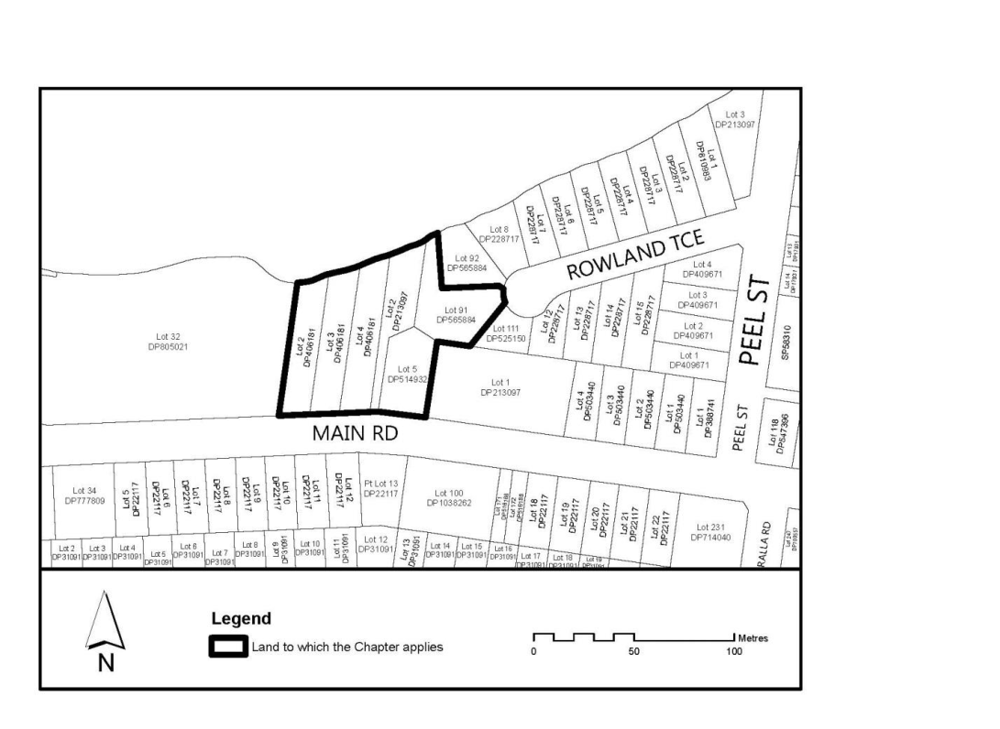

#### 5.44.2 ICONIC DEVELOPMENT OF THE “RUSTRUM KEY SITE”

#### OBJECTIVES

▪ To encourage site consolidation and redevelopment of the land.

▪ To allow for higher density development in a manner which minimises impacts on the locality

▪ To provide a high quality lakeside development that improves the streetscape and respects the sensitive lakeside location.

#### GENERAL REQUIREMENTS

a The building design is to exemplify design excellence, incorporating a high standard of architectural design, materials, façade treatments, green building solutions and landscaping that recognises the site’s prominent location, in particular streetscape presentation to Main Road, Toukley Gardens and the foreshore to Budgewoi Lake.

b Development of the site is to minimise impacts upon the nearby residential properties and Toukley Gardens with regard to bulk, scale and overshadowing, overlooking and design.

c A tree assessment report addressing significant trees to be retained on the site is to be prepared.  This is to accompany a landscape plan to be developed with any DA for the development of the site.

d The development is to provide for an appropriate response to the environmental constraints of the site, including addressing the potential for disturbance and remediation of acid sulfate soils, and/or any identified site contamination.

e The Traffic Impact Study (TIS) is to address the matters including traffic, parking demand, operation and impacts, including access from Main Road.

f The Development Application should address land swap opportunities with Council to enable reconfiguration of the park to overlook the foreshore and to connect the park with Rowland Terrace. (A subdivision facilitating the land swap was approved by Council on 23 January 2014, under DA/829/2013). The DA should include provision for a shared pathway linking Main Road and Rowland Terrace.

g A Social Impact Assessment (SIA) of the proposal is to be provided with the DA, addressing potential social impacts of the proposal in respect of future residents on the site and existing residents of surrounding properties. Consideration of matters such as noise and potential anti-social behaviour from nearby premises and impacts of potential connection through to Rowland Terrace shall be outlined and addressed.

h The development shall improve the park outlook over Budgewoi Lake and the connection to the Budgewoi Lake foreshore via Rowland Terrace.

i The proposed development shall address flooding constraints consistent with Council’s Tuggerah Lakes Floodplain Risk Management Study and Plan.

j , the development shall also meet or surpass the quality standards identified within the requirements of the relevant State Environmental Planning Policies (SEPP’s), including:

▪ SEPP 65 – Design Quality of Residential Apartment Development and the related Apartment Design Guide

▪ SEPP (BASIX) 2004; and

▪ State Environmental Planning Policy (Resilience and Hazards) 2021.

k The design is to clearly demonstrate architectural merit and iconic status. The Statement of Environmental Effects (SEE) is to clearly demonstrate how public benefit is delivered through the development.

l Development is to be located and designed with appropriate mitigating and adaptive measures against the anticipated impacts of climate change.  Such measures are to be consistent with Federal, State and Local Government Policies on climate change and sea level rise.  Specifically:

▪ NSW Coastal Planning Guideline: Adapting to Sea Level Rise (August 2010) by Department of Planning and Infrastructure (DoPI); and

▪ Flood Risk Management Guide: Incorporating Sea Level Rise Benchmarks in Flood Risk Assessments (August 2010) by Department of Environment, Climate Change and Water (DECCW).

m All new development shall include an appropriate sea level rise allowance in the Flood Planning Level.

n The design of the development is to incorporate Crime Prevention through Environmental Design (CPTED) principles, including measures to address the surrounding public open space areas.

o The development shall enhance the entry-arrival node identified by Council (the adjoining Toukley Gardens) in the Toukley Town Centre Public Domain Masterplan.

> [Picture on page 4: a picture, saved as a picture (images/ch-05-44-toukley-rustrum-key-site-page-4-1.gif, 150 dpi).]

#### Figure 1: The Rustrum Key Site
