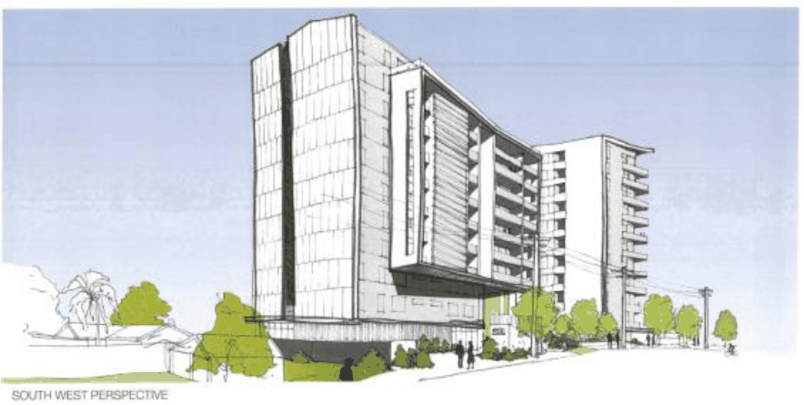
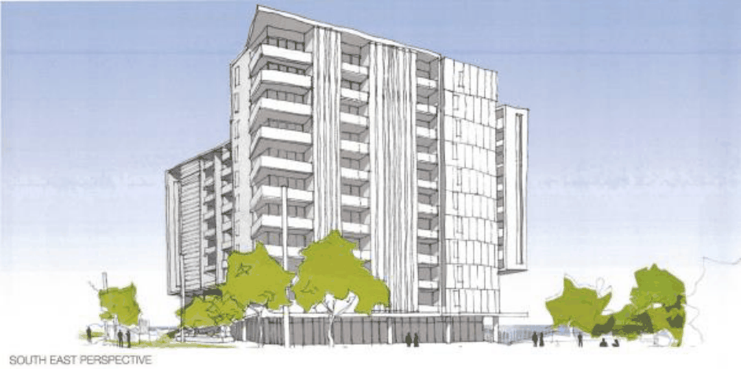
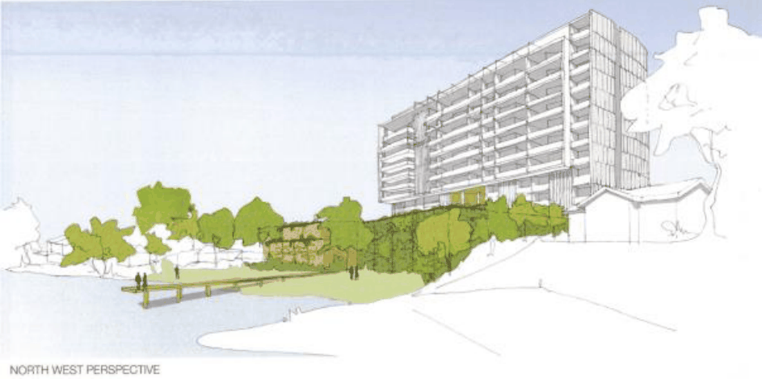

#### 5.44.2.3 Design of Building Elements

#### OBJECTIVES

▪ To ensure that the elevations and roof treatment of the building(s) have a high quality and iconic appearance and have regard to the character of the surrounding area.

▪ To ensure a positive relationship to the landscaped park setting, foreshore and Main Road.

#### REQUIREMENTS

a Development is to be designed having regard to the urban coastal context and the desired future character of the area.

b Development of the site is to minimise impacts upon the nearby residential properties and Toukley Gardens with regard to bulk, scale and overshadowing, amenity, overlooking and design elements.

c Building and landscape elements, including balconies, entries, rooflines and screening are to contribute to the character of the streetscape through distinctive and attractive façade treatments and detailing.

d The development shall enhance opportunities for passive visual surveillance of the public domain, enhance residential amenity and make a positive contribution to place identity.

> [Picture on page 7: a picture, saved as a picture (images/ch-05-44-toukley-rustrum-key-site-page-7-3.gif, 150 dpi).]

Figure 2: Indicative Use of Materials and Design to produce an iconic development of urban coastal character

> [Picture on page 7: a picture, saved as a picture (images/ch-05-44-toukley-rustrum-key-site-page-7-6.gif, 150 dpi).]

Figure 3: Indicative Use of Materials and Design to produce an iconic development of urban coastal character

> [Picture on page 8: a picture, saved as a picture (images/ch-05-44-toukley-rustrum-key-site-page-8-1.gif, 150 dpi).]

Figure 4: Indicative Use of Materials and Design to produce an iconic development of urban coastal character
