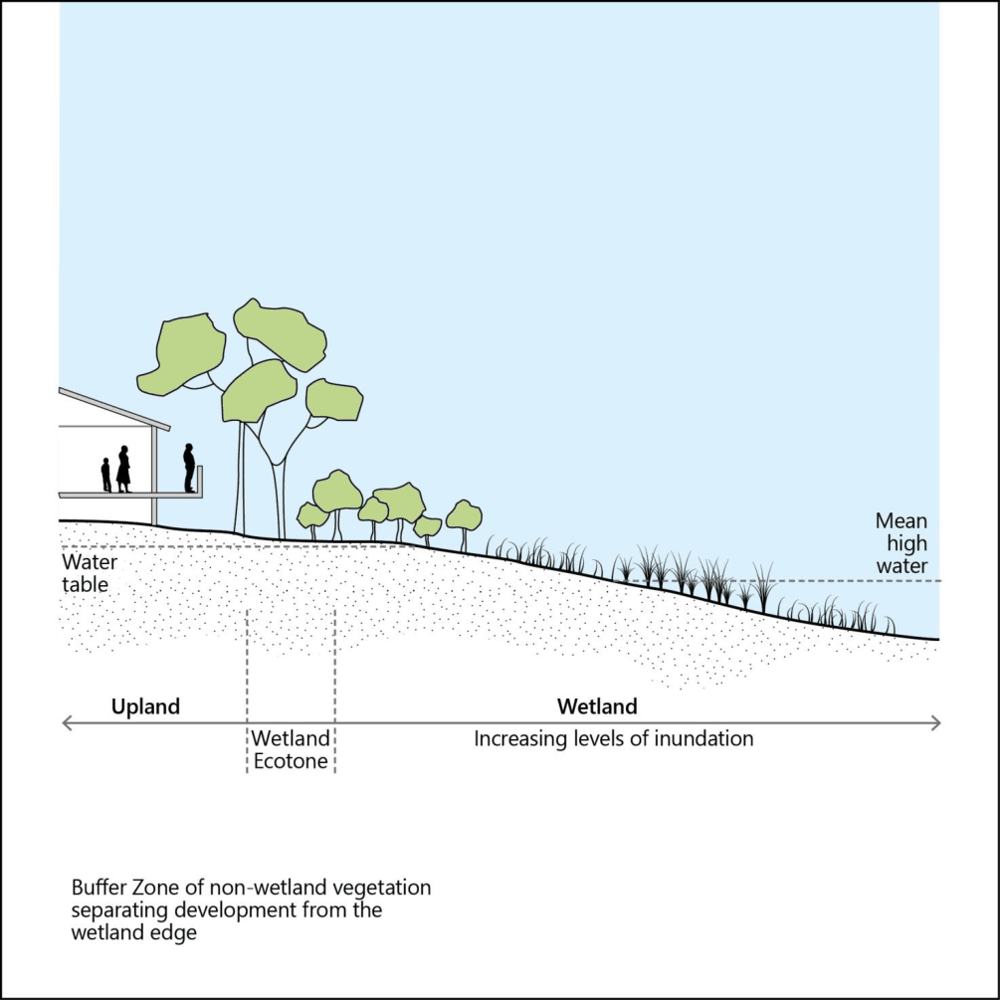
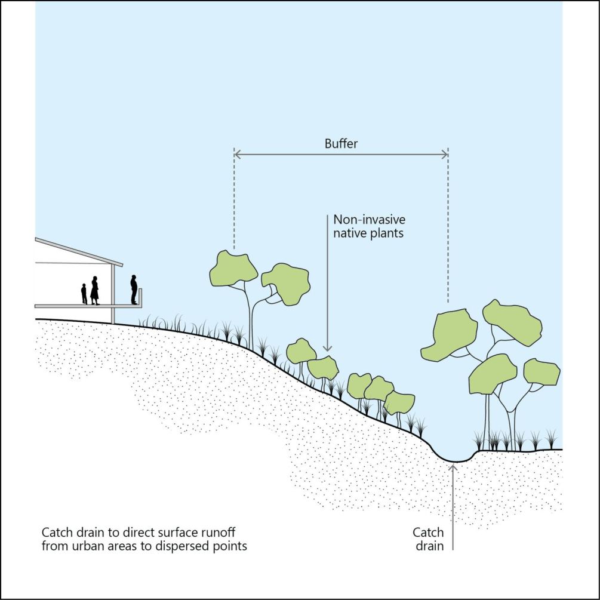
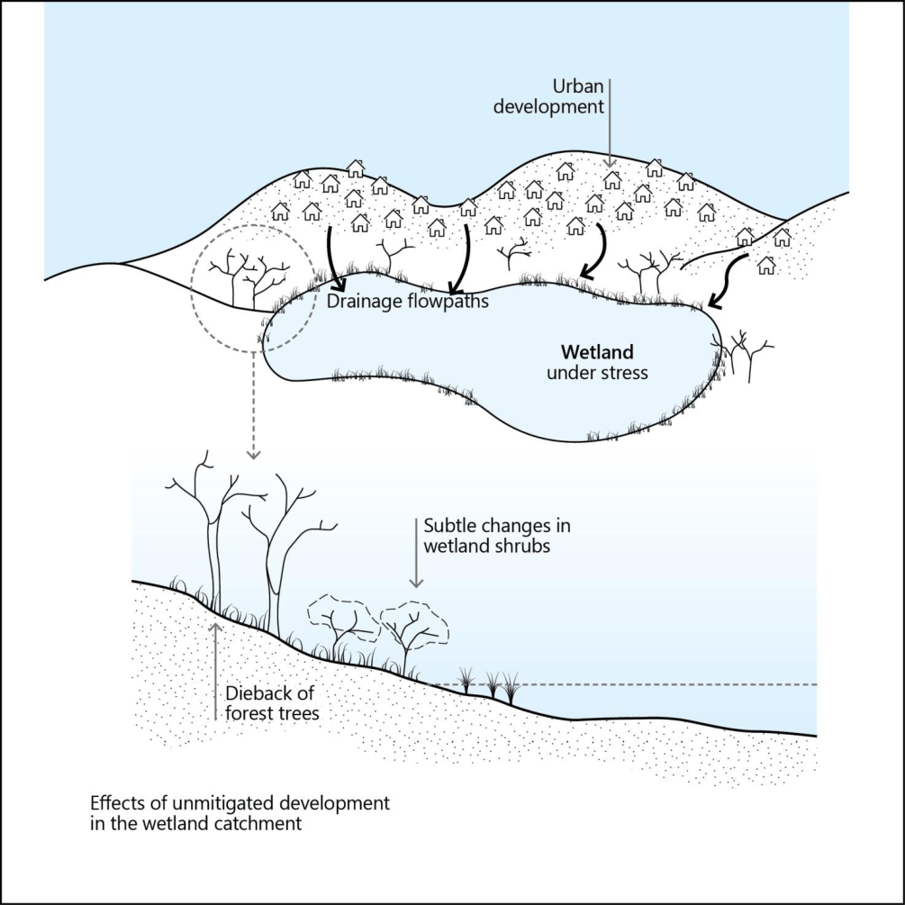
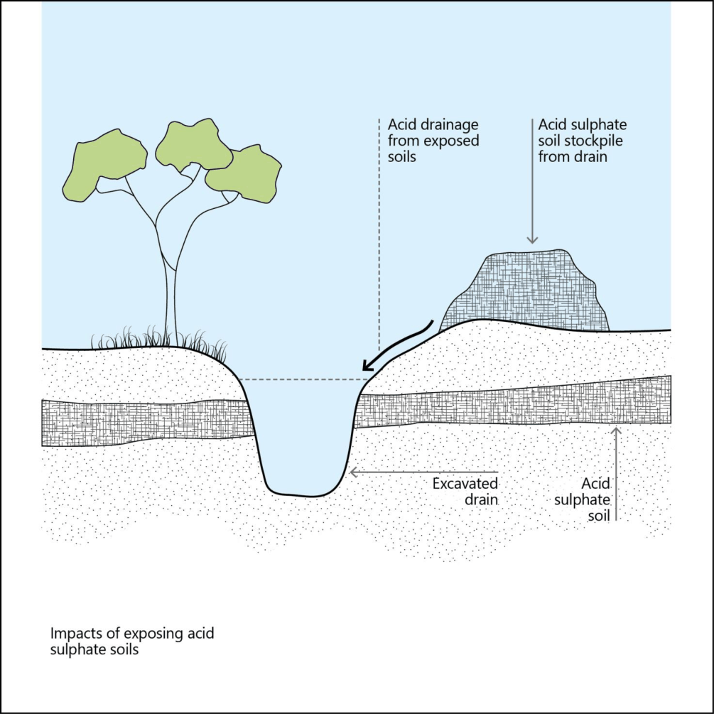
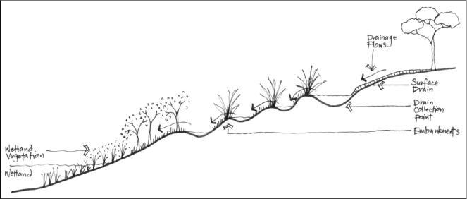

#### 5.46.2 GENERAL MATTERS FOR CONSIDERATION

#### 5.46.2.1 Development within Wetland Management Areas

When assessing an application in an area covered by this DCP Chapter, Council will consider how well the proposal complies with the following objectives and requirements.

#### OBJECTIVE

▪ To protect the environmental values and functions of wetlands from the potential impacts of adjoining land uses

#### REQUIREMENTS

a Where development is proposed near a wetland, bands of natural vegetation, known as buffers, should be kept between the development and wetland. A diagram showing a buffer zone of non-wetland vegetation separating development from the wetland edge is shown at Figure 1. Buffers provide supplementary fauna habitat and vegetatively linked buffers may potentially facilitate the movement of fauna between areas, thus maintaining ecosystem function and genetic diversity. The width of the buffer zone depends on factors such as the existing vegetation type, surrounding land use, slope, potential for weed invasion and potential for nutrient impacts on the wetland. Specialist advice from suitably qualified people should be sought on the width and management of wetland buffers for development adjoining wetland sites.

> [Picture on page 3: a picture, saved as a picture (images/ch-05-46-northern-wetlands-management-page-3-1.gif, 150 dpi).]

Figure 1 Buffer Zone of non-wetland vegetation separating development from the wetland edge

b Separate wetlands from development edges by the construction of a road or cycleway. This provides a hard management edge and firebreak to the wetland. Refer to the Urban Interface Area provisions within Chapter 2.4: Subdivision.

c Discourage the clearing of wetland boundaries and minimise disturbance to ecotones. Clearing and disturbance  will only result in pushing the disturbed area further into previously undisturbed wetland vegetation, thus further impacting the wetland ecosystem.

d If grazing is to be conducted on land adjoining wetland areas, owners should be encouraged to fence the wetland and native vegetation to prevent intrusion by stock.

e Avoid separation of wetland habitat and retain existing wildlife corridors to increase habitat values. Where corridors are not linked, fencing of areas and/or supplementary planting of endemic vegetation is recommended to increase the long-term viability of the corridor.

f The development interface must be carefully managed in locations which border wetland communities. Berms, stilling ponds, filter strip and nutrient control facilities (WSUD elements) shall be developed downstream of urban areas to reduce nutrient and weed transport into downstream wetlands.  Figure 2 shows a catch drain to direct surface runoff from urban areas to dispersion points. This reduces the potential for weed invasion and adverse hydrological changes to the wetland.

> [Picture on page 4: a picture, saved as a picture (images/ch-05-46-northern-wetlands-management-page-4-6.gif, 150 dpi).]

Figure 2 Catch drain to direct surface runoff from urban areas to dispersed points

#### 5.46.2.1.1 Hydrology

Water is the major feature of wetlands. Changes to catchment hydrology can, in turn, change the frequency, timing and depth of inundation, resulting in changes to the characteristics of wetlands and ultimately changes to adjoining lands or those lands elsewhere in the catchment.

The encroachment of urban and rural areas into natural catchments areas has the potential to modify downstream surface and groundwater flows. This can be to the detriment of a number of water tolerant species which rely on groundwater flows, such as those that occur in swamp forest wetland types.  The loss of

these groundwater flows leads to the loss of swamp forests and ultimately favours dryland terrestrial plant species.

Unmitigated development can result in excessive stormwater runoff and reduced water quality which can significantly impact on downstream wetlands. Development in wetland catchments reduces groundwater infiltration and water quality, and increases the permanency and frequency of hydration.  This can weaken the root structure of wetland trees, resulting in dieback. A diagrammatic representation of the effects of development in the wetland catchment is shown in Figure 3.

#### OBJECTIVE

▪ To maintain or restore the physical, chemical and biological processes existing in wetlands by minimising existing impacts on or exacerbating changes to hydrology from land uses in catchments

#### REQUIREMENTS

a When development proposals are being considered upstream of wetland ecosystems, proponents are to ensure that all likely changes in surface runoff and groundwater flows are adequately investigated and assessed. A catchment based approach to the management of stormwater runoff, is required in order to mimic as far as practicable pre-development hydrological conditions.

b Requirements may also exist under the Water Management Act 2000. Applicants may need to consult with the NSW Office of Water to obtain relevant approvals or licences.

c The type, employment and location of culverts, drains, and paved surfaces should be carefully considered, to ensure the maintenance of appropriate water flow regimes to downstream wetlands. Where possible, the use of natural drainage structures are preferred.

d Drainage works without appropriate environmental safeguards should be avoided, due to the potential impacts of falling or rising water tables. In some cases, falling water tables will cause the exposure of acid sulphate soils. This may cause water quality management problems or the formation of acid scalds which can kill vegetation and cause increased sediment runoff.

e Developments which are likely to have a significant impact on the hydrology of significant wetlands shall prepare a wetland management plan. This plan is to provide a comprehensive framework for managing environmental impacts including mitigation measures. The management plan should incorporate an environmental monitoring program encompassing relevant biological, physical and chemical parameters to detect any adverse changes in the health of the wetland ecosystem.

f In the event that mitigation measures do not work satisfactorily, the management plan needs to clearly indicate the commitments given by the proponent to rectify the problem. The commitments should contain the following elements:

i Who will deal with the issue?

ii How will they deal with it?

iii In what timeframe will they deal with it?

iv Who will they report these actions to?

> [Picture on page 6: a picture, saved as a picture (images/ch-05-46-northern-wetlands-management-page-6-1.gif, 150 dpi).]

#### Figure 3 Effects of unmitigated development in the wetland catchment

#### 5.46.2.1.2 Water Quality

Stormwater pollution can lead to the nutrification of habitat for wetland dependent flora and fauna which rely on the healthy functioning of wetlands for their survival. The most at risk are wetlands within catchment areas which are subject to development pressures. Discharge of sediment is the greatest concern during the urban development construction phase, whilst discharge of nutrients are of a greater concern after the land has been developed.

#### OBJECTIVE

To ensure water entering into natural wetlands is of sufficient quality so that wetland conservation values and functions are not compromised

#### REQUIREMENTS

a Drain construction and utility provision shall avoid excavation through wetlands.

> [Picture on page 7: a picture, saved as a picture (images/ch-05-46-northern-wetlands-management-page-7-1.gif, 150 dpi).]

#### Figure 4 Impacts of exposing acid sulphate soils

b Acid sulphate soils (ASS) are often present within low lying wetland areas. Works that are likely to expose acid sulphate soils, should be carried out with extreme caution, as excavated acid sulphate soils can leach highly acidic drainage waters which scald soils, which are then difficult to revegetate (as shown in Figure 4 above). The Department of Planning and Environment have provided data to Council identifying (ASS) Risk classes, which should be used to determine the likelihood of ASS. If ASS are present on site, a detailed and site specific ASS management plan should be prepared.

c A dispersed discharge of stormwater into a wetland is preferable to a concentrated flow regime. Create sheet flow conditions to avoid concentrated discharge into a wetland. Figure 5 below shows how stormwater from a surface drain can be dispersed using embankments.

> [Picture on page 8: a picture, saved as a picture (images/ch-05-46-northern-wetlands-management-page-8-1.gif, 150 dpi).]

#### Figure 5 Embankments are used to disperse stormwater from a surface drain

#### 5.46.2.1.3 Bushfire Hazard Reduction

Whilst fire has the potential to be used in wetland management to reduce the build up of combustible material its use as a management tool should not be considered without detailed knowledge of the environmental effects of fire on fire sensitive wetland flora and fauna.

#### OBJECTIVE

▪ To conserve biological diversity and ecological processes by giving consideration to appropriate fire management regimes and permanent hazard reduction techniques in wetland environments.

#### REQUIREMENTS

a The use of permanent fuel hazard reduction measures, such as building setbacks, fuel hazard radiation zones and fire trails shall be favoured as a hazard reduction technique in areas adjoining urban development rather than broad area burning for the purpose of reducing fuel loads.

b All wetland areas should not be subject to broad area burning, with a mosaic burning approach adopted. Areas left unburnt (habitat refuges) should be provided if an area is to be subjected to hazard reduction burning.

c Burning of wetland areas shall have regard to the sensitivity of wetland plant and animal communities and the natural frequencies and intensities of fires in such environments at different times of the year.

d Owners of wetland areas will not be permitted to carry out burning activities without obtaining appropriate authorisation and should consider relevant provisions of Bushfire Management Plans which have been prepared for the Central Coast Local Government Area, pursuant to Section 41A of the Rural Fires Act, 1997.

e Any proposal for bushfire hazard reduction should have regard to those management plans pertaining to that particular wetland area. In those areas where hazard reduction is considered as an appropriate management option, the hazard reduction should be conducted in accordance with the prescriptions identified in the management plan.

#### 5.46.2.1.4 Visual, Social and Cultural Values

Many wetlands possess scenic qualities which contribute to the landscape character of the area and provide social and recreational values important to local communities.

#### OBJECTIVE

To preserve the aesthetic, social and economic values of wetland areas

#### REQUIREMENTS

a The impact of disturbance on wetlands has the potential to reduce the values and long-term viability of wetlands. Types of disturbances on wetlands include: direct (i.e. clearing, infilling, etc.) or indirect: (i.e. inappropriate location of development in the vicinity of wetlands). In the latter, careful placement of development using landscape screening measures, sympathetic building placement, natural colour schemes and non-reflective materials can be implemented to reduce the impacts on wetlands.

b Maintain floodways and high hazard flood liable lands, and functions of low lying lands for nutrient cycling and sediment filtering by restricting development.
