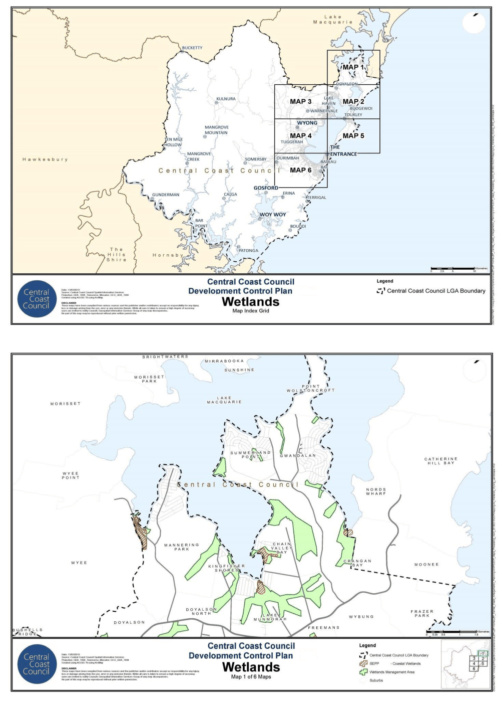
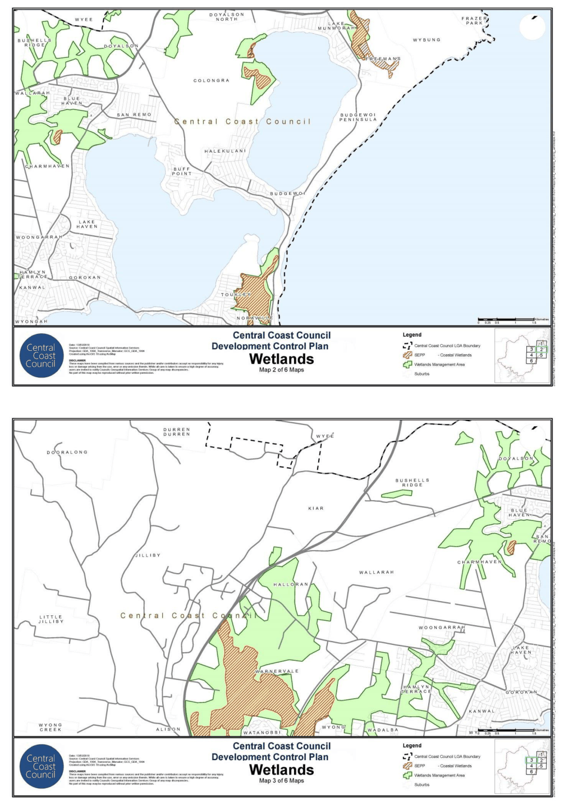
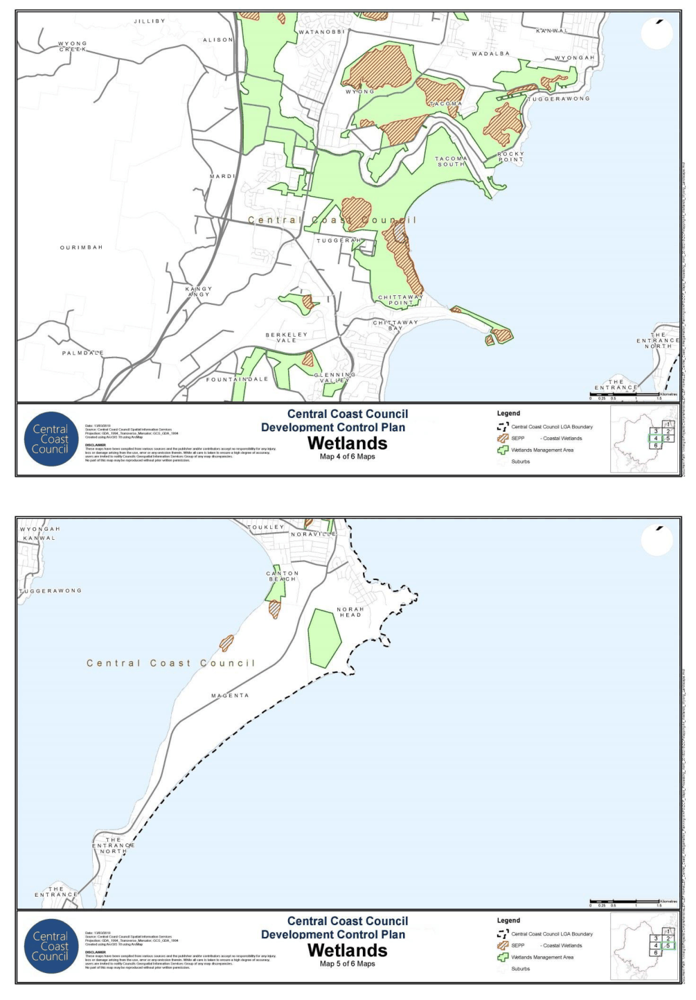
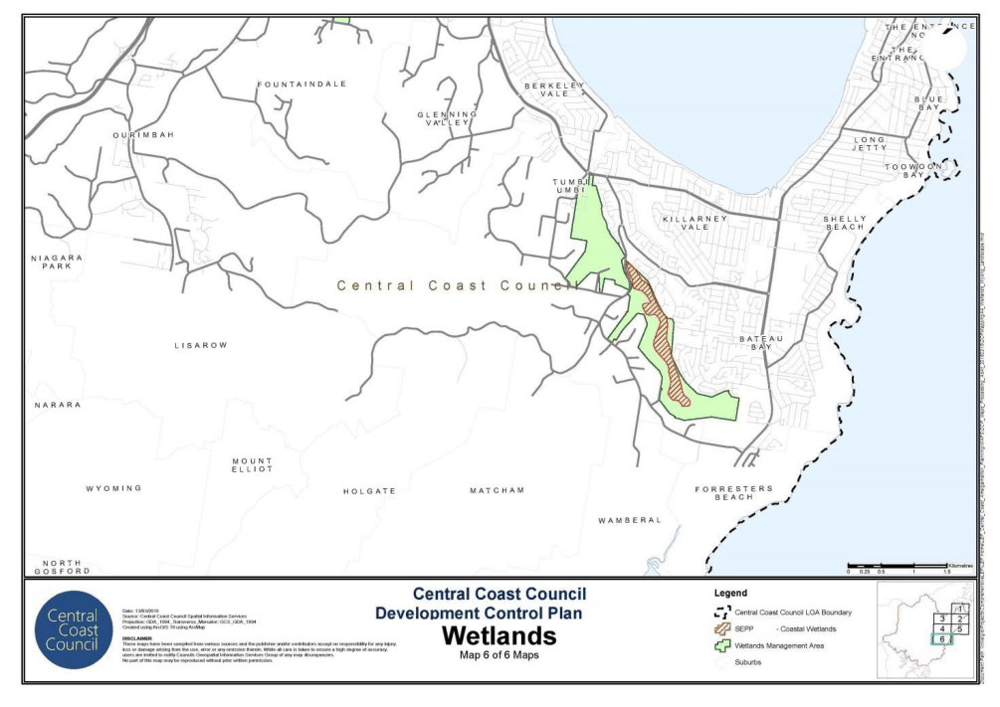

#### 5.46.3 WETLAND MANAGEMENT AREAS

Some wetland areas are subject to protection by State Environmental Planning Policy (Resilience and Hazards) 2021 Chapter 2 (which replaced SEPP 14 – Coastal Wetlands). Developments in or near wetlands protected by this Policy may be defined as “Designated Development”, or by the Environmental Planning and Assessment Regulation 2021. Many other significant wetland areas are also protected by the C2 – Environmental Protection Zone under the Central Coast LEP 2022. In this Chapter, these lands are identified as Wetland Management Areas.

#### 5.46.3.1 Development within a Coastal Wetlands Area/Proximity Area

### under State Environmental Planning Policy (Resilience and Hazards) 2021.

Certain development within the State Environmental Planning Policy (Resilience and Hazards) 2021areas (clearing, filling, draining or the construction of levees) are defined as “Designated Development” and applications are required to be accompanied by an Environmental Impact Statement (EIS). Applicants are advised to refer to the details of this policy and to seek and address the requirements specified by the Director-General of the Department of Planning and Environment.

Information regarding the location of the boundaries should be obtained from the 1:25,000 map series held by the Department or the maps notified with State Environmental Planning Policy (Resilience and Hazards) 2021.

#### 5.46.3.2 Wetland Management Areas

The accompanying Maps identify Wetland Management Areas, covering a range of low lying and wetland buffer areas which maintain water quality in downstream environments and maintain the ecological integrity of wetland, river and lake systems in the North Wyong area. Proper consideration of development within Wetland Management Areas relies on an understanding of the functions and values that the site performs within the landscape.

An evaluation chart (Appendix A) has been prepared to assist in the identification of conservation values and functions performed within different parts of the landscape which are identified as Wetland Management Areas.  These matters should be addressed by applicants who are undertaking development within any area identified on the Wetland Management Area Maps.

#### 5.46.3.3 Application for Development within Wetland Management Areas

a All Development Applications for works within Wetland Management Areas must be accompanied by a Statement of Environmental Effects (SEE). The Statement of Environmental Effects shall provide:

i an assessment of the sites geomorphologic characteristics and established wetland conservation values and functions the land may perform or contribute having considered the Evaluation Chart contained in Appendix A to this Chapter;

ii the developments relationship with the Wetland Management objectives provided in Section 2 of this Chapter;

iii a detailed description of the development including any environmental safeguards and mitigation measures;

iv a vegetation survey and map (defining the wetland boundaries);

v the environmental effects of the proposed development including, (but not limited to), the effect of the proposed development on:

▪ the growth of native plant communities;

▪ the survival of native wildlife populations;

▪ the scenic value of the area;

▪ the surface and groundwater characteristics of the site on which the development is proposed and of the surrounding area, including water quality; and

vi cumulative impacts resulting from a number of activities with similar impacts interacting with the environment in the same catchment;

vii The on-going environmental management commitments to the site, including any monitoring program and environmental management plan.

#### 5.46.3.4 Northern Area Wetland Maps

> [Picture on page 11: a picture, saved as a picture (images/ch-05-46-northern-wetlands-management-page-11-2.gif, 150 dpi).]

> [Picture on page 12: a picture, saved as a picture (images/ch-05-46-northern-wetlands-management-page-12-1.gif, 150 dpi).]

> [Picture on page 13: a picture, saved as a picture (images/ch-05-46-northern-wetlands-management-page-13-1.gif, 150 dpi).]

> [Picture on page 14: a picture, saved as a picture (images/ch-05-46-northern-wetlands-management-page-14-1.gif, 150 dpi).]

### APPENDIX A WETLAND EVALUATION CHART

| Values and Functions | Attributes | Element Assessment |
|---|---|---|
| Nutrient Cycling and Sediment Filtering | Surface and vegetation roughness is an influential factor in floodwater velocity, as increasing amounts of sediment (nutrients attached to soil particles) are deposited under low velocity conditions. Flooding - extent, regularity and depth of flooding are important factors which influence the nutrient cycling and sediment filtering value of land. Land slope and shape are important factors . Relationship of the area to land use. | ▪ Woody vegetation with shrub understorey has the highest value for sediment removal, however, reedlands/rushlands have a higher biochemical capacity to treat nutrients (higher value). ▪ Woody vegetation with grassy understorey (moderate value). ▪ Pasture/grasslands (lower value). Floodways and floodplains which are regularly inundated by low velocity floodwaters have higher values than areas which are inundated less frequently and have high velocity floodwaters. ▪ Drainage depressions, for example ancient riverflow paths and billabongs - highest value. ▪ Landslope less than 2% frequently contain waterlogged soils and wetland plant communities. These areas also occur on drainage lines and floodplains. Silt deposition occurs freely on such floodplains and areas immediately adjacent to floodways where water velocities decrease or mix with stored water. ▪ Landslope between 2-4% (moderate importance). ▪ Slopes greater than 4% have less importance as they create higher velocity flows and have a lower capability to collect silt and nutrients (low value). Wetland Management Areas which are located downstream of land uses which have the potential to generate higher pollutant loads are likely to provide a more substantive role than lands which are located in catchments with low pollutant generation characteristics (e.g. natural bushland). |

| Values and Functions | Attributes | Element Assessment |
|---|---|---|
| Wetland Buffers | Lands identified by the wetland management area often play an important role in buffering wetlands or smaller wetland remnants. | A diversity of wetland buffer issues and considerations exist within wetland management areas, some of these functions are outlined below: ▪ The wetland areas contain non-wetland vegetation in areas adjacent to core wetland habitat. The management of these areas is often crucial in maintaining conservation values within core wetland areas. ▪ The width of the buffer zone depends on a number of factors, such as vegetation type, intensity of surrounding land uses, potential for weed invasion, slope and management strategies. ▪ Low lying areas, such as remnant areas of wetland vegetation in drainage depressions often provide important buffering functions for downstream areas. |
| Core wetland areas are generally zoned C2 – Environmental Protection and some areas are also affected by State Environmental Planning Policy (Coastal Management) 2016. A number of other smaller wetland types or modified ecosystems have important conservation values. | Some of the wetland types which occur within the wetland management areas are: ▪ Large areas of wetland habitat ▪ Remnant wetlands ▪ Drainage lines ▪ Wet meadows ▪ Drainage depressions | Large Areas of Wetland Habitat These areas are protected by the C2 – Environmental Protection Zone under Central Coast LEP 2022. Remnant Wetlands Wetland vegetation which is less than one (1) hectare in size generally occur in wetland management areas. These small wetlands also possess a number of conservation values which must be considered in the development process. Drainage Lines The Central Coast floodplains often contain drainage channels which contain narrow bands of wetland or riparian vegetation. These bands of vegetation often play an important role in providing habitat linkages between isolated areas of wetland vegetation. Wet Meadows Wet meadows resemble pastures and are characterised by the presence of poorly drained soils. These areas may have contained wetland vegetation which has been converted to pasture by historic agricultural pursuits. Extensive areas of wet meadow are |

| Values and Functions | Attributes | Element Assessment included within the Wetland Management Areas. These areas frequently occupy low lying positions in floodplains and provide important feeding areas for wetland birds. Drainage Depressions The Central Coast floodplains contain channel-form remnants of past flow paths or temporary lagoons. These lands often contain small wetlands which provide habitat for amphibians and have some value for wetland birds. |
|---|---|---|
| Conservation Values | Some of the attributes which are important in defining the conservation value of lands within the wetland management area include: ▪ Alteration ▪ Special features ▪ Representativeness ▪ Biological diversity and habitat importance | Alteration The conservation value of a wetland can be reduced by human modifications such as clearing, grazing, excessive nutrient or sediment input. These types of disturbance should be identified in order to provide information on the degree that the wetland has been altered. Special Features ▪ Habitat or likely habitat of endangered or threatened plants and animals ▪ Whether the wetland is classified as an Endangered Ecological Community ▪ Presence of animal or plant communities which are regionally or locally uncommon ▪ The wetland plays a role in filtering runoff flows from the catchment before entering environmentally sensitive areas Representativeness The extent to which the particular wetland community occurs locally and its conservation status. Biological Diversity and Habitat Importance The biological value of the wetland depends on many factors such as the size of the wetland, length to width ratio, proximity to other areas of vegetation, diversity of flora and fauna. |
