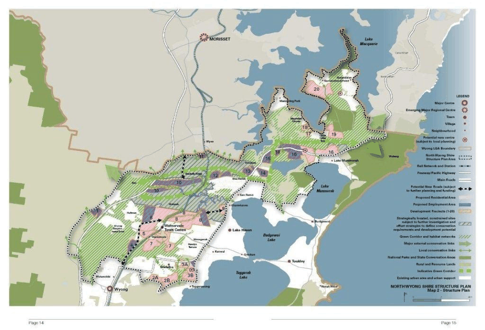

#### 5.47.3 MAKING DEVELOPMENT APPLICATIONS

#### 5.47.3.1 Information Required to Accompany Development Applications

a When this Chapter applies, additional environmental information may be required to be submitted to allow Council to properly assess the application.

b All proposals will be assessed to ensure consistency with the environmental performance criteria outlined in Section 2.2.

c Development applications for sites within or adjoining "Green Corridor, habitat network or conservation links", must demonstrate consistency with the objectives and requirements of Section 2.2 of this Chapter.

d Developments in areas shown as "Green Corridor, habitat network or conservation links", require careful consideration by Council to ensure that natural values are retained and enhanced. Management and approvals over this area requires a high level of attention to detail.  As a result development applications can be complex and may have substantial information requirements.  It is recommended that owners/developers consult with Council before finalising development applications or rezonings if they are proposed in any area shown as "Green Corridor, habitat network or conservation links".

e Any development application within "Green Corridor, habitat network or conservation links” must be submitted with an Ecological Report. The information requirements, for every application will be different.  Each site has its own characteristics and no two development proposals are identical.  The requirements for preparing an Ecological Report are outlined by Council’s Flora and Fauna Guidelines for Development.

f An Ecological Report is a document that details what plants and animals (flora and fauna) and ecological communities occur or are likely to occur in a particular locality, the effects that a development proposal may have on them and recommendations to minimise the impacts. They are also known as Flora and Fauna Reports, Threatened Species Reports or Biodiversity Assessment Reports. They can be stand-alone documents or they can be integrated into more complex reports that may be required under relevant legislation including Environmental Impact Statements (EISs) and Species Impact Statements (SISs).

g All proposals will be assessed to ensure consistency with the environmental performance criteria outlined in Part 3.  The information contained in an Ecological Report needs to address the specific objectives and requirements to ensure that Council can make the decisions outlined in Section 3.

#### 5.47.3.1.1 Proposal Objectives and Alternatives

a The relationship of a development or an activity to the objectives provided in Section 1.1 of this plan and the specific environmental performance criteria outlined in Section 2.2.

b An analysis of any feasible alternatives to the proposed development or alternatives to the site, having regard to its objectives, including an explanation of reasons justifying the carrying out of the development, and the consequences of not carrying out the development

#### 5.47.3.1.2 Description of Site and Locality

a A site survey showing all natural features such as landform (contours), natural features (creeks, gullies, trees and other bushland), existing structures, land uses, access points, fences and roads.

b A locality map showing significant features in the surrounding area e.g. creeks that the land drains to, adjoining vegetation or known threatened species habitat, and wildlife corridors that run through the land.

c A site analysis:

i addressing slope, access, aspect, prevailing winds, fire hazard, conservation values, natural features and drainage; and

ii identifying preferred sites for development and the management issues that will need to be addressed.

#### 5.47.3.1.3 A Description of the Proposed Development

a Plans showing the elevations and location of all proposed structures plus roads, driveways, and other proposed uses of the land.

b All proposed associated works such as drainage, water and sewerage, electricity, landscaping, earthmoving or fill, asset protection zones.

#### 5.47.3.1.4 Environmental Impact Assessment

a An assessment is required of the direct and indirect impacts of all proposals and remedial measures needed to mitigate those impacts. The assessment is to include the following information, where relevant to the proposal:

i the size of the areas (in m2 or ha) proposed to be cleared or modified in any way by the proposal and distance (in metres) to nearby remnant patches of vegetation shall be provided;

ii a report describing the flora, fish, amphibians, reptiles, birds (both indigenous and migratory), and mammals (including bats) which occur or have the potential to occur in the study area and the occurrence of any organism listed under the Biodiversity Conservation Act, 2016, Environmental Protection and Biodiversity Conservation Act, 1999 or Fisheries Management Act, 1994 (if relevant) or any species which is known to have local, regional, state or national conservation significance;

iii detailed vegetation community descriptions and mapping for the study area;

iv an assessment of the habitat and corridor roles of vegetation where it is to be cleared, modified or affected by development. Factors to be examined include:

▪ species which are likely to utilise vegetation in the corridor for dispersal;

▪ habitat quality and food resource availability; and

▪ the restoration potential and requirements of degraded areas of vegetation.

v details of the disturbance history of the site (how long has the period of any disturbance been occurring and what form has this taken e.g. grazing, clearing of understorey, mowing, tree removal);

vi the hydrological conditions that exist on the site and whether the land has a direct association with plant communities that are reliant on the maintenance of existing hydrological conditions. All ecosystems are sensitive to hydrological modifications but wetlands, riparian and drainage line vegetation are the most sensitive;

vii assessment of the amenity values and cultural significance of land is required. Relevant factors include:

▪ Does the land provide a link between existing public reserve, parcel of land owned by a government authority or area of public open space?

▪ Does the land contain, or provide a context or setting for, a heritage item, Aboriginal landscape or site?

#### 5.47.3.1.5 Management and Offsetting

a Outline land management and monitoring actions proposed to be taken to reduce actual and potential impacts to vegetation, fauna, water quality and hydrological regime during the construction and operational stages of the proposed development (e.g. weed control, replanting, collection and propagation of native seed stock, creek line rehabilitation, fencing off habitat with significant conservation values)

b Should the development proposal involve the establishment of permanent conservation offsets, a copy of the Biobanking Agreement, Biocertification Documentation, or Property Vegetation Plan is to be submitted.

### APPENDIX A - RELEVANT LEGISLATION, PLANNING INSTRUMENTS AND POLICIES

#### Federal Government Legislation

▪ Environmental Protection and Biodiversity Conservation Act, 1999 – Identifies eight matters of national environmental significance, including world heritage properties, national heritage places, wetlands of international importance, nationally listed threatened species and ecological communities, migratory species, Commonwealth marine areas, The Great Barrier Reef Marine Park, and nuclear actions, and requires an environmental assessment and approval for actions that have, or are likely to have a significant impact on such matters

#### NSW Government Legislation

In addition to the requirements of the Environmental Planning and Assessment Act, 1979 other legislation is relevant to the development of land containing natural assets and may require licences or other approvals in addition to a development consent from Council.  Applicants should consult with relevant agencies prior to lodgement of a Development Application in relation to the following legislation:

▪ Biodiversity Conservation Act 2016 (NSW Office of Environment and Heritage)

▪ Local Land Services Amendment Act 2016 (NSW Local Land Services and NSW Department of Primary Industries) applies to proposals to clear land outside urban and environmental zones.

▪ National Parks and Wildlife Act, 1974 (NSW Office of Environment and Heritage) - requires a permit to remove, damage, destroy or otherwise alter threatened species, populations or ecological communities, protected species or Aboriginal sites

▪ Protection of the Environment Operations Act, 1997 (NSW Office of Environment and Heritage) - Provides for comprehensive control over polluting activities and includes air, water, noise and land pollution

▪ Heritage Act, 1977 (NSW Office of Environment and Heritage) - Controls development which may impact on identified heritage items by requiring the consent of the NSW Heritage Office

▪ Fisheries Management Act, 1994 (NSW Department of Industry and Investment - Fisheries) - Includes provisions similar to the Threatened Species Conservation Act in relation to the protection of aquatic species

▪ Water Management Act, 2000 (NSW Office of Water) – Provides for the sustainable and integrated management of water resources.  Part 3 requires approval from the Office of Water to carry out a controlled activity in, on or under water front land.  Approval is also required to carry out an activity that interferes with an aquifer under Part 5 of the Water Act, 1912

#### State Environmental Planning Policies (SEPPs)

▪ State Environmental Planning Policy (Resilience and Hazards) 2021

▪ State Environmental Planning Policy (Biodiversity and Conservation) 2021.

#### Local Environmental Plan

▪ Central Coast Local Environmental Plan 2022

#### Local Policies and Guidelines

▪ Central Coast Council DCP 2022: Chapter 3.5 – Tree and Vegetation Management

▪ Central Coast Council DCP 2022: Chapter 3.6 – Heritage Conservation

▪ Central Coast Council Flora and Fauna Guidelines for Development

▪ Interim Ecological Assessment Information Required to Assess Clearing Impacts within Squirrel Glider Habitat within Central Coast Council LGA.

▪ Interim Survey Guidelines for Ground Orchids which are listed under the Threatened Species Conservation Act, 1995 in Central Coast Council LGA.

### APPENDIX B CONSERVATION AREAS FOR NORTH WYONG

> [Picture on page 12: a picture, saved as a picture (images/ch-05-47-northern-conservation-areas-page-12-2.gif, 150 dpi).]

#### Figure 1 North Wyong Shire Structure Plan, October, 2012

Note; Refer to the North Wyong Shire Structure Plan for more detail
