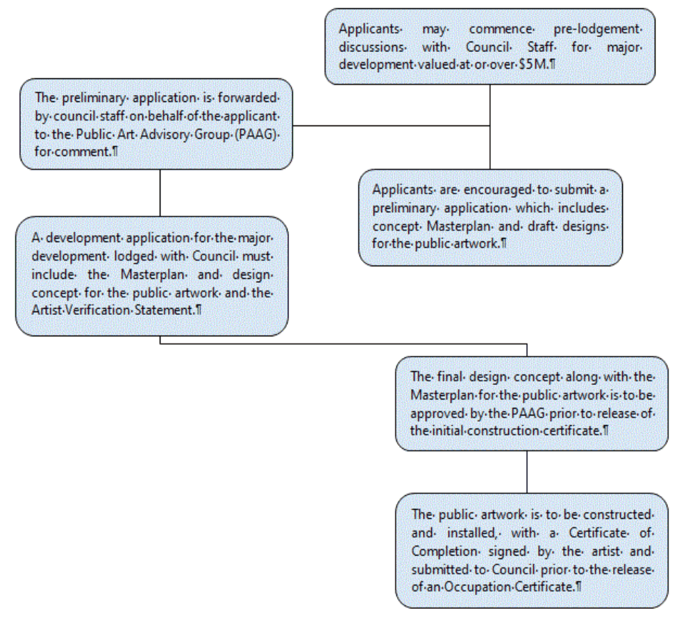

#### 5.48.2.1 Development Requirements

#### 5.48.2.1.1 Major Development

a Major developments valued at $5M or greater must implement public art as part of the development with a minimum of 1% of the total cost of the development to be designated to the public art budget. Funds toward the Public Art Budget remain part of the Proponents overall development budget for the engagement by the proponent of the artist and public art coordinator or verified project manager to undertake planning, design, development and management of a public artwork. Developments valued at $5M or more will therefore require a minimum of $50,000 to be utilised for public artwork.

b The public artwork is to be generally located within the curtilage of the development site proposed for the major development except where the proponent has entered into a mutual agreement with Council to provide the public artwork on public land, and where the provision of public art on public land is consistent with the requirements of this Chapter.

c Applicants must engage a Public Art Coordinator or verified project manager responsible for the planning, management and reporting of the public art.

d Consultation and pre-lodgement discussions with Council staff are recommended to ensure that any issues are resolved at the earliest date possible. These pre-lodgement discussions can also assist by verifying the qualifications of the project manager who may not be pre-approved on the Council register for public art coordinators.

#### 5.48.2.1.2 Provisions for Mixed-Use Development

Where any commercial, public administration, and/or retail portion of a mixed-use development exceeds $5M the requirements of this Chapter shall apply.

#### 5.48.2.1.3 Preliminary Application Requirements

The applicant is encouraged to submit a preliminary application for the public art component of the major development prior to lodgement of a development application. Preliminary applications for major developments should include the following:

a Identification of the public art coordinator or verified project manager;

b Preliminary schematics for the public artwork which can include sketches, montages, digital renditions or other suitable concept schematics;

c The anticipated public art budget and necessary quotations; and

d A preliminary description of the proposed public artwork including potential materials to be used and a brief explanation as to the intention of the artwork and sensitivity to existing urban design qualities.

#### 5.48.2.1.4 Development Application Requirements

a Development applications for major developments are required to include the following:

i identification of the public art coordinator or verified project manager;

ii a description of the proposed public artwork including materials to be used;

iii The location of the artwork within the subject site and dimension details (height, width etc.);

iv justification as to how the proposed artwork satisfies section 5.48.3.1 of this Chapter; and

v a description as to how the proposed artwork integrates into the site and surrounds, the development intention of the artwork and sensitivity to existing urban design qualities.

b Where development is located in an area of natural, cultural, or economic significance, the applicant must demonstrate how the public artwork is responsive to these attributes.

c Where development is located within an identified gateway or key site under any other chapter of this DCP the public artwork should be consistent with the objectives and design themes of the relevant DCP Chapter. The applicant is to demonstrate how this is achieved.

d Research and consultation documentation undertaken throughout the concept development process for the artwork.

e The anticipated public art budget and necessary quotations.

f An Artist Verification Statement which provides evidence that the artist has viewed all documentation to be submitted as part of the development application and is satisfied that the submitted documentation is consistent with the final design concept of the artwork.

g The design concept along with the Masterplan for the public artwork is to be submitted as part of the development application and referred through the PAAG process – refer to the former Wyong Shire Council PAAG Operational Framework available on Council’s website for a detailed outline of the PAAG process.

h The final design concept must be approved by the PAAG prior to issue of the initial Construction Certificate for the major development.

i The public artwork is to be constructed and installed prior to release of an Occupation Certificate for the major development.

j A Certificate of Completion is to be signed by the artist and submitted to Council prior to the release of an Occupation Certificate for the major development.

#### 5.48.2.1.5 Public Art Budget

a The Public Art Budget includes the total financial allocation towards a public artwork. This can include all pre-lodgement investigations, design advice, community engagement, coordination costs, artist fees, cost of material, and construction costs but excludes the cost of land where upon the public artwork is located.

b Public Art can be incorporated into the design features of a building. The finances allocated toward the construction of a building can be included into the public art budget if this component is demonstrated to be public art. The artwork may serve a dual role of providing effective public domain services such as lighting or shading, provided the work is consistent with the objectives and definitions of this Chapter and its appendices. Council will exercise discretion as the determining authority in regards to whether the design concepts proposed as ‘public artwork’ satisfy the requirements contained within this Chapter.

#### 5.48.2.1.6 Procedure for Including Public Artwork within Major Development

> [Picture on page 7: a picture, saved as a picture (images/ch-05-48-northern-areas-public-art-page-7-2.gif, 150 dpi).]

#### Figure 1 Procedure for installing public artwork
