#### 5.48.3 PUBLIC ART CONCEPTUAL CONSIDERATIONS

#### 5.48.3.1 Conceptual Relevance to the former Wyong Shire LGA

High quality public art has the potential to contribute to the daily experiences of residents and visitors through the interpretation of local culture and heritage, and other social and environmental factors. The conceptual considerations listed below are largely informed by the Policy and Implementation Plan for Public Art 2013, a policy document which underpins this Chapter.

To ensure public art is effectively integrated into its context, the concept and design of proposed artworks must consider, where relevant, the following:

a history - the many layers of history and contemporary culture which make any location or place within the Shire rich with content;

b culture - modern society and its wide-ranging impacts on how different social and cultural groups within the Shire understand their place in the world;

c environment - the qualities of coastal and hinterland landscape, natural light, topography and local flora and fauna within the locality;

d urban form - existing urban character and desired future character of the area as well as site specific characteristics;

e sustainability - the increasing role of government and community in the movement toward a sustainable future.

### APPENDIX A PHOTOGRAPHIC EXAMPLES

The following photographic examples of Public Artworks are indicative of different public art typologies which have been successfully developed in response to a specific site. These examples must be taken as indicative only and are not to be used as exact requirements or reproduced in any way. While the examples provided here do not cover the breadth of artwork potentially available for use within major developments, the following photos demonstrate how effective public art can enhance an area and streetscape

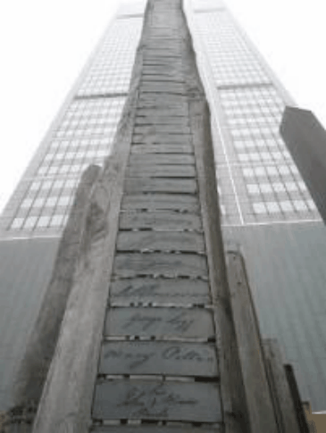

> [Picture on page 9: a picture, saved as a picture (images/ch-05-48-northern-areas-public-art-page-9-7.gif, 150 dpi).]

### Multi-media Installation

Commissioning Body:  Museum of Sydney

Artist:  Fiona Foley and Janet Laurence

A site-specific piece commissioned for the forecourt of the Museum of Sydney at its opening in 1995. The installation includes 29 sandstone pillars, and wood and steel materials which are arranged as a walk-through installation and entrance statement to the museum.

The pillars symbolise the 29 Aboriginal clans from around Sydney and include wooden pillars from trees once grown in the area which have been recycled from demolished industrial buildings within Sydney. The work is an example of how public art can provide meaning by connecting modern localities to their cultural heritage.

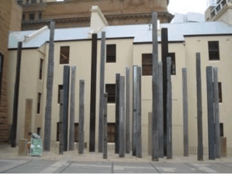

> [Picture on page 9: a picture, saved as a picture (images/ch-05-48-northern-areas-public-art-page-9-24.gif, 150 dpi).]

#### Figure 1 ‘The Edge of Trees’

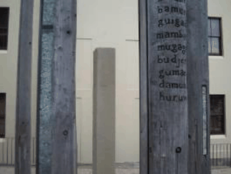

> [Picture on page 9: a picture, saved as a picture (images/ch-05-48-northern-areas-public-art-page-9-26.gif, 150 dpi).]

#### Figure 2 ‘The Edge of Trees’

#### Figure 3 ‘The Edge of Trees’

### Ceramic Mural

Commissioning Body:   Marrickville City Council

Artist:  Luis Geraldes

This mural was commissioned for placement opposite a Petersham café and restaurant strip frequented by many residents of migrant heritage, especially Portuguese.  The mural was commissioned to commemorate the visit in 2002 to Marrickville of the Portuguese President and provides a definite identity to the street and

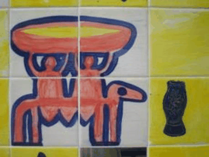

> [Picture on page 10: a picture, saved as a picture (images/ch-05-48-northern-areas-public-art-page-10-7.gif, 150 dpi).]

is viewable from the shops opposite (see Figure 7).

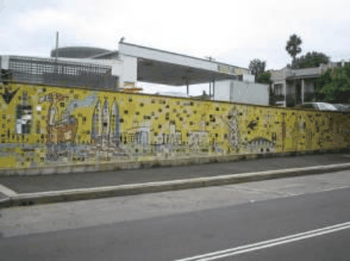

> [Picture on page 10: a picture, saved as a picture (images/ch-05-48-northern-areas-public-art-page-10-9.gif, 150 dpi).]

#### Figure 8 Ceramic mural

#### Figure 5 Ceramic mural

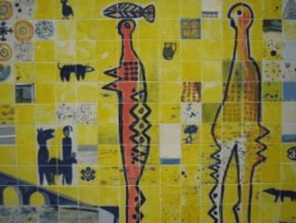

> [Picture on page 10: a picture, saved as a picture (images/ch-05-48-northern-areas-public-art-page-10-12.gif, 150 dpi).]

#### Figure 6 Ceramic mural

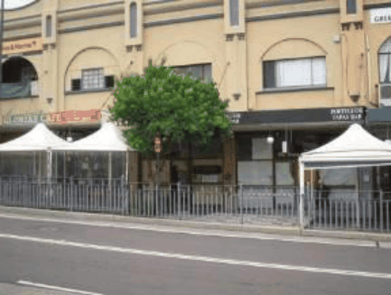

> [Picture on page 10: a picture, saved as a picture (images/ch-05-48-northern-areas-public-art-page-10-14.gif, 150 dpi).]

#### Figure 7 Shop front opposite ceramic

mural

### Custom Streetscape Fencing

Commissioning Body:  Unknown

Artist:  Unknown

Located along a restaurant and café strip and opposite the beach at Brighton Le-Sands, Sydney, this work sets the theme of food, eating and enjoyment, providing a less formal boundary between the footpath and road for pedestrians and motorists. It marks the area as a unique place and destination and as a place to

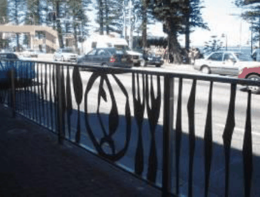

> [Picture on page 11: a picture, saved as a picture (images/ch-05-48-northern-areas-public-art-page-11-7.gif, 150 dpi).]

remember.

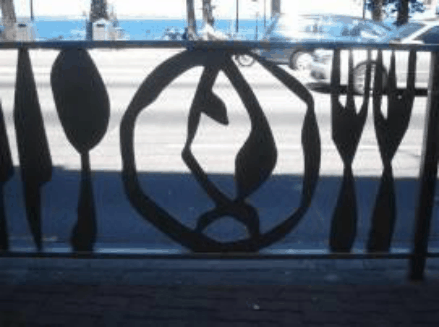

> [Picture on page 11: a picture, saved as a picture (images/ch-05-48-northern-areas-public-art-page-11-9.gif, 150 dpi).]

#### Figure 9 Streetscape custom fencing

#### Figure 10 Streetscape custom fencing

### Integrated Custom Pathway

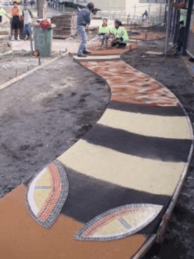

> [Picture on page 11: a picture, saved as a picture (images/ch-05-48-northern-areas-public-art-page-11-13.gif, 150 dpi).]

Commissioning Body:  Wyong Shire Council

Artist:  Margrete Erling

Pavement artwork for forecourt area at Gravity Youth Centre, Lake Haven,. This artwork provides an example of how public art can be integrated into a site and perform a dual role for the development.

#### Figure 11 Integrated custom pathway

### Heritage Installation / Gateway

Commissioning Body:  City of Canterbury

Artist:  Unknown

As part of the City of Canterbury Heritage Program an unknown artist was commissioned to develop public art at Mary McKillop Reserve. The works resulted in the creation of an entranceway and resting place utilising custom designed components and interpretive signage, establishing the name and theme for a reserve whilst also being part of a ‘heritage walk’.

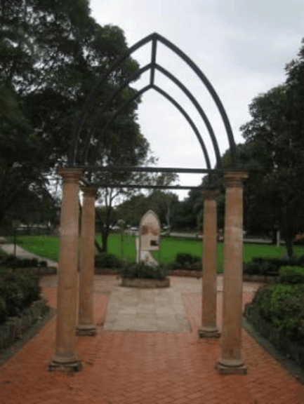

> [Picture on page 12: a picture, saved as a picture (images/ch-05-48-northern-areas-public-art-page-12-11.gif, 150 dpi).]

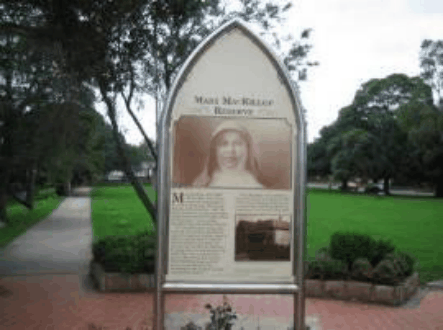

> [Picture on page 12: a picture, saved as a picture (images/ch-05-48-northern-areas-public-art-page-12-12.gif, 150 dpi).]

#### Figure 12 Heritage installation / gateway

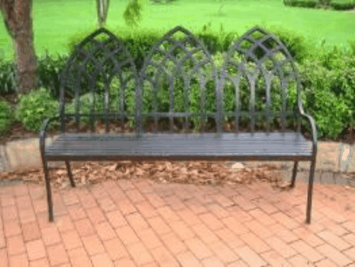

> [Picture on page 12: a picture, saved as a picture (images/ch-05-48-northern-areas-public-art-page-12-14.gif, 150 dpi).]

#### Figure 14 Heritage installation / gateway

#### Figure 13 Heritage installation / gateway

### Façade Treatment

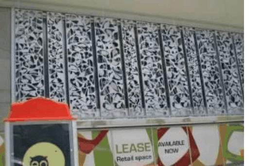

> [Picture on page 13: a picture, saved as a picture (images/ch-05-48-northern-areas-public-art-page-13-2.gif, 150 dpi).]

Commissioning Body:  Unknown

Artist:  Unknown

Façade treatments provide an opportunity to integrate public art as an architectural feature of a development which offers visual interest to a site. Treatments can also function as a street corridor which affords a unique identity to the streetscape and provides diversity in built form.

#### Figure 15 Façade treatment

### Custom Designed Utilities

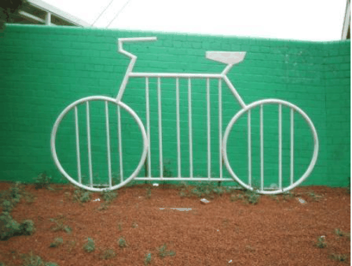

> [Picture on page 13: a picture, saved as a picture (images/ch-05-48-northern-areas-public-art-page-13-13.gif, 150 dpi).]

Commissioning Body:  Unknown

Artist:  Unknown

This bicycle stand at Canterbury Station provides a creative solution to a functional community utility.

#### Figure 16 Custom designed utility

### Single Sculpture

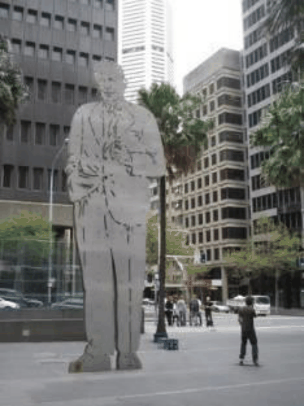

> [Picture on page 14: a picture, saved as a picture (images/ch-05-48-northern-areas-public-art-page-14-2.gif, 150 dpi).]

Commissioning Body:  City of Sydney

Artist:  Simeon Nelson

A sculpture located at Chifley Tower Forecourt, constructed in 1997.  The work provides an example of how public art can adequately integrate with the character of a locality; the sculpture provides a marker that is representative of the business, commerce and political heritage themes within the area.

#### Figure 17 Single sculpture

### Interactive Sculpture

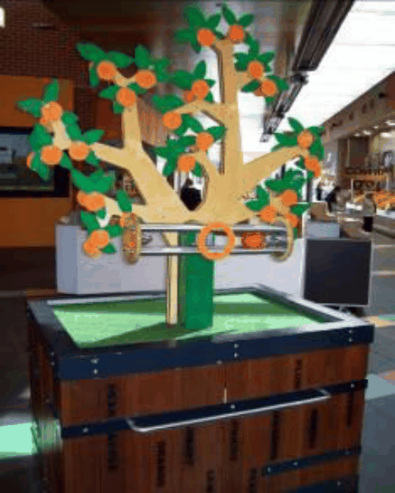

> [Picture on page 14: a picture, saved as a picture (images/ch-05-48-northern-areas-public-art-page-14-14.gif, 150 dpi).]

Commissioning Body:  GPT

Artist:  Unknown

An interactive educational experience for visitors and residents.  The artwork has been themed on the area’s local heritage of market gardens.

#### Figure 18 Interactive sculpture

### Artist and Resident Collaboration

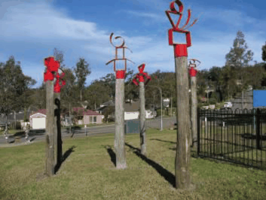

> [Picture on page 15: a picture, saved as a picture (images/ch-05-48-northern-areas-public-art-page-15-2.gif, 150 dpi).]

Commissioning Body:  Wyong Shire Council

Artist:  Vicki Sienczuk

Building frontage markers developed through a collaborative process involving a professional artist and local community members at Woodbury Park Community Centre, Mardi.

#### Figure 19 Artist and resident

collaboration

### Custom Designed Garden-Bed Retainer

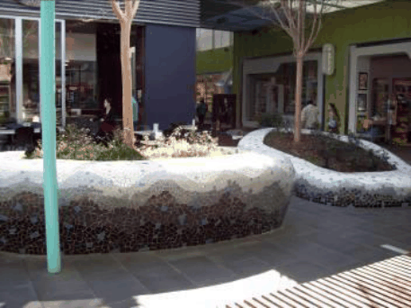

> [Picture on page 15: a picture, saved as a picture (images/ch-05-48-northern-areas-public-art-page-15-12.gif, 150 dpi).]

Commissioning Body:  GPT

Artist:  Unknown

Mosaic garden-bed retainers located within Rouse Hill Town Centre. These custom designed structures have been integrated into a plaza area to create a distinct sense of place whilst also functioning as space dividers and alternate seating.

#### Figure 20 Custom designed garden-bed

retainer

### Mural Graphic

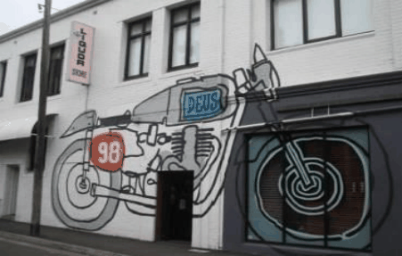

> [Picture on page 15: a picture, saved as a picture (images/ch-05-48-northern-areas-public-art-page-15-24.gif, 150 dpi).]

Artist:  Unknown

A large scale painted mural on a business premises provides visual interest and graphically communicates the use of the building as a bike enthusiast’s café and shop.

#### Figure 21 Mural graphic

Commissioning Body:  Unknown
