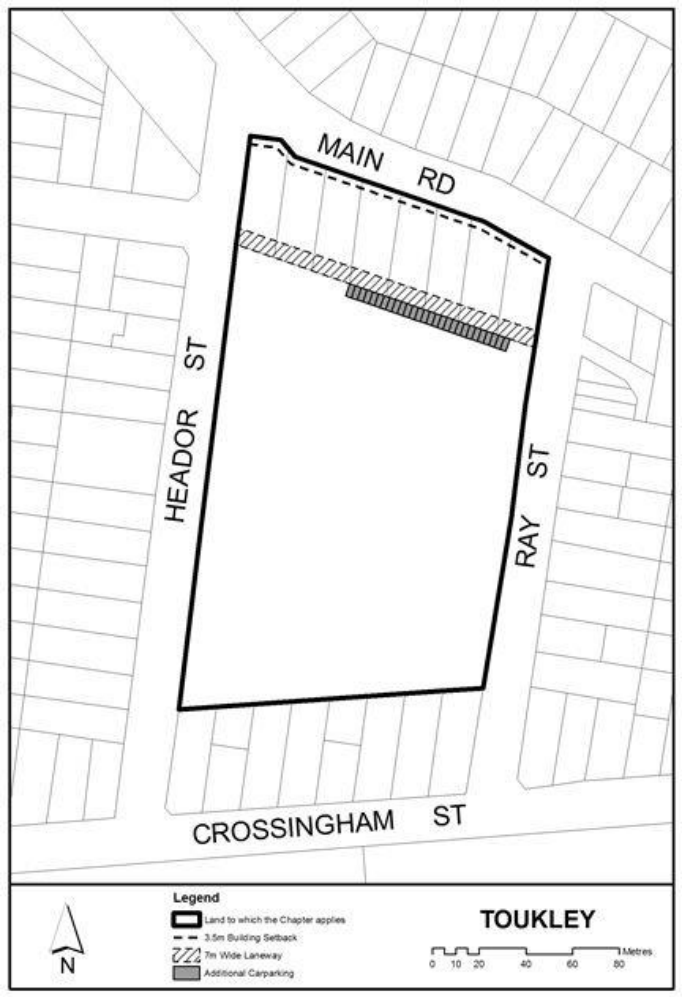

#### Chapter 5.50 East Toukley Main Road Commercial

### CHAPTER 5.50 EAST TOUKLEY – MAIN ROAD

### COMMERCIAL

#### 5.50.1 INTRODUCTION

The purpose of this Chapter is to provide planning and traffic strategies that facilitate development for business purposes in the land at East Toukley to which this Chapter applies.

#### 5.50.1.1 Land to which this Chapter Applies

This Chapter applies to Lots 87 to 93 DP 20482, Lot 94 DP 656653 Main Road, Toukley and Lot 314 DP 21154

> [Picture on page 1: a picture, saved as a picture (images/ch-05-50-east-toukley-main-road-commercial-page-1-11.gif, 150 dpi).]

Ray Street, Toukley.

Figure 1 Land in East Toukley to which this Chapter applies and the proposed laneway

Central Coast Development Control Plan 2022

Part 5

Location Specific Development Controls
