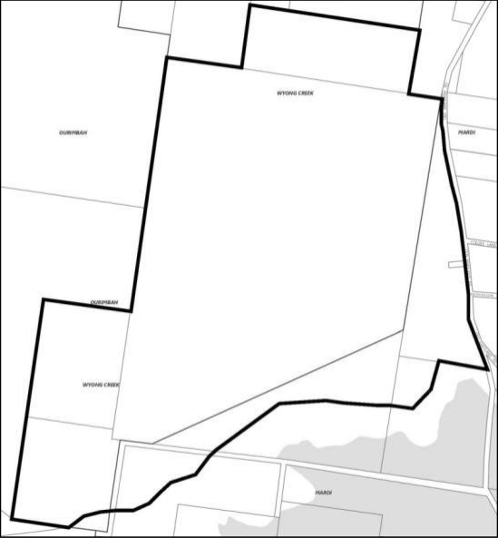

#### 5.51.1.2 Land to which this Chapter Applies

This Chapter applies to land as shown edged heavy black in Figure 1.

> [Picture on page 1: a picture, saved as a picture (images/ch-05-51-mardi-rural-residential-development-page-1-14.gif, 150 dpi).]

#### Figure 1 Land to which this Chapter applies (not to scale)
