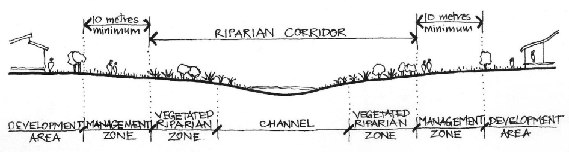
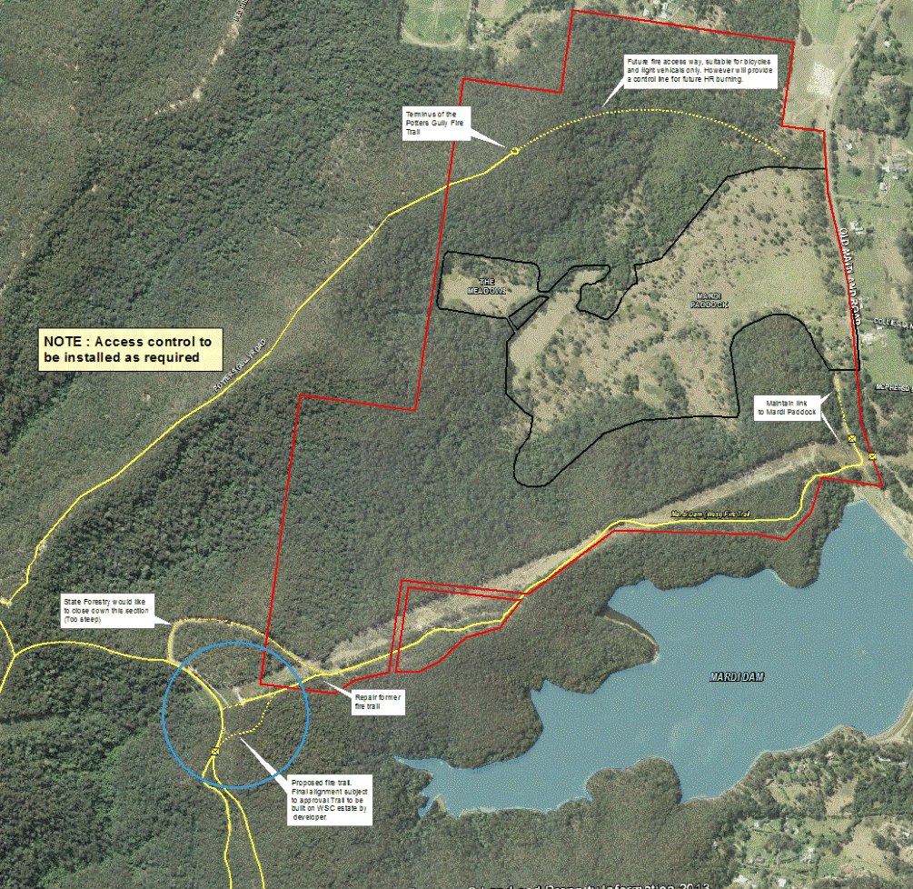

#### 5.51.2.9 Bushfire Management

#### OBJECTIVES

▪ To minimise the risk of adverse impact of bushfires on life, property and the environment.

▪ To ensure that development in bushfire prone areas is accessible by emergency services at all times.

▪ To enable appropriate bushfire protection without unreasonably compromising the biodiversity and landscape values of the area.

▪ To implement an ongoing maintenance regime to manage surrounding vegetation and asset protection zones to reduce possible bushfire risks and protect development.

#### REQUIREMENTS

a Any application for subdivision of the subject site is to be accompanied by the relevant requirements set out within any Voluntary Planning Agreement relating to or affecting the land.

b Any application for subdivision is to include a Bushfire Risk Management plan. The plan is be consistent with the provisions and requirements of the following:

i Planning for Bushfire Protection (PBP) 2019;

ii Australian Standard 3959:2009 (as updated); and

iii Chapter 2.4: Subdivision of this DCP.

c Any riparian corridor on the subject land is to provide for adjoining bushfire management zones to be retained in the ownership of the Community Association. The zones must provide for a minimum 10m bushfire management zone, generally in accordance with Figure 2. The purpose of such zones is to provide protection against possible bushfire risks from vegetation within the riparian corridor.  The management of such zones is to be documented within the Bushfire Risk Management Plan.

> [Picture on page 15: a picture, saved as a picture (images/ch-05-51-mardi-rural-residential-development-page-15-26.gif, 150 dpi).]

#### Figure 2 Generalised riparian corridor cross section

d The Bushfire Risk Management Plan is to incorporate the following minimum requirements:

i Identification and details of proposed points of access to the site for emergency access and point of egress both during construction and occupation.

ii Provide for a fire trail, constructed in accordance with the Council’s  ‘Fire and Land Management Trail Construction Guidelines’ wholly within the subject site, adjacent to that land which incorporates Mardi Dam, located as generally indicated in Figure 3;

iii Identify any necessary upgrades and approval requirements to the Potters Gully Fire Trail, located as generally indicated in Figure 3, for the trail to meet the relevant performance criteria for fire trails as prescribed by PBP 2019;

iv Specification of the management regimes to ensure the ongoing maintenance of fire trails to a reasonable standard (where they are located on the subject land) that will be undertaken by, and the responsibility of, the future Owners’ Association.

v Specification of the management regimes to ensure the ongoing maintenance of any APZs to a reasonable standard. Any perimeter APZs will be the responsibility of the future Owners’ Association.  The developer must undertake any maintenance and/or management of any Fire Trails and APZs until such time as the Owners Association has been established, operational and/or has sufficient capital to undertake this requirement.

vi Identification of the requirements for the provision, construction, maintenance and/or management of fire trails and/or APZs. Such requirements are to be registered on the title of the land.

e Any application for subdivision must provide for an APZ around the perimeter of the central and western development area within the R5 Large Lot Residential zone.

f The perimeter road must be two-way with a minimum carriageway width of eight (8) metres, exclusive of any APZ requirements or on-street parking areas. Perimeter road designs are to ensure that any on-street parking does not obstruct the minimum carriageway width, in accordance with section 4.1.3(1) of PBP 2019.

g Two vehicular access links to the western development area (as zoned R5 Large Lot Residential) are to be provided to create an effective perimeter road for APZ purposes for development in this locality.

h All APZs must enable dwellings to achieve a deemed to satisfy Bushfire Attack Level (BAL) rating under Australian Standard AS3959 Construction of buildings in bushfire prone areas, not exceeding BAL 29.

i APZs are not to be located on slopes greater than 18 degrees.

j All allotments are to incorporate nominated building envelopes, to be registered on title, which comply with the above requirements.

> [Picture on page 17: a picture, saved as a picture (images/ch-05-51-mardi-rural-residential-development-page-17-1.gif, 150 dpi).]

Figure 3 Generalised Location of Fire Trails (not to scale) (Source: Travers Consulting 2016)
