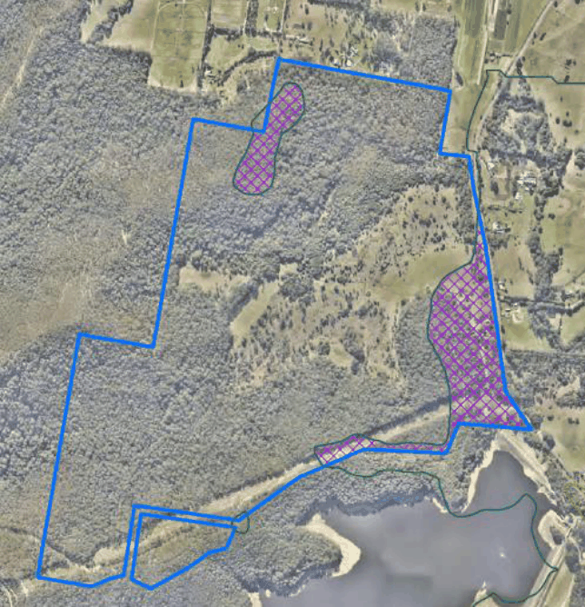
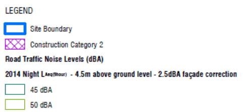

#### 5.51.2.12 Odour, Noise & Acoustics

#### OBJECTIVES

▪ To manage land use conflicts that may arise due to neighbouring turf farms and agricultural operations.

▪ To ensure that traffic noise impacts on adjoining land holdings arising from the development and occupation of the subject land are minimised.

▪ To mitigate traffic noise impacts on future residential dwellings on the subject land arising from the

M1 Motorway.

#### REQUIREMENTS

a Any habitable or public buildings or places must be located at a distance no less than 100m from any operational turf farm or adjoining agricultural land use.

b Vegetative screens should be utilised in areas identified for habitable or public buildings or places in areas adjoining any operational turf farm or adjoining agricultural land use to assist to capture wind-blown dust and/or chemical particles.

c Any application seeking subdivision of the land must demonstrate compliance with noise assessment criteria detailed in Table 3 (Road traffic noise assessment criteria for residential land

uses) of the NSW Road Noise Policy.  This demonstration must undertake cumulative assessments for each proposed stage of the subdivision and must be undertaken in accordance with the provisions of Appendix B of the NSW Road Noise Policy.

d Any residential dwellings located within 60m of the Old Maitland Road frontage must be of a construction standard which is in accordance with Category 3 of AS 3671-1989 (Acoustics: road traffic noise intrusion – Building siting and construction)

e Any other residential dwellings located beyond 60m of Old Maitland Road and located in areas hatched purple in the figure 3 below must be of a construction standard which is in accordance with Category 2 of AS 3671-1989 (Acoustics: road traffic noise intrusion – Building siting and construction).

f For all other areas, the following general design considerations should apply:

▪ Dwellings are to be located as far as possible from the traffic noise source.

▪ The size and number of windows facing the traffic noise source are to be minimised.

▪ Noise insensitive areas such as the kitchen, storage areas and laundry should be located toward the traffic noise source.

▪ Construction techniques that focus on sealing gaps around windows, doors, ceiling spaces, etc. are to be utilised

▪ Thick glass or double glazing should be utilised.

▪ Solid core doors and appropriate door seals should be used.

> [Picture on page 19: a picture, saved as a picture (images/ch-05-51-mardi-rural-residential-development-page-19-10.gif, 150 dpi).]

> [Picture on page 19: a picture, saved as a picture (images/ch-05-51-mardi-rural-residential-development-page-19-11.gif, 150 dpi).]

Figure 3 Areas subject to additional acoustic construction standards (Source: SLR 2014)

### APPENDIX A

| Ecological Feature | Implications of Development | Recommendations |
|---|---|---|
| Native vegetation including trees | Clearing or disturbance of generally disturbed native vegetation from several plant communities. | The primary mechanism to offset the losses of native vegetation including EECs is to reserve and protect adequate areas of the non-developed areas of vegetation in the study area. At a minimum, standard management measures (according to the BioBanking methodology) should be applied within those areas. Ideally, locate services infrastructure such as roads and utilities in and through areas that are already cleared and highly degraded. Individual building pads should similarly be located in disturbed areas of lower ecological value. Clusters of native trees and shrubs that are currently included in the clearing calculations (Figures 3 and 4) could be retained to the extent that bushfire asset protection is not compromised, thus reducing the biobanking ecosystem credit deficit for the floodplain communities. Where avoidance is not feasible, minimise impacts to native vegetation by storing soil/fill, fuel, other materials or machinery within the existing clearings and only removing vegetation that is required for the actual subdivision and associated services. Trim branches rather than removing trees for access where possible. Designate areas outside of native vegetation in a construction environmental management plan for storage of soil/fill, fuel, other materials, machinery and vehicular access. |
| Introduction or spread of plant pathogens | Potential for introduction and /or spread of root or leaf fungal pathogens (root rot or myrtle rust) resulting from the clearing, soil filling, construction, landscaping and revegetation works. | During vegetation clearing and construction, ensure that a protocol is in place to minimise the risk of importation to the site of root-rot fungus (Phytophthora cinnamomi) or myrtle rust via the transport of contaminated soil on machinery or footwear, any importation of contaminated soil for fill, or myrtle rust spores in imported plant material or on clothing. These protocols should follow recognised guidelines (such as those set out by OEH). Where possible, machinery and footwear should be free of soil or washed clean and free of any soil before arriving on site. Any soil imported onto the site for fill should be sourced from root-rot fungus free areas or certified to be free of the pathogen. Ensure excavated soil is not distributed around the study area and that all machinery and equipment is washed and free of soil before being moved offsite. Ensure that any nursery stock imported into the site for planting from the family Myrtaceae (mainly eucalypts, callistemons, melaleucas and leptospermums) are certified free of myrtle rust. |
| Biconvex Paperbark | Removal of a portion of the local population of | Design the subdivision layout such that as much of the Biconvex Paperbark habitat as possible can be retained and protected within the larger lots. |

| Ecological Feature | Implications of Development | Recommendations |
|---|---|---|
| Melaleuca biconvexa | Melaleuca biconvexa or indirect disturbance to adjoining retained patches. | Designate No Go Zones consisting ideally of 5m buffers immediately adjoining the edges of mapped occurrences of the species to be retained (Figure 4). Fence these buffers to avoid accidental intrusions into retained habitat by machinery. The No Go Zone is to be implemented for the construction phase of the proposal and be shown clearly on construction environmental management plans. No access is allowed into No Go Zones during construction. No fuel, machinery or other equipment, material or soil is to be stored in No Go Zones. Indicate these zones clearly on site maps showing the mapped extent of retained patches of the species and ensure that construction personnel are fully aware of the presence and locations of retained patches of the species before site work commences. Implement hydrological and runoff controls in the vicinity of the retained patches of the species to ensure that any changes in hydrology or groundwater due to nearby fill placement or water management works are minimal. Monitor the abundance and health of retained patches of the species as part of the Biodiversity Management Plan. |
| Riparian and aquatic areas | Potential contamination of downstream aquatic environments within Deep Creek and associated drainage lines traversing the central portion of the R5 zone within the site Removal or disturbance to native flora and fauna habitat within riparian areas. | Identify riparian and aquatic areas of highest ecological value along the creek and develop measures to protect these values as far as possible within the Biodiversity Management Plan. Key areas occur at the eastern end of the rainforest community and the eastern end of the paperbark community. These should be delineated on a map within the plan. Wherever possible, minimise disturbances to native vegetation and soil disturbances within or adjacent to riparian areas along the creek and major drainage lines. Install current best practice sediment control measures downstream of any works involving soil disturbance or placing of fill prior to the commencement of works. Design any new detention basins or dams to provide aquatic fauna habitat (see below) |
| Noxious and Environmental Weeds | Potential spread of noxious and environmental weeds as a result of the proposed works: Bitou Bush, Lantana, Privet, Camphor Laurel, exotic grasses, escaped garden plants. | Control noxious weeds in the study area according to the legal requirements set out in section 3.7. For all noxious and environmental weeds, refer to local and regional control plans and measures as provided by Wyong Shire Council, and the DPI Guidelines for individual species. Note that since some native fauna species are reliant on dense understorey vegetation it is important to not clear weed species in a manner that opens up the understorey too dramatically, without replacing the shrub layer first. (i.e. cut lantana branches left in place until other shrub species are established). |

| Ecological Feature | Implications of Development | Recommendations A weed management strategy should be included as part of the Biodiversity Management Plan that addresses control and management of noxious and environmental weeds, with particular emphasis on separate removal and disposal of vegetation containing bitou bush. Other considerations specific to particular species, particularly lantana, blackberry, exotic perennial grasses and camphor laurel should be included in the plan based on measures recommended for the local area by Council or DPI. Control at cleared edges with retained native bushland should be a primary focus of the strategy, including prevention of garden refuse dumping into bushland by new residents of the subdivision by: i. Information leaflets and education/awareness, appropriate signage; ii. Promoting co-operation; iii. Monitoring compliance; iv. Warnings in the event of non-compliance; and v. Imposition of fines and penalties as a last resort. |
|---|---|---|
| Hollow-bearing Trees | Removal or disturbance of potential roosting or nesting habitat for threatened hollow- dwelling fauna. It is recommended that a development area hollow tree survey be carried out before final plan / layout of development is designed. | Any hollow-bearing trees found present within the development area should be retained where possible. A minimum buffer of three metres around hollow bearing trees to be retained should be implemented for the construction phase of the proposal and show these clearly on construction environmental management plans. The buffer has been applied to each tree to ensure plant and equipment does not accidently damage the tree and disturb fauna. No Go Zones are to be clearly marked onsite using high visibility para webbing or similar. No access is allowed into No Go Zones during construction. No fuel, machinery or other equipment, material or soil is to be stored in No Go Zones. If these trees cannot be avoided, a Nest Box Management Plan should be developed, which may include series of stag watching to determine occupancy prior to the commencement of works. The Nest Box Management Plan should also include additional avoidance options, tree felling requirements and a safe construction protocol for hollow- dwelling fauna, if located. Any removal of hollow-bearing trees within the development area should be completed under the supervision and guidance of a qualified ecologist. Tree hollows removed for the proposal should be salvaged and relocated within adjacent bushland. |
| Artificial lakes and other water sources / aquatic habitat | Current dams and wet areas within the development area will be removed. However | Artificial lakes and other water sources should be designed to maximise potential habitat for local fauna (i.e. shallow edges and vegetation for wetland birds and frogs,) minimise chances of introduction of predatory fish. This may actually increase the habitat on site for some species. |

| Ecological Feature | Implications of Development there are plans for an artificial lake/s | Recommendations |
|---|---|---|
| Koala feed trees | Some koala feed trees will be removed | Landscaping within the development should include Koala feed trees. |
| Domestic pet (competition and predation) | Some of the threatened species, as well as many common species of native fauna are injured and killed by domestic dogs and cats | Dogs and cats need to be on a lead or confined to the yards of future residences and not permitted to roam the riparian area and reserved areas within and around the development. A Community Plan of Management needs to identify how domestic animals are to be managed. |
| Riparian Zone buffer | The riparian area provides important habitat for many species and also provides a corridor to further riparian habitat outside of the development. | A larger buffer zone is recommended, where the APZ should be located entirely within the already cleared area and should not encroach on the riparian vegetation by the creekline through the rainforest or paperbark community adjacent to the development area. The crossing through the rainforest community should be in the form of a bridge to minimise impact to the creek. |
| General fauna habitat | Fauna falling within trenches and becoming trapped during construction Removal of nesting habitat Removal of fauna sheltering habitat | All excavation including trenching must be capped and sealed on the same day, prior to leaving the site and left in place until works recommence. Avoid tree removal during peak breading season, between August and January. If clearing works are undertaken in spring, a qualified ecologist should inspect the study area prior to tree felling to provide recommendations that ensure no bird nests or possum dens are harmed during the process. Should any fauna be discovered or injured, a suitably qualified wildlife carer would be contacted. Contact details for WIRES would be kept onsite. Prior to removal of bushrock or woody debris, a pre- clearance check of sheltering habitat should be undertaken by an Ecologist. Bushrock and woody debris removed for the proposal should be salvaged and relocated within adjacent areas of bushland. An education program for new residents should be prepared and implemented highlighting the ecological values of the site outside the development area and notifying them that pets are not to be allowed to roam through that area and that bushrock and firewood collection is not permitted. Erect signage in several locations on the boundary of the retained lands reiterating the restrictions on use of the area that are also highlighted in the community education program. |
| Other threatened flora and fauna | Unexpected threatened flora or fauna are located | Should unexpected threatened flora or fauna be located at any time during the proposed activities, all works should cease immediately in the area to prevent any further harm to |

| Ecological Feature | Implications of Development during construction. Changes o dams and ponds or new wet areas to be constructed | Recommendations the individual. A suitably qualified ecologist should be contacted to determine if further assessment may be required. Include in the design provision for some shallow banks and naturally vegetated margins that will provide improved habitat for frogs and other semi- aquatic species |
|---|---|---|

(Source: Adapted from Biosis (2015) Proposed Subdivision of The Old Farm, Mardi: Flora and Fauna Assessment)
