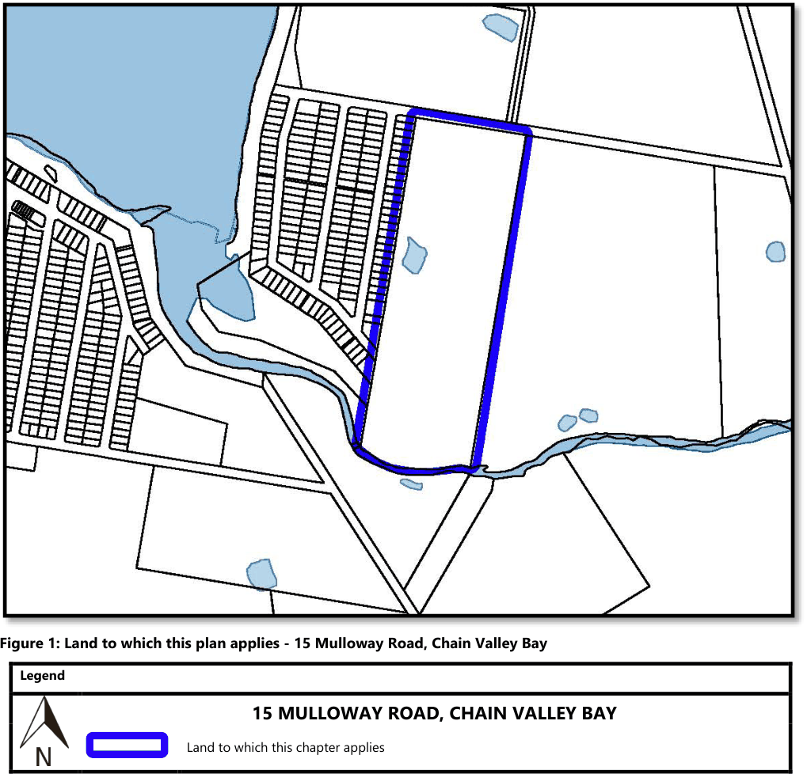

## 15 MULLOWAY ROAD

#### 5.52.1 INTRODUCTION

The purpose of this Chapter is to provide guidance for residential development at 15 Mulloway Road, Chain

Valley Bay. The land has been the subject of a Planning Proposal (rezoning) to specifically facilitate a low-density

residential development and the conservation of environmentally sensitive land.

#### 5.52.1.1 Objectives of this Chapter

• To appropriately integrate development with the existing built and natural environment.

• To provide a high quality and varied residential environment.

• To provide a safe and efficient system of roads and pathways for vehicular, pedestrian and cycle

movements.

• To provide for the protection and enhancement of the environment, including retention and restoration

of bushland areas to form part of a wider vegetation corridor.

• To adopt water sensitive urban design that employs best practice in quality and quantity controls.

#### 5.52.1.2 Land to which this Chapter Applies

This Chapter applies to Lot 273 DP 755266 as shown in Figure 1.

> [Picture on page 2: a picture, saved as a picture (images/ch-05-52-chain-valley-bay-15-mulloway-road-page-2-1.gif, 150 dpi).]

#### Figure 1: Land to which this plan applies - 15 Mulloway Road, Chain Valley Bay

> Words printed on the picture (title and legend, copied from the PDF):
> Land to which this chapter applies
