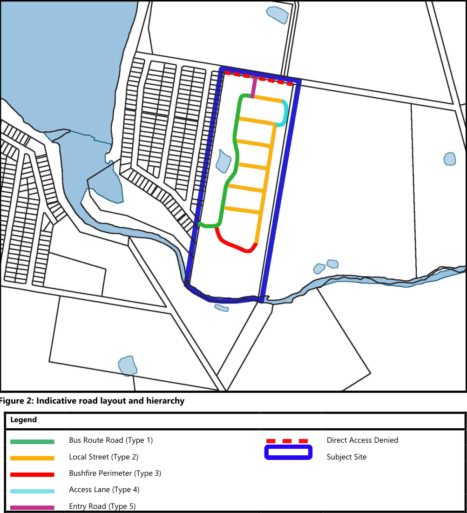
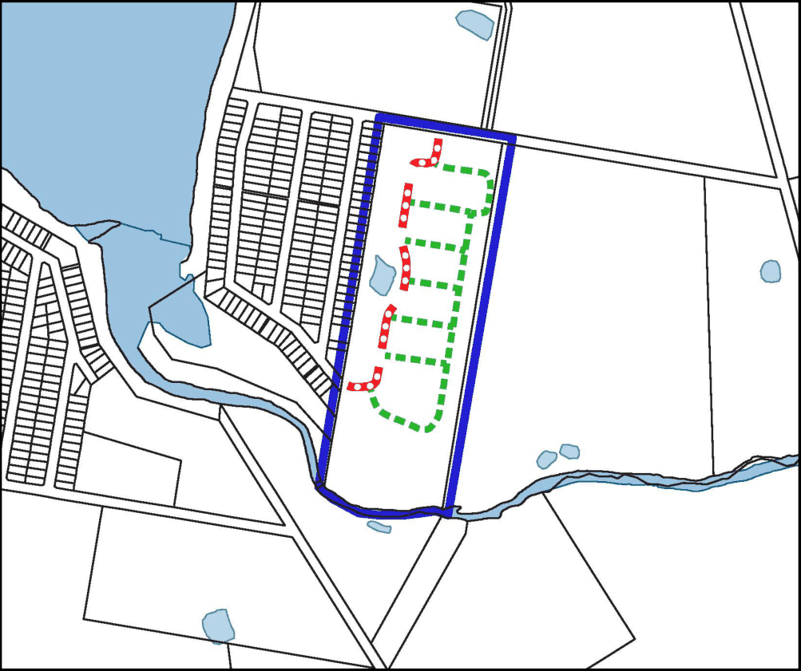
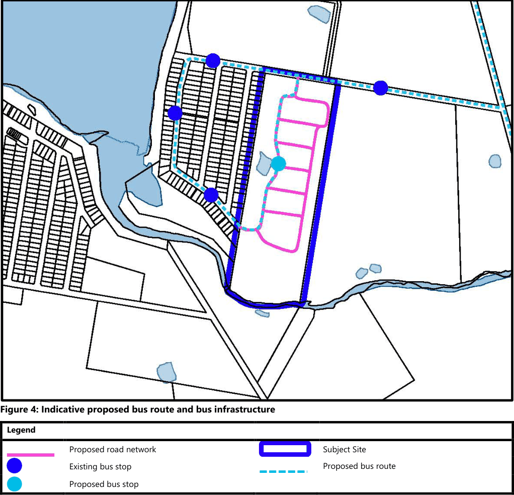
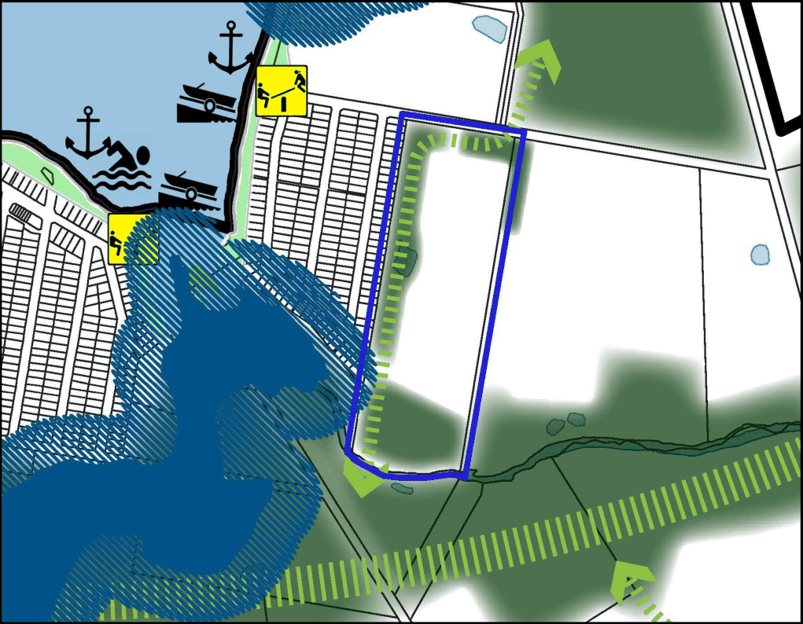
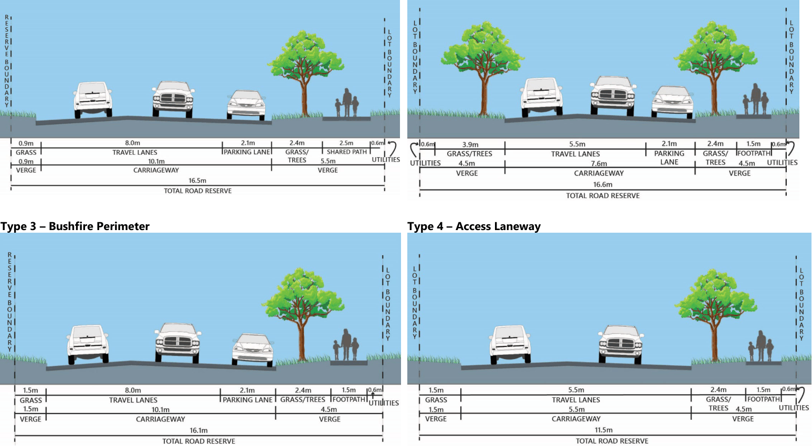
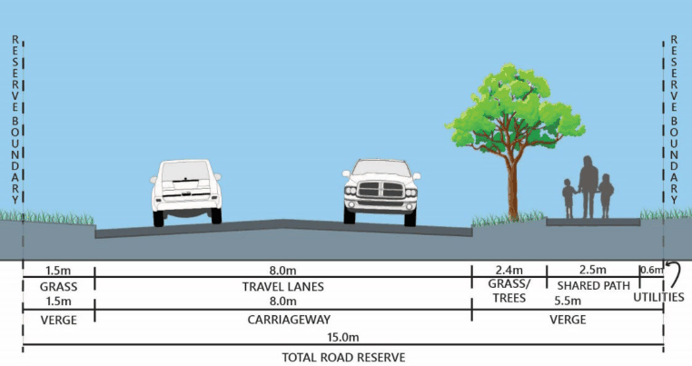

## 15 MULLOWAY ROAD, CHAIN VALLEY BAY

#### 5.52.1.3 Relationship to other Chapters and Policies

This Chapter should be read in conjunction with other relevant Chapters of this Development Control Plan and

other Policy Documents of Council, including but not limited to: Chapter 2.1 – Dwelling Houses, Secondary Dwellings and Ancillary Structures Chapter 2.2 – Dual Occupancies and Multi-Dwelling Housing Chapter 2.4 – Subdivision Chapter 2.11 – Transport and Parking Chapter 3.5 – Tree and Vegetation Management Council’s Civil Works Specification.

Where any inconsistencies arise with the provisions contained in this Chapter, this Chapter shall prevail.

#### 5.52.2 DEVELOPMENT PRINCIPLES

#### 5.52.2.1 Subdivision – General

#### OBJECTIVES

To provide for the orderly subdivision and development of the site.

To ensure that the existing and proposed future character of the area is considered in subdivision works. To ensure that subdivision design and associated civil works meets the appropriate standards of Council. To minimise the impacts of development on the Karignan Creek ecosystem.

#### REQUIREMENTS

a Any applications for the subdivision of the site must meet the provisions of Chapter 2.4 – Subdivision

and Council’s Civil Works Specification.

b Where there is any conflict between the requirements of this DCP Chapter, Chapter 2.4 – Subdivision

and Council’s Civil Works Specification, the provisions of this DCP Chapter apply.

#### 5.52.2.2 Lot Development

#### OBJECTIVES

To ensure that development applications for development in low density residential areas are consistent

with the relevant plans and policies of Council.

#### REQUIREMENTS

a Development Applications for detached dwellings houses shall adopt the provisions of Chapter 2.1 –

Dwelling Houses, Secondary Dwellings and Ancillary Structures.

b Development Applications for dual occupancy development shall adopt the provisions of Chapter 2.2.

– Dual Occupancies and Multi-Dwelling Housing.

#### 5.52.2.3 Streetscape

#### OBJECTIVES

To ensure a consistent and pleasant streetscape blending into the surrounding natural environment. To preserve the natural features of the area, as far as possible.

#### REQUIREMENTS

a A Landscape Design Report and Streetscape Plan, prepared by a suitably qualified professional, is to be

provided with each subdivision application.

b The Streetscape Plan shall show: i street drainage treatment and pathways with consideration of the requirements for vegetation

retention under the Conservation Measures Implementation Plan (CMIP). ii location and detailing of carriageway pavement, parking bays, bus stops, kerbs, footpath, shared

paths and speed control devices. iii any relevant details for the design and location of street furniture - lighting, seats, bus stops, street

signs, etc. Applicants are required to consult with Council to ascertain preferred design standards

for street furniture prior to the lodgement of a subdivision application. iv location and species of proposed trees or other vegetation. v location of existing vegetation to be retained and proposed treatments to ensure its health. Note: Wider verges are often necessary to provide space for larger trees, varied service requirements or

varied parking requirements particularly where densities are 15 dwellings per hectare or greater.

c The Landscape Design Report shall: i select species that are drought resistant and locally occurring where possible. ii emphasise street tree species that attain a minimum height of 8 metres at maturity. iii select species that have a growth habit and propagation that would inhibit weed growth. iv select species that will not obscure street lighting, vehicle sight lines at intersections or overhang

the carriageway so as to interfere with service vehicles or buses. v select species that require minimal maintenance once established.

#### 5.52.2.4 Road Layout and Hierarchy

#### OBJECTIVES

To establish a road layout and hierarchy which maximises convenience, amenity and safety for vehicles,

pedestrians and cyclists.

#### REQUIREMENTS

a The road and intersection layout and hierarchy is to be generally in accordance with Figure 3 and the

diagrams in Appendix A.

b Roads and intersections are to be designed and constructed in accordance with Appendix A and

Council’s Civil Works Specification, including verge trees and paths.

c Safe Systems Assessments together with Road Safety Audits will be required to be carried out to assist

in the development of a safer environment for all road users, including ensuring appropriate lighting,

and using crime prevention through environmental design principles.

d The road layout is to provide roads at the perimeter of the wildlife corridor to maximise public amenity.

Ensuring lots do not back onto the wildlife corridor increases amenity and safety within those spaces.

e The road and intersection layout is to indicate Mulloway Road as the primary common access to the site.

Secondary access only to be provided from Teragalin Drive.

f The road and intersection layout is to clearly identify access locations for any new lots adjacent to

Mulloway Road to address potential traffic conflicts.

g Any subdivision “entry treatments” are to be approved by Council. No expectation is to be given that

Council will take ownership of entry treatments or be responsible for ongoing maintenance.

h All servicing & utilities are to be underground.

> [Picture on page 5: a picture, saved as a picture (images/ch-05-52-chain-valley-bay-15-mulloway-road-page-5-4.gif, 150 dpi).]

#### Figure 2: Indicative road layout and hierarchy

> Words printed on the picture (title and legend, copied from the PDF):
> Bus Route Road (Type 1)
> Direct Access Denied
> Local Street (Type 2)
> Bushfire Perimeter (Type 3)
> Access Lane (Type 4)
> Entry Road (Type 5)

#### 5.52.2.5 Pathway Networks

#### OBJECTIVES

To provide safe and convenient pedestrian and cycle networks with clear internal links and connections

to the regional network and nodes within the area such as shops, schools and sports fields.

#### REQUIREMENTS

a Pathways shall be provided as indicated in Figure 4 and the diagrams in Appendix A. b Shared paths/footpaths and cycleways are to be designed and constructed in accordance with Council’s

Civil Works Specification.

c The provision of bike lanes, shared paths, footpaths and associated infrastructure will consider and align

with the aims and objectives of the Central Coast Bike Plan and Pedestrian Access and Mobility Plan

(PAMP) and provide connectivity to all existing and proposed bicycle and pedestrian routes in

accordance with the required Standards as outlined in the document Action Plans.

> [Picture on page 6: a picture, saved as a picture (images/ch-05-52-chain-valley-bay-15-mulloway-road-page-6-8.gif, 150 dpi).]

#### Figure 3: Indicative pathway layout and hierarchy

#### Legend

Shared Path

Subject Site

Footpath

#### 5.52.2.6 Public Transport

#### OBJECTIVES

To make provision for convenient local transport links and infrastructure. To consult with local bus service providers to optimise delivery of public transport infrastructure.

#### REQUIREMENTS

a Bus infrastructure shall be provided as indicated in Figure 5 and constructed in accordance with Council’s

Civil Works Specification.

b Any applications for the subdivision of the site must provide evidence documenting the outcomes of

discussions with local bus service providers regarding proposed bus routes within the development.

c Roads within the development identified as local bus routes must be designed to cater for large and

rigid vehicles, having regard for grade, sightlines and turning movements.

> [Picture on page 7: a picture, saved as a picture (images/ch-05-52-chain-valley-bay-15-mulloway-road-page-7-8.gif, 150 dpi).]

#### Figure 4: Indicative proposed bus route and bus infrastructure

> Words printed on the picture (title and legend, copied from the PDF):
> Proposed road network
> Existing bus stop
> Proposed bus route
> Proposed bus stop

#### 5.52.2.7 Water Cycle Management Requirements

#### OBJECTIVES

To minimise the impacts of development on the Karignan Creek ecosystem. To limit erosion of watercourses and banks due to runoff from impervious areas of the development.

To safeguard the environment by improving the quality of stormwater run-off to receiving waters and

groundwater systems, to achieve best practice standards. To provide water quality and quantity control measures that are cost effective and affordable, with

consideration given to ongoing maintenance costs.

#### REQUIREMENTS

a Water Sensitive Urban Design (WSUD) elements must be provided to control suspended solids and

nutrients leaving the development area.

b The drainage system shall ensure that no runoff leaves the development area other than via water quality

control structures.

c A Soil and Stormwater Management Plan shall be submitted with any Development Application for

subdivision as is required by Chapter 2. 4 - Subdivision. This plan must address: i soil erosion, sediment control and stormwater management for the proposed subdivision during

the construction phase and over the long-term life of the development. ii the management of anticipated increase in stormwater run-off and provide appropriate controls

as part of the treatment train for the site including appropriate WSUD Principles.

#### 5.52.2.8 Environment and Vegetation Protection

#### OBJECTIVES

To protect the environmental and ecological values of land identified as biodiversity corridor. To ensure satisfactory arrangements are in place for the protection of environmentally sensitive land. To protect wildlife corridors, threatened species and their habitats within areas identified for

protection on environmental zoned land. To provide for the restoration and regeneration of the biodiversity corridor, where necessary. To facilitate long term monitoring of the biodiversity corridor to determine changes (if any) to flora

and fauna, particularly threatened species, their habitats and endangered ecological communities and

recommend actions if required.

#### REQUIREMENTS

a A wildlife corridor shall be provided as indicated in Figure 6. b Provide detail regarding the appropriate and adequate protection of the environmentally sensitive land

zoned C2 Environmental Conservation through appropriate separation of development from

environmental land and the application of the Urban Interface Area principles identified under Chapter

2.4 Subdivision.

c Any application lodged for the development and/or subdivision of the subject land must comply with

the requirements of the Biodiversity Conservation Act, 2016.

d Any application lodged for the development and/or subdivision of the subject site is to be supported

by approved Biodiversity Certification for the site. Any development application for subdivision is to be

supported with the agreement of the Department of Planning and Environment – Biodiversity &

Conservation Division that satisfactory arrangements are in place for the protection of environmentally

sensitive land. Biodiversity Certification is to be determined prior to the lodgement of development

applications and not as part of the development application process.

e The Biodiversity Certification for the site is to include an approved Conservation Measures

Implementation Plan (CMIP). The CMIP is to: i include an arborist report as per the requirements of Chapter 3.6 – Tree and Vegetation

Management recommending trees suitable for retention or replacement. ii address necessary fire protection measures (asset protection zones, fuel-free and fuel reduced

zones). All necessary fire protection measures are not to impact on the wildlife corridor area. iii specify appropriate access and service locations. No fencing which would prevent movement of

ground dwelling mammals, including ground dwelling medium sized mammals, should be erected

within the wildlife corridor. iv provide for the installation of fauna friendly crossing devices (Squirrel Glider dispersal poles) at

the point where the corridor crosses Mulloway Road. v Identify areas of the corridor and retained C2 land that require weeding and planting.

f There is to be minimal use of overhead lighting in or within proximity to the wildlife corridor, to ensure

nocturnal movement of native species along fauna corridors is not interrupted by lighting. Where

necessary, light shielding should be utilised to mitigate impact on fauna.

g Where possible, large logs generated from clearing of land should be relocated to adjacent retained

C2 Environmental Conservation zoned areas as supplementary fauna habitat.

h Any servicing infrastructure such as water, power and telecommunications that is unavoidably located

within the wildlife corridor should: i not result in unnecessary clearing or significant fragmentation of the area. ii retain corridors of vegetation around and where possible over, the proposed facility. iii not compromise the value and connectivity of the wildlife corridor.

i The Lot Layout Plan is to identify areas of the site that will be subject to: i a Restriction on Use for development under Section 88B of the Conveyancing Act 1919 for both

the protection of retained vegetation and an Asset Protection Zone. ii a Positive Covenant for Asset Protection Zone maintenance under Section 88B of the

Conveyancing Act 1919. The requirements for appropriate ongoing Asset Protection Zone

maintenance are to be provided in the Conservation Measures Implementation Plan (CMIP). iii Edge treatment – Fencing location, materials.

> [Picture on page 10: a picture, saved as a picture (images/ch-05-52-chain-valley-bay-15-mulloway-road-page-10-1.gif, 150 dpi).]

#### Figure 5: Park, open space and wildlife connection locations

| Legend |  |
|---|---|
| Environmental - Biodiversity Corridor - Proposed | Biodiversity Connection - Regional |
| Coastal Wetland Area - SEPP Coastal Management (2018) | Biodiversity Connection - Local |
| Coastal Wetlands Proximity - SEPP Coastal Management (2018) | Recreation Area - Passive - Existing |
| Recreation - Play Ground - Existing | Recreation Facility - Public Jetty |
| Recreation - Play Ground - Proposed | Recreation Facility - Boat Ramp |
| Subject Site | Recreation Facility - Swimming |

#### 5.52.2.9 Potential Site Contamination

#### OBJECTIVE

To provide proponents with information that can be used to supplement the requirement to consider

potential site contamination in preparing a development proposal

#### REQUIREMENT

a Compliance with the Preliminary Site Investigation for Contamination, Proposed Rezoning for Residential

Development - 15 Mulloway Road, Chain Valley Bay by Douglas Partners (2016).

b Consideration of the impact of historic and current land use practices at the time of assessment of

development and subdivision applications.

Note: This is supplementary information provided for applicants and landowners. All development proposals

must consider all relevant Council and State Government Policy including State Environmental Planning Policy

(Resilience and Hazards) 2021 – Chapter 4: Remediation of Land.

#### 5.52.2.10 Bushfire

#### OBJECTIVES

To minimise the risk of bushfires on life, property and the environment. To enable appropriate bushfire protection without unreasonably compromising the biodiversity and

landscape values of the area.

#### REQUIREMENTS

a. Any application for subdivision or MHE is to include a Bushfire Risk Management Plan. The plan is be

consistent with the provisions and requirements of Planning for Bushfire Protection 2019 (PBP 2019)

and is to include (but not limited to): i Provision of Asset Protection Zones in accordance with PBP 2019. ii Access to be provided in accordance with the design specifications set out in PBP 2019. iii Services to be provided in accordance with PBP 2019.

### APPENDIX A ROADS AND INTERSECTIONS

#### Type 1 – Bus Route Road

> [Picture on page 12: a picture, saved as a picture (images/ch-05-52-chain-valley-bay-15-mulloway-road-page-12-3.gif, 150 dpi).]

#### Type 2 – Local Street

#### Type 3 – Bushfire Perimeter

#### Type 4 – Access Laneway

#### Type 5 – Entry Road

> [Picture on page 13: a picture, saved as a picture (images/ch-05-52-chain-valley-bay-15-mulloway-road-page-13-2.gif, 150 dpi).]
