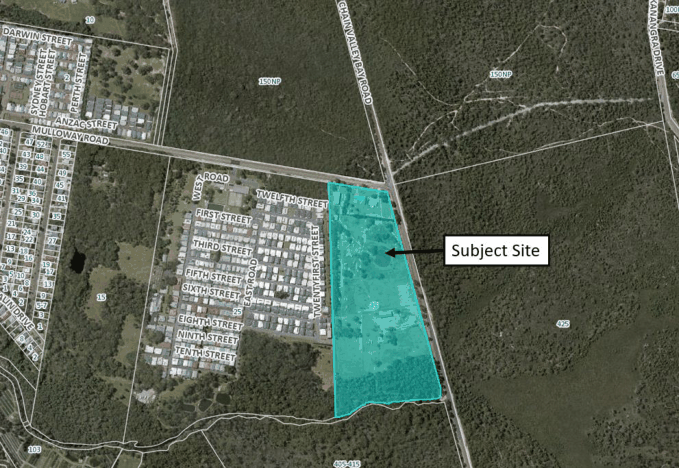

#### 5.53.1 INTRODUCTION

The purpose of this Chapter is to provide guidance for the subdivision and development of certain land at Chain Valley Bay identified within Figure 1.

The land has been the subject of a Planning (rezoning) Proposal to specifically facilitate a Manufactured Housing Estate (MHE), low density residential development and the conservation of environmentally sensitive land.

#### 5.53.1.1 Objectives of this Chapter

▪ To provide for the orderly subdivision and development of the site.

▪ To provide a high quality and varied residential environment.

▪ To provide a safe and efficient system of roads and pathways for vehicular, pedestrian and cycle movements.

▪ To provide for the protection and enhancement of the environment.

#### 5.53.1.2 Land to which this Chapter applies

This Chapter applies to Lot 5 DP 1228880 as shown in Figure 1.

> [Picture on page 1: a picture, saved as a picture (images/ch-05-53-chain-valley-bay-45-mulloway-road-page-1-17.gif, 150 dpi).]

#### Figure 1: Land to which this plan applies - 45 Mulloway Road, Chain Valley Bay

#### 5.53.1.3 Relationship to other Chapters and Policies

This Chapter should be read in conjunction with other relevant Chapters of this Development Control Plan and other Policy Documents of Council, including but not limited to:

▪ Chapter 2.1 – Dwelling Houses, Secondary Dwellings and Ancillary Structures

▪ Chapter 2.11 – Transport and Parking

▪ Chapter 3.5 – Tree and Vegetation Management

▪ Chapter 2.4 – Subdivision

▪ Council’s Civil Works Specification

MHE Development is considered under Part 8 of State Environmental Planning Policy (SEPP) Housing 2021. Where there is inconsistency between the SEPP and this DCP the provisions of the SEPP apply.
