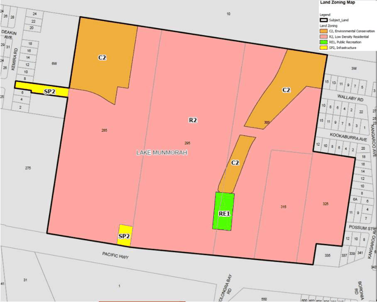

#### 5.54.1.1. Objectives of this Chapter

To provide a high quality and varied residential environment with accessible local open space and access to conservation areas

To provide attractive streetscapes which reinforce the function of a street and enhance the amenity of dwellings

To provide opportunity for a variety of housing types

To provide a self-informing, coherent, safe and efficient system of roads and pathways for vehicular, pedestrian and cycle movements

To protect and enhance significant environmental features of the area

#### Land to which this Chapter Applies

#### 5.54.1.2.

This Chapter applies to land as shown in Figure 1.

> [Picture on page 1: a picture, saved as a picture (images/ch-05-54-lake-munmorah-285-325-pacific-highway-page-1-21.gif, 150 dpi).]

Figure 1-285-325 Pacific Highway Lake Munmorah
