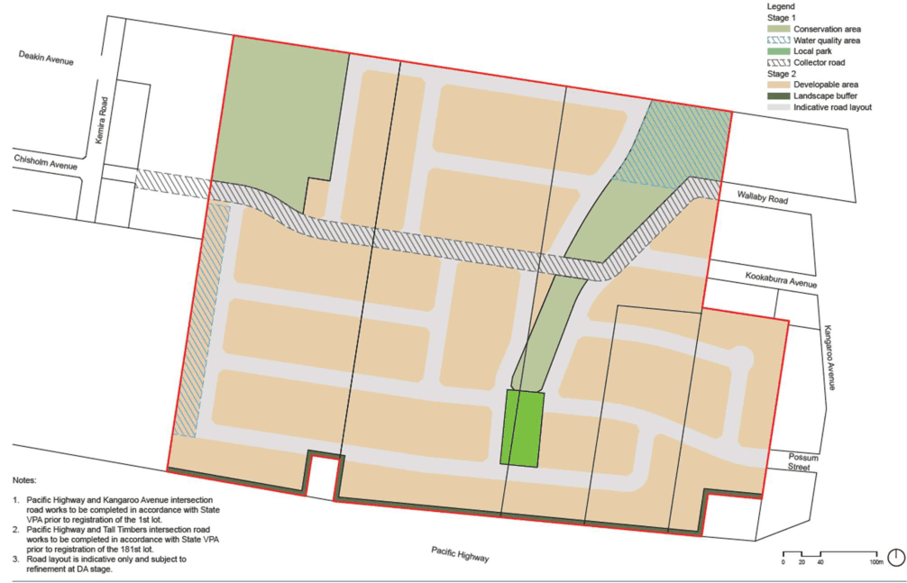

#### 5.54.2 DEVELOPMENT PRINCIPLES

#### 5.54.2.1 Subdivision Design

#### OBJECTIVES

To encourage subdivision design of high quality, which controls and mitigates the potential environmental impacts arising from development

To ensure the development of the site is undertaken in an orderly and sustainable fashion

To provide a self-informing, legible, safe and efficient system of roads and pathways for vehicular, pedestrian and cycle movement

To ensure the economic and orderly development and servicing of land

#### REQUIREMENTS

a The development is to be staged generally in accordance with the staging plan as indicated in Figure 2.

b Staging of development is required to be undertaken to ensure delivery of infrastructure requirements.

> [Picture on page 3: a picture, saved as a picture (images/ch-05-54-lake-munmorah-285-325-pacific-highway-page-3-1.gif, 150 dpi).]

Figure 2-Indicative plan
