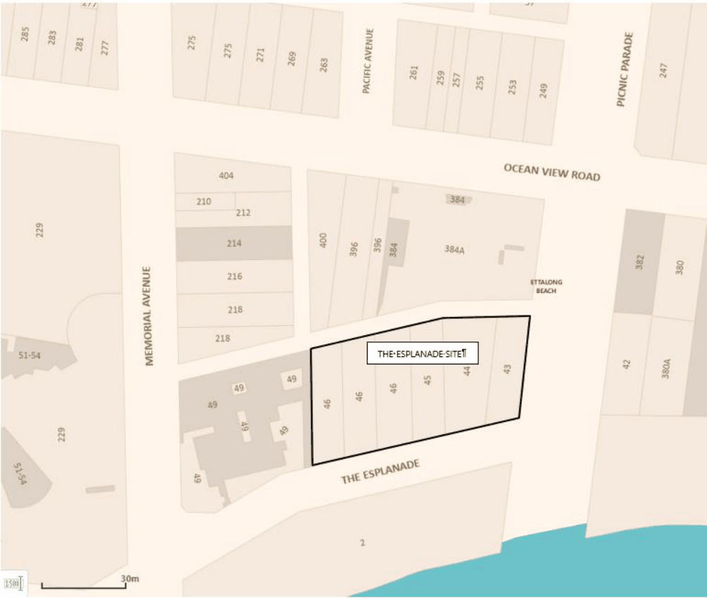

#### 5.55.1 INTRODUCTION

#### 5.55.1.1 Application of this Plan

This Chapter applies to land identified as Lots 117 – 122 in DP10650 No. 43 – 46 The Esplanade, Ettalong Beach; subject to lot consolidation (see Figure 1).

#### 5.55.1.2 Aims and Objectives

#### OBJECTIVES

▪ To promote quality development that accommodates a mix of residential, commercial, and retail use and achieves a balance between economic, social, environmental and service functions

▪ To ensure that the development shall have an appropriate scale, texture and materiality that is sympathetic to the character of Ettalong Beach

▪ To allow for higher density development in a manner which minimises impacts on the locality and surrounding development

▪ To ensure the development of the site improves the public domain function and local amenity and connectivity

▪ To ensure that the development provide a strong entry /arrival node for the Ettalong Beach foreshore

▪ To ensure that the development exhibits design excellence, including a high standard of architectural design, materials, façade treatment and landscape design

#### 5.55.1.3 Land to which this Chapter Applies

This Chapter applies to land as shown on Figure 1 as follows:

> [Picture on page 2: a picture, saved as a picture (images/ch-05-55-ettalong-beach-43-46-the-esplanade-page-2-1.gif, 150 dpi).]

#### Figure 1 Land to which Chapter 5.55 applies

#### 5.55.1.4 Relationship to other Plans

Central Coast Local Environmental Plan (CCLEP) 2022 applies to the site.

In the event of an inconsistency between this development control plan chapter and the provisions of the CCLEP 2022, the latter shall apply.

This development control plan chapter should be read in conjunction with other chapters of Central Coast Development Control Plan (CCDCP) 2022 and policies (including relevant Section 7.11 and 7.12 plans) which may apply to the site, including but not limited to:

▪ Chapter 2.3 – Residential Flat Buildings

▪ Chapter 2.7 – Tourism Development

▪ Chapter 2.13 – Transport and Parking

▪ Chapter 2.14 – Site Waste Management

▪ Chapter 2.15 – Signage and Advertising

▪ Chapter 2.17 – Character and Scenic Quality

▪ Chapter 3.1 - Floodplain Management and Water Cycle Management

▪ Chapter 3.2 - Coastal Hazard Management

▪ Chapter 3.7 – Geotechnical Requirements

▪ Chapter 4.2 – Peninsula Centres

The provisions of this development control plan chapter shall prevail where there is any inconsistency between this development control plan chapter and other development control plan chapters.
