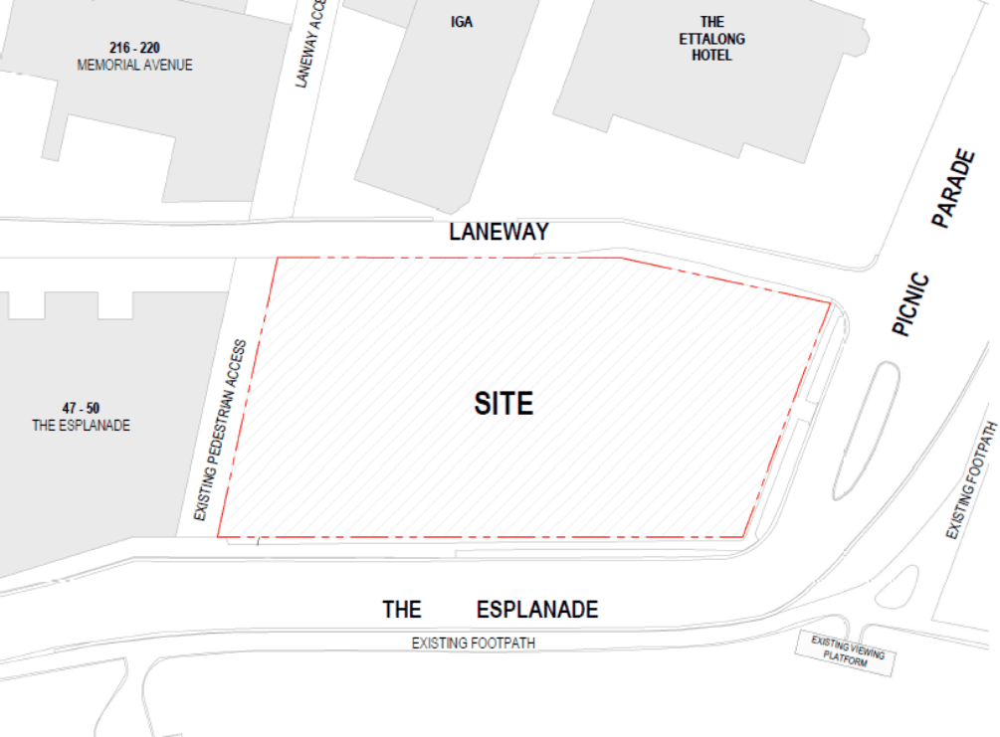

#### 5.55.2 LOT CONSOLIDATION

This Chapter applies only where Lots 117 – 122 in DP10650 No. 43 – 46 The Esplanade, Ettalong Beach are consolidated into a single lot and the development applies to the whole of the consolidated lot.

#### OBJECTIVES

▪ To encourage lot consolidation and the efficient use of land

▪ To ensure that the development site has sufficient frontage and site area to accommodate a development with the permitted heights and floor space ratios

#### REQUIREMENTS

a. The consolidation of Lots 117 – 122 in DP10650 must be achieved as part of the development application in order to apply the building height and floor space ratio bonus provisions identified under the DCP Chapter and CCLEP 2022

b. The development application shall be accompanied by a Plan showing the consolidation of the lots (see Figure 2)

> [Picture on page 4: a picture, saved as a picture (images/ch-05-55-ettalong-beach-43-46-the-esplanade-page-4-1.gif, 150 dpi).]

#### Figure 2 Diagram showing consolidation of all lots into one single lot
