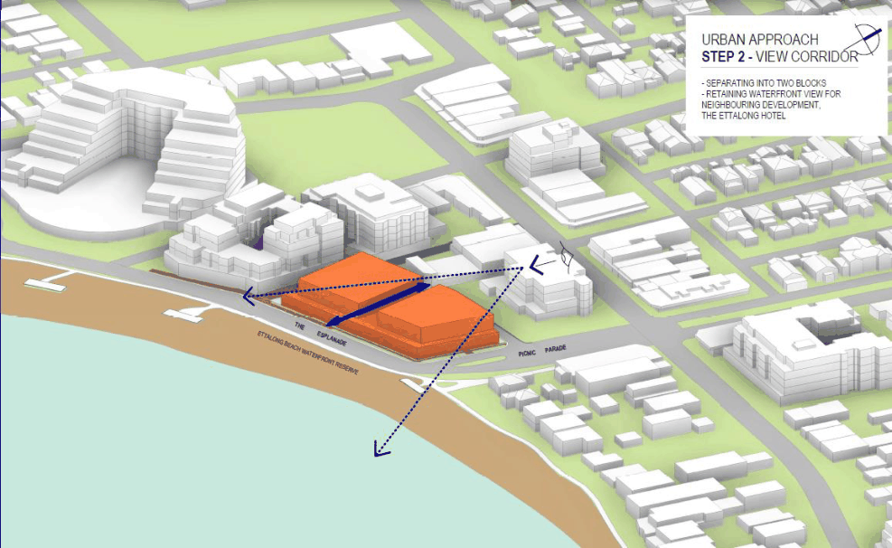
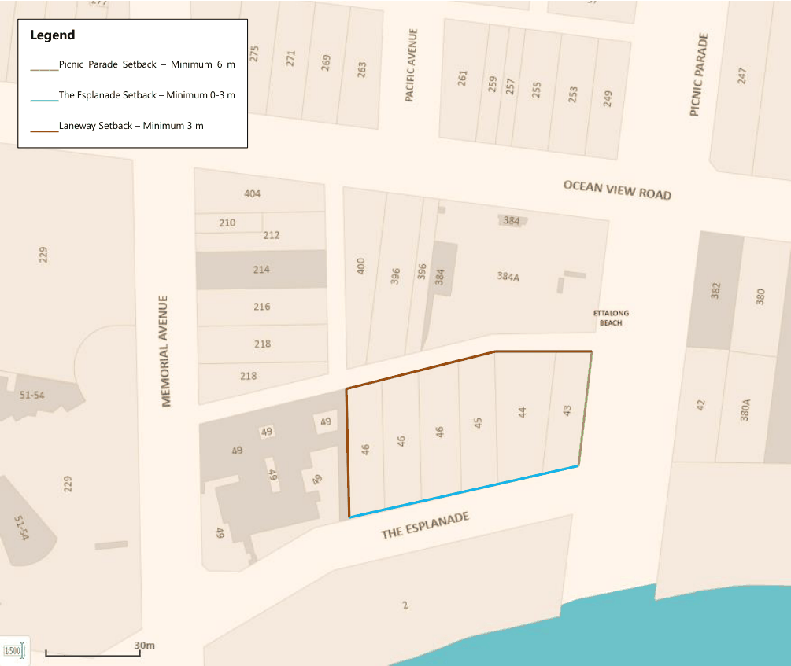

#### 5.55.3 BUILDING FORM

#### OBJECTIVES

▪ To provide for a quality building, displaying architectural design excellence and innovative green building solutions

▪ To minimise impacts upon the amenity of nearby residential properties with regard to bulk and scale, access to sunlight, privacy and views

▪ To minimise overshadowing of the beach and public open space

#### REQUIREMENTS

a. The building form is to provide an appropriate relationship with the public domain and streetscape. Street front elements are to respond to the character of existing beachfront street development, with ground level shopfronts protected by awnings and accessible from the street frontage and western connecting laneway, and with residential uses above

b. Incorporate a design aesthetic that responds to the character of the area and its beach front location

c. Provide a building form that minimises overshadowing of the foreshore and public open space

d. The building is to transition in height between the higher density development to the west and lower density residential areas to the east

#### 5.55.3.1 Building Height and Density

#### OBJECTIVES

▪ To limit the visual impact of multi-storey buildings upon the scenic quality of the coastal setting, and allow for view sharing

▪ To provide for a transition in height to existing low density residential areas

▪ To minimise overshadowing of the beach and public open space

▪ To recognise the prominence of the development when viewed from the foreshore area and ensure that the development steps away the foreshore to reflect the natural terrain

▪ To maintain the established pedestrian-friendly scale of two storey facades facing streets

#### REQUIREMENTS

a. The building heights of the development are to provide for a transition down from west to east, to respond to the heights of existing and proposed adjoining development

b. A maximum of 8.75 metre high, 2 storey podium applies to all frontages of the site

c. The building form is to step down toward the foreshore to decrease the bulk and scale and to respect the natural attributes of the locality

d. The maximum building height of the development is to be in accordance with the Height of Building Map contained within Central Coast LEP 2022 and relevant considerations under the Central Coast Local Environmental Plan 2022

e. The Floor Space Ratio Map and relevant considerations under the Central Coast Local Environmental Plan 2022 are applicable

#### 5.55.3.2 Views

#### OBJECTIVES

▪ To facilitate view sharing from other areas within the village centre, including views through the site and across the Esplanade to Ettalong Beach foreshore, whilst not restricting the reasonable development potential of the site

▪ To have opportunities for public vistas and public views from streets and public places protected and enhanced through building design, location and landscape design

#### REQUIREMENTS

a. New development shall be designed to minimise loss of views from adjoining and adjacent properties identified in the site analysis process, while still providing opportunities for views from the proposed development

b. Design solutions shall respond graphically to the site analysis outcomes through the issue of plans, elevations, photographs and photomontages to demonstrate how view sharing is to be achieved (see Figure 3)

c. A visual analysis illustrating the impacts of the proposed development upon views may be required for developments which have the potential to obstruct views. This analysis will be required to outline the impact of the development on the views of all affected properties

d. Important public views and vistas beyond the site shall be protected and maintained where possible, through responsive building form and treatment including roof design and increased setbacks

> [Picture on page 6: a picture, saved as a picture (images/ch-05-55-ettalong-beach-43-46-the-esplanade-page-6-13.gif, 150 dpi).]

#### Figure 3 Diagram showing potential view corridors and view sharing

#### 5.55.3.3 Setbacks

#### OBJECTIVES

▪ To provide for a building form within a landscaped setting that has adequate setbacks from the beach front, the street and adequate separation from adjacent residential and heritage buildings

▪ To maintain adequate privacy and solar access and allow for view sharing from adjacent properties

▪ To minimise overshadowing of the beach and public open space

▪ To ensure a pedestrian scale is retained at street level

▪ To facilitate a landscaped pedestrian forecourt to Picnic Parade suitable for outdoor dining

#### REQUIREMENTS

a. The building is to have adequate separation to existing and future buildings and the street and ensure that an appropriate degree of solar access is retained for surrounding development, in accordance with the requirements of SEPP 65 – Design Quality of Residential Apartment Development and the related Apartment Design Guide.

b. In addition to building separations and setbacks in accordance with the Apartment Design Guide, specific building setbacks are indicated below and in Figure 4:

#### 5.55.3.3.1 Setback to The Esplanade

a. Setbacks to The Esplanade can range from a minimum of 0 metres and 3 metres, to allow for outdoor seating, landscaping, entryways and building articulation

b. Development above 2 storeys in height is to be setback an additional minimum of 3 metres

c. Development above 3 storeys is to be setback in accordance with the pedestrian scale envelope outlined in the Peninsula Centres Chapter of this DCP

#### 5.55.3.3.2 Setback to Picnic Parade

a. Development is to provide a minimum 6 metre setback to Picnic Parade to allow for outdoor dining, landscaping and deep soil zones, and to provide an appropriate transition to the adjacent heritage item and residential development

b. Development above 2 storeys in height is to be setback an additional minimum of 3 metres

c. Development above 3 storeys is to be setback in accordance with the solar protection envelope outlined in the Peninsula Centres Chapter of this DCP

#### 5.55.3.3.3 Setback to rear vehicular laneway

a. The development is to be setback a minimum of 3 metres from the rear laneway in accordance with the Peninsula Centres Chapter of this DCP

b. Development above 2 storeys in height is to be setback an additional minimum of 3 metres

#### 5.55.3.3.4 Setback to pedestrian laneway

a. The development is to be setback a minimum of 3m from the western pedestrian lane way in accordance with the “Active Laneway” requirement in the Peninsula Centres Chapter of this DCP.

b. Development above 2 storeys in height is to be setback an additional 3metres minimum.

c. Development above 3 storeys is to be setback in accordance with the pedestrian scale envelope outlined in the Peninsula Centres Chapter of this DCP

#### 5.55.3.3.5 Corner Splays

a. To preserve sight lines at the corners of the site, a splay with minimum dimensions of 1.5 metres x 1.5 metres must be provided. No walls, fences or plantings higher than 0.6 metres are permitted within the splay.

> [Picture on page 8: a picture, saved as a picture (images/ch-05-55-ettalong-beach-43-46-the-esplanade-page-8-12.gif, 150 dpi).]
> Words printed on the picture (title and legend, copied from the PDF):
> Legend

___Picnic Parade Setback – Minimum 6 m ___The Esplanade Setback – Minimum 0-3 m ___Laneway Setback – Minimum 3 m

#### Figure 4 Diagram showing minimum street setbacks at ground level

#### 5.55.3.4 Deep Soil Zones

#### OBJECTIVES

▪ To provide areas on the site that allow for and support healthy plant growth of larger trees with large canopies

▪ To allow infiltration of rain water to the water table and reduce stormwater runoff

▪ To provide a visual connection to the foreshore vegetation and continue the coastal theme into the site

▪ To allow for a transition between the site and the low density residential zone to the east

#### REQUIREMENTS

a. Provide deep soil zones with a total area of a minimum of 7% of the site area and with a minimum dimension of 6 metres

b. Deep soil zones are to be free from any buildings or structures. They exclude areas with basement car parks, services, retaining walls, or impervious surfaces

c. Locations for deep soil zones on the eastern and western boundaries of the site are encouraged to assist with integrating landscaping and the coastal theme from the foreshore
