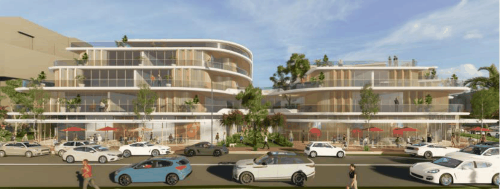
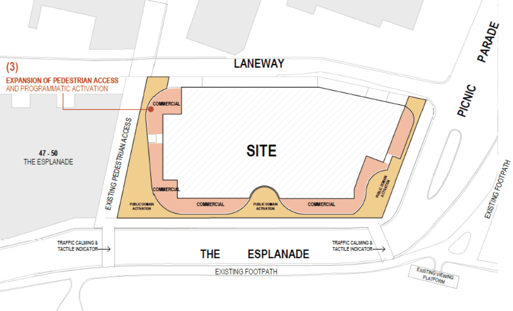

#### 5.55.4 BUILDING DESIGN

#### OBJECTIVES

▪ The building design is to exemplify design excellence, incorporating a high standard of architectural design, appropriate and durable materials, detailed façade treatments, green building solutions and landscaping that recognises the site’s prominent coastal location and climate, in particular streetscape presentation to The Esplanade and the Ettalong Beach foreshore reserve

▪ To ensure that façade articulation and elements within the building setback areas facilitate an active street environment and modern attractive and interesting building design

▪ To ensure that the elevations and roof treatment of the building(s) have a high quality appearance and have regard to the character of the surrounding area.

▪ To ensure a positive relationship to the landscaped street setting, foreshore reserve and beachfront interface

#### REQUIREMENTS

a. Development is to be designed having regard to the urban coastal context and the desired future character of the area

b. Building and landscape elements, including balconies, entries, rooflines and screening are to contribute to the character of the streetscape through distinctive and attractive façade treatments and detailing

#### 5.55.4.1 Materials and Finishes

#### OBJECTIVES

▪ To ensure that the materials and finishes are of high quality and have regard to the coastal context

#### REQUIREMENTS

a. Building and landscape materials are to be fit for purpose and reflect the desired urban and beachside character of the area, be appropriate for climatic conditions and the marine environment and be able to ensure long term quality and sustainability of the development (see Figure 5)

b. Considerations of materials and finishes include:

I. heavy materials for the base structure: durable materials with “self cleaning” attributes such as concrete, masonry render, stone, face brickwork

II. Lightweight materials for the top of the building to allow flexibility in roof form: steel, aluminium and other metallic materials

III. Lightweight screening elements to provide enhanced privacy to the occupants of the development as well as to adjoining residential properties

IV. Materials that minimise reflective glare and provide a modern appearance

V. Large expanses of any single material on the building façade are to be avoided

> [Picture on page 10: a picture, saved as a picture (images/ch-05-55-ettalong-beach-43-46-the-esplanade-page-10-22.gif, 150 dpi).]

Figure 5 – Indicative use of materials and design to produce high quality development of urban coastal character

#### 5.55.4.2 Active Frontages

#### OBJECTIVES

▪ To achieve a well-designed streetscape that engages and activates the Ettalong Beach centre and contributes to its economic viability

▪ To encourage active uses and pedestrian orientated development at ground level

▪ To ensure that uses and frontages of buildings adjacent to The Esplanade, Picnic Parade and western laneway link contribute to the activation of the public domain, to serve the local community and tourists alike

#### REQUIREMENTS

a. The ground floor to The Esplanade, Picnic Parade and the western pedestrian laneway link is to accommodate active uses including retail, cafes and restaurants, with appropriately defined access to residential uses above (see Figure 6)

b. Maximise operable and glazed retail frontages, entries for all uses, active office uses such as reception and any other activities which provide pedestrian interest and activation

c. Minimise blank walls (with no windows or doors), fire escapes, service doors, plant and equipment hatches

> [Picture on page 11: a picture, saved as a picture (images/ch-05-55-ettalong-beach-43-46-the-esplanade-page-11-17.gif, 150 dpi).]

Figure 6 – Plan showing primary active street frontages along The Esplanade, Picnic Parade and the existing pedestrian laneway to the west

#### 5.55.4.3 Entries and Circulation

#### OBJECTIVES

▪ To ensure that residential levels of buildings are integrated within the development, and safety and amenity is maximised for residents

▪ To minimise conflicts between residential and non-residential uses

#### REQUIREMENTS

a. Any tourist accommodation and non-residential uses are to have separate pedestrian entries to the residential component and be designed to ensure that an appropriate level of safety and amenity (particularly acoustic amenity) is provided to residents

b. Residential entries are to be directly accessible from the street via a safe pedestrian route

c. Concealment opportunities are to be avoided

d. Residential circulation areas are to be clearly defined
