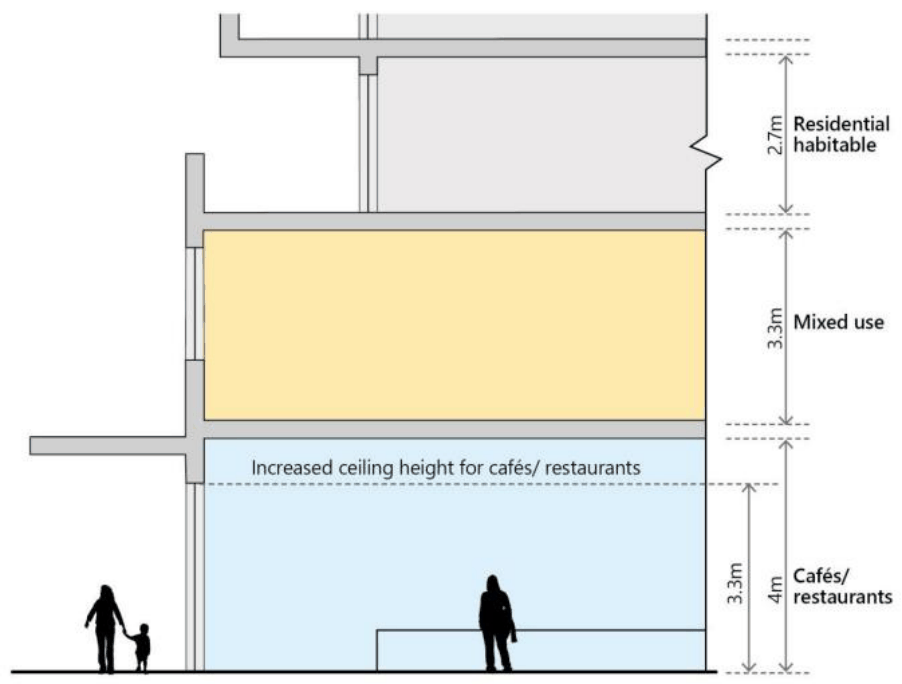

#### 5.55.5 COMMERCIAL DEVELOPMENT

#### 5.55.5.1 Size and depth of tenancies

#### OBJECTIVES

▪ To encourage appropriate commercial development that is developed as a result of understanding the local context

▪ To allow for commercial development of sufficient size to support a wide range of uses

▪ To provide new commercial development that creates well-defined streets, street corners and public spaces

#### REQUIREMENTS

a. Commercial floor space should address the street frontages and pedestrian laneway creating opportunities for passive surveillance

b. Commercial floor areas on the ground floor should have a minimum area of 80 square metres and minimum depth of 6 metres

#### 5.55.5.2 Ceiling heights

#### OBJECTIVES

▪ To ensure appropriate floor to ceiling heights within commercial buildings, and to enable flexibility of uses through higher floor to ceiling heights for ground floor development.

#### REQUIREMENTS

a. Ground floor ceiling heights in commercial development are to be a minimum of 4 metres to allow for servicing and permit flexibility of use (see Figure 7)

b. First floor level ceiling heights in commercial development are to be a minimum of 3.3 metres to ensure longer term adaptability for other uses

> [Picture on page 13: a picture, saved as a picture (images/ch-05-55-ettalong-beach-43-46-the-esplanade-page-13-6.gif, 150 dpi).]

#### Figure 7 – Minimum ceiling heights for commercial development

#### 5.55.5.3 Awnings

#### OBJECTIVES

▪ To improve pedestrian amenity by the provision of awnings for weather protection

▪ To ensure that awnings are in keeping with the desired streetscape character and with the scale and design of the development

#### REQUIREMENTS

a. Awnings should be provided on The Esplanade street frontage and in other areas where practicable

b. Generally, awnings are to be a minimum of 3 metres deep and setback a minimum of 0.6 metres from the kerb, to allow for street signage, lighting and street tree planting

c. Awning heights are to be between 3m and 3.5m except where integration with adjoining properties requires variation; in this case awning height must not be greater than 4.2m
