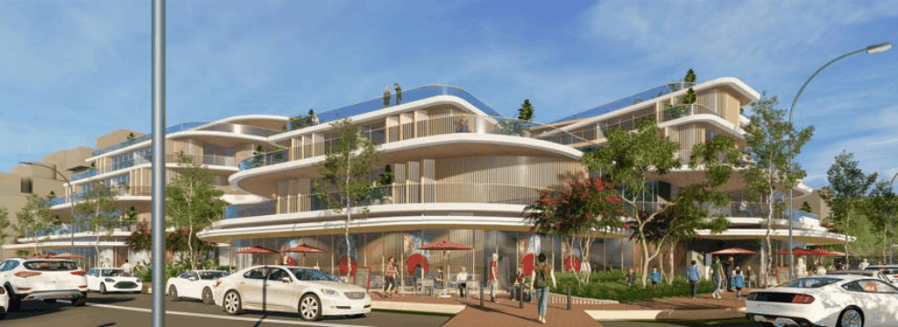
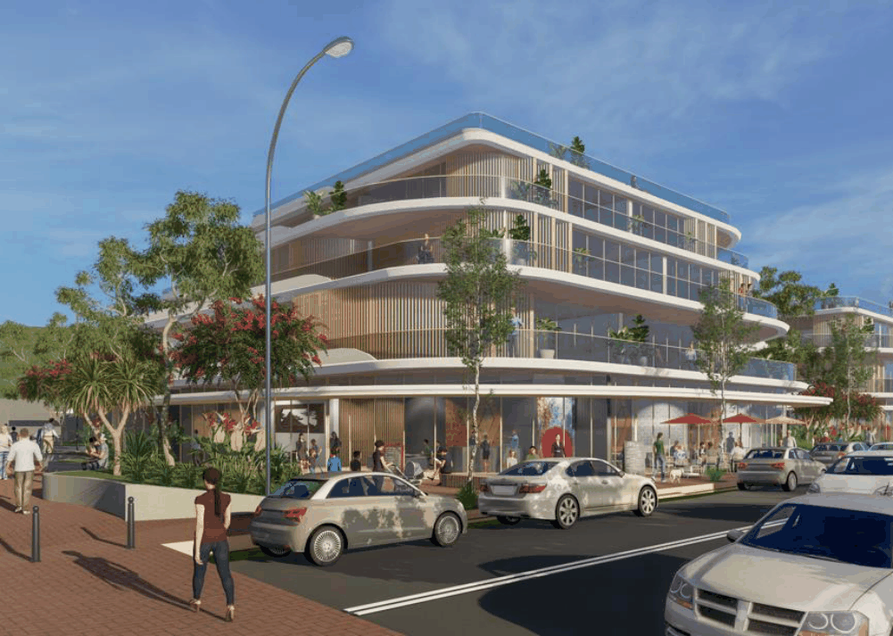

#### 5.55.6 PUBLIC DOMAIN AND LANDSCAPE

The public domain includes public areas such as streets and footpaths, and also privately owned areas accessible to the public like building forecourts, landscaped setbacks, retail premises, and car parks. New development must create gathering places that enhance and connect with those already existing. Shared public areas should be accessible to all community members and visitors. As a setting for community life they need to be attractive, safe, interesting, comfortable, well defined and easily accessible.

#### OBJECTIVES

▪ To provide a safe walkable environment around the development, with visual interest, pedestrian amenity, and opportunities for social interaction

▪ To ensure that the public domain is accessible to all members of the community

▪ To integrate with Council’s public domain improvements within Ettalong Beach Centre and the Ettalong Beach Foreshore Reserve

▪ To improve and enhance the existing laneway to the west of the site by integrating it into the design for the public domain around the site

#### REQUIREMENTS

#### 5.55.6.1 Public Domain

a. The development shall be accompanied by a Public Domain Plan, detailing public domain improvements agreed with Council

b. The design of apartments and balconies shall maximise passive surveillance of the public domain and reinforce the activation of the street environment

c. Pedestrian routes are to be clear, safe, well-lit and legible to all. Particular attention should be given to linking areas of the public domain and to improve safety at potential conflict points between different transport modes

d. Pedestrian and vehicle access ways are to be separated and clearly distinguishable

e. Pedestrian areas should minimise any changes in levels where possible

f. Pedestrian areas are to allow for wheelchair, scooter or pram access from public areas and car parking to any retail areas, including at the threshold of shops

#### 5.55.6.2 Landscape Design

a. The development shall use landscaping that will assist in the integration of buildings and related structures into the streetscape at street level, including the western laneway link and the foreshore to the south

b. A suitably qualified landscape design consultant is to undertake the design and construction of landscaping for the development, details to be lodged as part of any Development Application for the site

c. The landscape design for the development is to:

i. Provide appropriate shade to promote use of passive space using trees or structures

ii. Provide accessible routes within the site and between buildings, and links to the public domain

iii. Contribute to streetscape character and the amenity of the locality by using planting, fencing, lighting and other landscape elements appropriate to the scale of the development

iv. Visually soften the bulk of the development for the person on the street and from the foreshore area

#### 5.55.6.3 Street Trees

a. Provide street tree plantings at a rate of at least two semi-advanced trees per 15 metres of frontage

b. Street tree selection should make use of native, locally endemic species were possible, that are well suited to coastal conditions and provide canopy cover and shade to the streetscape.

c. All landscaping and maintenance must be in accordance with relevant Council technical specifications

d. A street tree planting plan shall be included as part of the landscape design report and is to include the location of any services within the footpath area

e. All tree supply and procurement is to be in accordance with AS 2303. Minimum tree installation size is to be 100ltr for trees on private land, and 200ltr for all street trees on public land.

#### 5.55.6.4 Outdoor Dining

a. Outdoor dining areas associated with restaurants may be provided within the public domain subject to Council’s requirements (see Figure 8)

> [Picture on page 16: a picture, saved as a picture (images/ch-05-55-ettalong-beach-43-46-the-esplanade-page-16-1.gif, 150 dpi).]

Figure 8 - Indicative outdoor dining areas

#### 5.55.6.5 Paving and Street Furniture

a. Benches and other forms of seating should be provided both inside and outside buildings to provide places for passive enjoyment of the space

b. Street furniture and paving shall take into account the needs of people with a disability or decreased mobility (e.g. seats to have arms and not be too low, slip resistant paving should be utilised)

c. Paving shall be predominantly concrete with a high quality exposed aggregate finish. Approximately 10% brick or stone edging or banding should be used to visually break up the concrete and improve the aesthetics of the site

d. High quality natural stone paving should be considered at key points within the site

e. Furniture and fixings are to all be of the same brand or palette and selected for their quality and longevity in a coastal area. Hard-wood materials and galvanised steel are to be used for benches and tables, and a combination of timber and galvanised steel used for bollards or other fittings.

#### 5.55.6.6 Pedestrian Laneway

a. Incorporate the pedestrian laneway on the west of the site into the design for public domain, by widening the lane and enhancing it with landscaping, shelter from the weather, street furniture and opportunities for recreation (see Figure 9)

> [Picture on page 17: a picture, saved as a picture (images/ch-05-55-ettalong-beach-43-46-the-esplanade-page-17-1.gif, 150 dpi).]

Figure 9 - Indicative design of western pedestrian laneway
