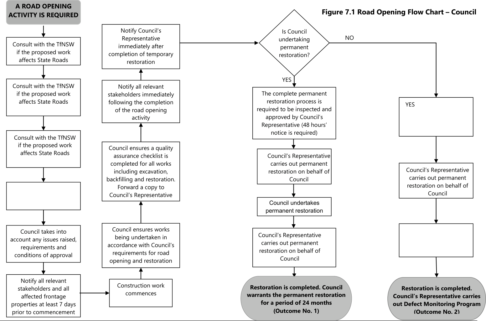

### 7.2 Responsibility and Process for Council

In this Section, Council includes any Service Provider engaged to carry out the required works on behalf of Council.

Council, being a Roads Authority, is responsible for maintaining its road pavement and ancillary road reserve assets in a good and safe condition.

The Roads Act 1993 Section 101 empowers the Roads Authority to direct persons who dig up public roads to make restoration of those roads or to take action to recover costs associated with the restoration of disturbed roads.

The Roads Act 1993 Section 101 (in part):

101 Restoration of public road following excavation, etc

(1) A roads authority may direct any person by whom a public road is dug up to restore the road to its previous condition.

(2) If a public road is damaged as a result of a leakage from, or breaking or bursting of, any object or work placed in, on or over the road, the appropriate roads authority may direct the person:

(a) who was responsible for placing the object or work in, on or over the road, or

(b) who has the care or control of the object or work, or

(c) whose act or omission caused the leakage, breaking or bursting, to restore the road to its previous condition.

(3) A direction under this section may specify:

(a) the manner in which or the standard to which, and

(b) the period (being at least 14 days) within which, the direction must be complied with.

Unless exempt under relevant legislation, such as the Roads Act 1993, Electricity Supply Act 1995, or Telecommunications Act 1997, undertaking works within Council’s road reserve requires obtaining an approval from Council under Section 138 of the Roads Act 1993 in the form of a Section 138 approval or a Road Opening Permit. If works involve impacting traffic, including pedestrian and motorised traffic, a Road Occupancy Licence needs to be obtained from Council.

Water and Sewer works undertaken by Council or its contractors within the road reserve shall be carried out in accordance with the Infrastructure Services Directorate | Water and Sewer Directorate Service Level Agreement (SLA). This SLA sets out the processes, responsibilities and accountabilities for the delivery of various services between Council’s Infrastructure Services and Water and Sewer Directorates.

Council is responsible for undertaking all searches and obtaining necessary approvals associated with their proposed works. Other requirements to be addressed shall include:

• Complying with any relevant legislation.

• Environmental Impact Statement.

• Environmental Assessment or Review of Environmental Factors.

• Environmental Management Plan.

• Safety requirements.

• Conditions of approval.

Where a road activity affects any State Roads, TfNSW shall also be consulted about their specific requirements.

All utility services should be installed within the Council’s footway allocation in accordance with the NSW Streets Opening Coordination Council’s Guide to Codes and Practices for Streets Opening.

Council’s Representative shall be consulted where deviation from footway allocation is unavoidable.

Council is required to take into account any issues raised, requirements and conditions of approval prior to commencing a road opening activity.

Council’s Representative shall also be consulted regarding requirements for road reinstatement.

Council shall ensure works are being undertaken in accordance with this section of the Civil Works Specification. Council shall quality assure their excavation, backfilling and restoration works.

A quality assurance checklist shall be completed for the execution of all works including excavation, backfilling and restoration. Copies of quality checklists including all inspection and testing results shall be forwarded to Council’s Representative within 7 days of practical completion of works. At any time, Council’s Representative may undertake random inspection of the works being carried out on site.

At least 7 days prior to commencement of physical work, Council shall notify:

• All relevant stakeholders including Council’s Representative.

• All affected residential frontage properties.

Council’s Representative shall be notified immediately following the completion of all temporary and permanent restoration works.

Council shall maintain any temporary restoration in a safe and trafficable condition.

Council’s Representative shall be consulted regarding who will be undertaking permanent restoration for the proposed works as well as any permanent restoration arrangement on behalf of the Council. If it is decided that Council shall be undertaking permanent restoration, the complete permanent restoration process shall be inspected and approved by Council’s Representative. Forty-eight hours’ notice is required prior to permanent restorations being undertaken.

The permanent restoration is required to be warranted for a period of 24 months by Council. During this period, the repair of defects such as subsidence and surface deterioration shall be the responsibility of Council.

> [Picture on page 105: a map, saved as a picture (images/civil-works-specification-construction-specificati-page-105-1.gif, 150 dpi); the street names and other small labels are on the picture.]
> Words printed on the picture (title and legend, copied from the PDF):
> A ROAD OPENING
> ACTIVITY IS REQUIRED
> Consult with the TfNSW
> if the proposed work
> completion of temporary
> affects State Roads
> Consult with the TfNSW
> The complete permanent
> if the proposed work
> Notify all relevant
> affects State Roads
> following the completion
> restoration process is
> required to be inspected and
> of the road opening
> approved by Council’s
> Representative (48 hours’
> notice is required)
> Consult with the TfNSW
> if the proposed work
> Council ensures a quality
> affects State Roads
> assurance checklist is
> completed for all works
> carries out permanent
> restoration on behalf of
> backfilling and restoration.
> carries out permanent
> restoration on behalf of
> Consult with the TfNSW if
> Forward a copy to
> the proposed work
> affects State Roads
> Council ensures works
> Council takes into
> account any issues raised,
> being undertaken in
> accordance with Council’s
> carries out permanent
> restoration on behalf of
> carries out permanent
> restoration on behalf of
> conditions of approval
> requirements for road
> opening and restoration
> Notify all relevant
> stakeholders and all
> Restoration is completed. Council
> warrants the permanent restoration
> for a period of 24 months
> Restoration is completed.
> Council’s Representative carries
> out Defect Monitoring Program
> properties at least 7 days
> (Outcome No. 1)
> (Outcome No. 2)
> prior to commencement

Figure 7.1 Road Opening Flow Chart – Council
