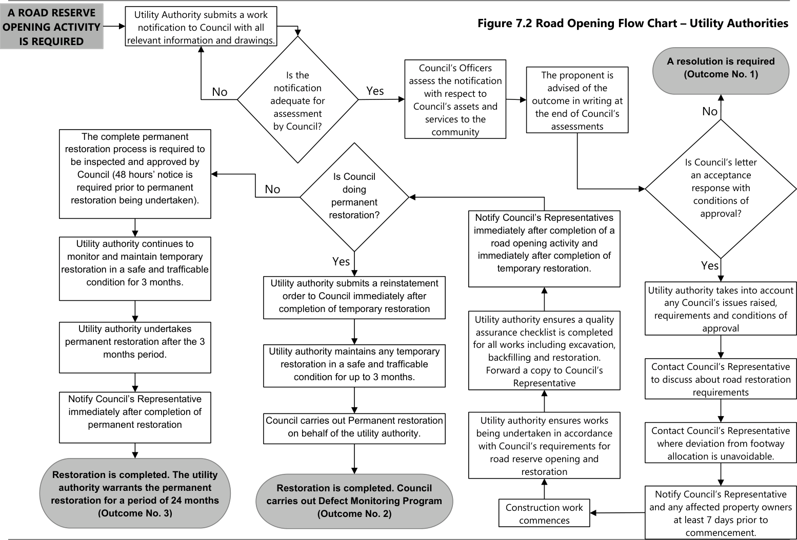

### 7.3 Responsibility and Process for Utility Authorities

In this Section, Utility Authorities includes any Service Provider or contractor engaged to carry out the required works on behalf of a Utility Authority.

Before commencing a road opening activity, it is the responsibility of utility authorities to provide a Notice of Proposed Works to Council in accordance with the provisions of the following:

• Electricity Supply Act 1995 (Section 45).

• Telecommunications Act 1997 (Schedule 3).

• Gas Supply Act 1996 (Section 47).

Such notice shall contain relevant information including (but not limited to) the following:

• Works description.

• Location details.

• Anticipated commencement date.

• Proposed start/finish dates.

• Design Drawings.

In situations where a road opening activity has been carried out without notifying Council, the utility authority will be charged with a late fee in accordance with Council’s Fees and Charges (available on Council’s website). Council shall also be notified when the original proposal has been altered.

Utility Authorities are responsible for undertaking all searches and obtaining necessary approvals associated with their proposed works. Other requirements to be addressed shall include:

• Complying with any relevant legislation.

• Environmental Impact Statement.

• Environmental Assessment or Review of Environmental Factors.

• Environmental Management Plan.

• Safety requirements.

• Conditions of approval.

Utility Authorities are required to notify Council’s Representative of any proposed work and allow sufficient time for Council’s Representative to carry out detailed assessments of the proposal with respect to Council’s assets and services to the community. The utility authority is required to provide as much notice as possible with a minimum of 4 weeks for major works and a minimum of 2 weeks for minor maintenance work.

Council shall commence its assessment of a proposal once all relevant information is submitted. The utility authority shall be advised of the outcome and any requirements and/or conditions for the proposed works following the completion of the assessment.

The utility authority is required to take into account any issues raised, requirements and conditions of approval prior to the commencement of the proposed work.

All utility services shall be installed within the Council’s footway allocation in accordance with the NSW Streets Opening Coordination Council’s Guide to Codes and Practices for Streets Opening. Council’s Representative shall be consulted where deviation from footway allocation is unavoidable.

Utility authorities shall ensure works are being undertaken in accordance with Council’s requirements, standards and specifications for road opening and restoration. Additionally, utility authorities shall quality assure their excavation, backfilling and restoration works.

A quality assurance checklist shall be completed for the execution of all works including excavation, backfilling and restoration. Copies of quality checklists including all inspection and testing results shall be forwarded to Council’s Representative within 7 days of practical completion of works. At any time, Council’s Representative may undertake random inspection of the works being carried out on site.

At least 7 days prior to commencement of physical work, the Utility Authority shall notify:

• Council’s Representative.

• All affected residential frontage properties.

Council’s Representative shall be notified immediately following the completion of all temporary and permanent restoration works.

Council shall be informed about who shall undertake permanent restoration for the proposed works. If it is decided that Council will not be undertaking permanent restoration on behalf of a utility authority, the complete permanent restoration process shall be inspected and approved by Council’s Representative. Forty-eight hours’ notice is required prior to permanent restorations being undertaken. Any inspection carried out by Council’s Representative may be subject to an inspection fee.

The utility authority is required to warrant its permanent restoration for a period of 24 months during which time Council will carry out routine defect monitoring program for all completed restorations. During this period, the repair of defects such as subsidence and surface deterioration is the responsibility of the utility authority. Where works carried out are considered by Council to be unsatisfactory, the utility authority will be given 14 days’ notice to rectify the fault. Where works are not rectified within this time frame Council may elect to undertake the rectification with costs being charged to the utility authority.

Where Council is engaged or required to undertake permanent restorations on behalf of utility authority, reinstatement orders shall be submitted to Council, immediately after completion of

work. The utility authority is responsible for maintaining any temporary restoration in a safe and trafficable condition for up to a period of 3 months after Council has been formally engaged to undertake a permanent restoration. After which time, the maintenance of temporary restoration becomes the responsibility of Council relieving the utility authority of future liability.

> [Picture on page 108: a map, saved as a picture (images/civil-works-specification-construction-specificati-page-108-1.gif, 150 dpi); the street names and other small labels are on the picture.]
> Words printed on the picture (title and legend, copied from the PDF):
> Utility Authority submits a work
> A ROAD RESERVE
> OPENING ACTIVITY notification to Council with all
> relevant information and drawings.
> A resolution is required
> (Outcome No. 1)
> The proponent is
> assess the notification
> advised of the
> outcome in writing at
> with respect to
> Council’s assets and
> the end of Council’s
> services to the
> The complete permanent
> restoration process is required to
> be inspected and approved by
> Is Council’s letter
> Council (48 hours’ notice is
> required prior to permanent
> restoration being undertaken).
> Notify Council’s Representatives
> immediately after completion of a
> road opening activity and
> immediately after completion of
> Utility authority continues to
> monitor and maintain temporary
> restoration in a safe and trafficable
> condition for 3 months.
> Utility authority submits a reinstatement
> Utility authority takes into account
> order to Council immediately after
> completion of temporary restoration
> any Council’s issues raised,
> requirements and conditions of
> Utility authority ensures a quality
> Utility authority undertakes
> permanent restoration after the 3
> assurance checklist is completed
> for all works including excavation,
> Utility authority maintains any temporary
> restoration in a safe and trafficable
> backfilling and restoration.
> Forward a copy to Council’s
> condition for up to 3 months.
> Contact Council’s Representative
> to discuss about road restoration
> Notify Council’s Representative
> immediately after completion of
> Council carries out Permanent restoration
> Contact Council’s Representative
> Utility authority ensures works
> being undertaken in accordance
> on behalf of the utility authority.
> where deviation from footway
> with Council’s requirements for
> allocation is unavoidable.
> road reserve opening and
> Restoration is completed. The utility
> authority warrants the permanent
> restoration for a period of 24 months
> Restoration is completed. Council
> carries out Defect Monitoring Program
> Notify Council’s Representative
> and any affected property owners
> (Outcome No. 3)
> (Outcome No. 2)
> at least 7 days prior to

Figure 7.2 Road Opening Flow Chart – Utility Authorities

Civil Works Specification – Construction Specification
