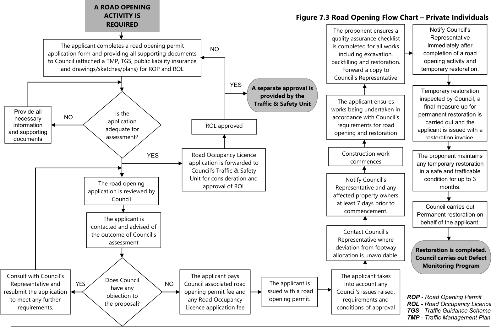

### 7.4 Responsibility and Process for Private Individuals

In this Section, Private Individuals includes any Service Provider or contractor engaged to carry out the required works on behalf of a Private Individuals or other parties who are not Council or Utility Authorities.

Before commencing a road opening activity, it is the responsibility of private individuals to obtain a Road Opening permit, which is available on Council’s website. A Road Opening Permit form must be completed, and associated permit fee and restoration charges shall be paid by the private individual in accordance with Council’s Fees and Charges. The permit will be valid for 6 months from the date of issue. In situations where private individuals have carried out a road opening activity without a Road Opening Permit, they will be charged with a late fee in addition to the standard Fees and Charges.

Where a road opening activity is associated with a current Development Consent, the applicant is required to complete a Roads Act 1993 application form in place of a Road Opening Permit application. A Roads Act 1993 application form is available on Council’s website.

The private individual is responsible for undertaking all searches and obtaining necessary approvals associated with their proposed works. Other requirements to be addressed shall include:

• Complying with any relevant legislation.

• Environmental Impact Statement.

• Environmental Assessment or Review of Environmental Factors.

• Environmental Management Plan.

• Safety requirements.

• Conditions of approval.

All utility services shall be installed within the Council’s footway allocation in accordance with the NSW Streets Opening Coordination Council’s Guide to Codes and Practices for Streets Opening. Council’s Representative shall be consulted where deviation from footway allocation is unavoidable.

The private individual is required to take into account any issues raised, requirements and conditions of approval prior to commencing a road opening activity.

The private individual shall ensure works are being undertaken in accordance with Council’s requirements, standards and specifications for road opening and restoration. The private individual shall quality assure their excavation, backfilling and restoration works.

A quality assurance checklist completed by the private individual shall be completed for the execution of all works including excavation, backfilling and restoration. Copies of quality checklists including all inspection and testing results shall be forwarded to Council’s Representative within 7 days of practical completion of works. At any time, Council’s Representative may undertake random inspection of the works being carried out on site.

At least 7 days prior to commencement of physical work, the Private Individual shall notify:

• All relevant stakeholders including Council’s Representative.

• All affected residential frontage properties.

Council shall undertake all permanent restorations on behalf of the private individual. However, the private individual is required to maintain any temporary restoration in a safe and trafficable condition for a period of up to 3 months after Council has been formally engaged to undertake a permanent restoration. After which time, the maintenance of temporary restoration becomes the responsibility of Council.

Prior to Council undertaking permanent restoration works, any temporary restoration shall be inspected by a Council’s Representative, a final measure up for permanent restoration shall be required and a restoration invoice shall be issued to the applicant.

> [Picture on page 111: a map, saved as a picture (images/civil-works-specification-construction-specificati-page-111-1.gif, 150 dpi); the street names and other small labels are on the picture.]
> Words printed on the picture (title and legend, copied from the PDF):
> A ROAD OPENING
> The proponent ensures a
> quality assurance checklist
> is completed for all works
> completion of a road
> The applicant completes a road opening permit
> application form and providing all supporting documents
> to Council (attached a TMP, TGS, public liability insurance
> backfilling and restoration. opening activity and
> and drawings/sketches/plans) for ROP and ROL
> Forward a copy to
> A separate approval is
> inspected by Council, a
> provided by the
> Traffic & Safety Unit
> The applicant ensures
> works being undertaken in
> final measure up for
> permanent restoration is
> accordance with Council’s
> carried out and the
> applicant is issued with a
> requirements for road
> opening and restoration
> Road Occupancy Licence
> application is forwarded to
> The proponent maintains
> any temporary restoration
> in a safe and trafficable
> Council’s Traffic & Safety
> Unit for consideration and
> condition for up to 3
> approval of ROL
> The road opening
> application is reviewed by
> Representative and any
> affected property owners
> at least 7 days prior to
> Council carries out
> Permanent restoration on
> behalf of the applicant.
> The applicant is
> contacted and advised of
> the outcome of Council’s
> deviation from footway
> allocation is unavoidable.
> Restoration is completed.
> Council carries out Defect
> Consult with Council’s
> The applicant takes
> The applicant is
> issued with a road
> resubmit the application
> The applicant pays
> Council associated road
> opening permit fee and
> into account any
> Council’s issues raised,
> to meet any further
> any Road Occupancy
> Licence application fee
> conditions of approval
> ROP - Road Opening Permit
> ROL - Road Occupancy Licence
> TGS - Traffic Guidance Scheme
> TMP - Traffic Management Plan

Figure 7.3 Road Opening Flow Chart – Private Individuals
