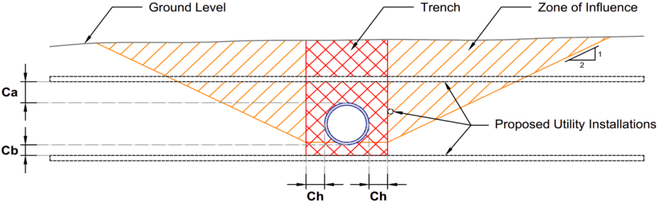

### 7.7 Clearances to Council’s Underground Assets

#### 7.7.1 Water and Sewer

Minimum clearances to Council’s existing water and sewer reticulation mains shall be to the Water Services Association of Australia (WSAA) Water and Sewer Design Codes of Australia standards or Council’s minimum clearance standards, whichever is greater.

The following conditions including minimum horizontal and vertical clearances to water and sewer assets have been compiled to assist utility providers with clearances required to Council’s assets.

#### Table 7.1 Utility Clearances from Water and Sewer

|  | MAIN SIZE | GAS |  | TELECOMMUNICATION |  | ELECTRICAL |  |
|---|---|---|---|---|---|---|---|
|  |  | Minimum Clearance (mm) |  | Minimum Clearance (mm) |  | Minimum Clearance (mm) |  |
|  | (mm) | H | V | H | V | H | V |
| WATER | ≤ 200 >200≤450 >450 | 300 600 1000 | 150 150 500 | 300 600 1000 | 150 300 500 | 500 1000 1000 | 300 300 500 |
| SEWER | ≤300 >300 RM≤200 RM>200 | 300 600 300 600 | 150 150 150 150 | 300 600 300 600 | 150 150 150 150 | 500 1000 500 1000 | 300 300 300 300 |

A minimum 1000mm horizontal (H) and 500mm vertical (V) clearance applies on large major trunk mains, sewer rising mains and larger gravity mains critical to the operation of the water and sewer systems.

Utility services shall not to be installed on the same vertical alignment as the Water Authority’s main.

The proponent cannot utilise the Water Authority’s defined street allocation services corridor for installation of utility services without written consent of the Water Authority (Council).

The pipe material of Council’s assets may also present additional considerations for any proposed installation. Clearances may need to be increased to ensure disturbance does not incur damage to existing water and sewer assets. Compaction of trenching within close proximity to asbestos cement (AC) and cast iron (CICL) assets is restricted to methods not incorporating mechanical vibration.

Service poles located within 1.5m of water and sewer mains are to be embedded below the invert of the mains. Where poles are to be placed with reduced horizontal clearances to mains, placement shall not incur damage to mains or destabilisation of pipe support. Additionally, poles shall not to be placed within 1.5m of sewer maintenance structures.

#### 7.7.2 Stormwater Drainage

Minimum clearances shall be provided to Council’s existing and/or proposed stormwater drainage assets in accordance with requirements shown in the Table 7.2 and Figure 7.4 below.

#### Table 7.2 Utility Clearance from Stormwater

| Council Stormwater Drainage Assets |  | Proposed Underground Utility Installations Minimum Clearances* (mm) |  |  |
|---|---|---|---|---|
| Category | Sub-category | Ca1 | Cb2 | Ch3 |
| Pipe | Ø ≤ 900 900 < Ø ≤ 1500 Ø > 1500 | 300 600 600 | 200 300 500 | 300 500 1000 |
| Box Culvert | Any size | The same as the pipe with equivalent cross- sectional area |  |  |
| Pit/ Headwall | Any size | Not Acceptable | The same as the largest conduit connecting to it |  |
| Channel/ Table Drain | Lined (concrete or similar) Unlined (e.g. turf or rock) |  | 500 1000 | 500 1000 |

1 Clearance above stormwater asset 2 Clearance below stormwater asset 3 Horizontal clearance from stormwater asset, where proposed utility installation is running parallel

Ø Internal diameter (mm) * Measured from the external dimensions of the stormwater drainage assets

#### Notes:

1\. Sewer mains should be installed below stormwater to minimise the possibility of backflow contamination in the event of a main break.

2\. Also, where possible, water mains should be installed above stormwater and sewer mains to minimise the possibility of backflow contamination in the event of a main break.

3\. For cases where there is no alternative and the main must cross under the sewer, the design shall nominate an appropriate trenchless construction technique or other water main construction and protection treatment, effectively joint-free in the vicinity of the sewer.

#### Figure 7.4 Typical Stormwater Clearance Requirements

> [Picture on page 116: a picture, saved as a picture (images/civil-works-specification-construction-specificati-page-116-2.gif, 150 dpi).]

Utility services that are located within 1% AEP flood zones and/or sea level rise affected zones, consideration shall be given to minimise the hazards to community and interruption to service resulting from potential flooding and future sea level rise. Information on 1% AEP flood zones and sea level rise affected zones is available on Central Coast Council's website.

Utility services shall not to be installed on the same vertical alignment as the existing and/or proposed stormwater drainage assets.

The section of the proposed mains, cables and/or conduits passing over the trench of the existing and/or proposed stormwater drainage conduits shall be joint free and self-supporting.

Pits, cabinets, poles, kiosks and/or substations shall not be installed within the trench of the existing and/or proposed stormwater drainage assets.

Pits, cabinets, kiosks and/or substations shall be installed outside the zone of influence of existing and/or proposed stormwater drainage assets, unless underpinning of the proposed structures are undertaken.

Poles shall be installed outside the zone of influence of existing and/or proposed stormwater drainage assets. However, if poles are to be installed within the zone of influence of existing and/or proposed stormwater drainage assets, the poles shall be installed to a depth that is below the zone of influence.

There shall be no installation of utility infrastructure within existing and/or proposed stormwater drainage easements and/or drainage reserves.

Should the clearances required for installing the proposed mains, cables and/or conduits passing over existing stormwater drainage assets cannot be met, the installation shall be below the existing stormwater drainage assets, unless prior approval has been given by Council’s Representative.

When the proposed utility mains, cables and/or conduits are concrete encased, the clearance below the stormwater asset may be reduced by the following:

• 100mm for stormwater pipes that are smaller than 1500mm in diameter or box culverts with equivalent cross sectional area.

• 150mm for stormwater pipes that are larger than 1500mm in diameter or box culverts with equivalent cross sectional area.

• 150mm for a lined channel and/or table drain.

• 300mm for a creek, unlined channel and/or table drain.

#### 7.7.3 Depth of Underground Services

Generally, the minimum depth of cover for underground utility services shall be 600mm within footways and 750mm for trench crossings and pits within the carriageway and 900mm for approved longitudinal trenches within the carriageway. For some utilities these depths will increase, see Table 7.3 below. All utility service provides need to be contacted to confirm their individual requirements.

#### Table 7.3 Nominal Depth of Cover of Utility Service

|  | Footway (mm) | Carriageway (mm) |
|---|---|---|
| Electrical |  |  |
| LV Cable | 600 | 600 |
| HV Cable to 22kV | 600 | 750 |
| HV Cable 33kV and above | 900 | 900 |
| Gas |  |  |
| ≤ 400kPa |  | 600 |
| ≥1000kPa | 600 | 900 |
| ≥3500kPa | 1200 | 1200 |
| Water main |  |  |
| ≥750mm diameter | 800 | 800 |

WARNING: Table 7.3 outlines the depth of underground utilities and indicates only the depths at which the various utility providers are nominally laying services. It has been prepared for information purposes only. Existing and future services/utilities may be located at different depths from those indicated. Therefore, Service Providers intending to excavate or bore shall check with the utility providers/authorities concerned before commencing work. They must exercise care in areas where utilities are indicated by the utility providers/authorities and all utilities shall be located by hand excavation/non-destructive method, before any mechanical equipment is used.

#### 7.7.4 Construction of Trenches

All longitudinal trenches, trench crossings and pits within the road reserve shall be constructed in accordance with Council’s Civil Works Specification - Standard Drawings.

Compaction and compaction testing of backfill and pavement material shall be in accordance with Table 7.4 and Table 7.5 below, which are adapted from AUS-SPEC 1152 (Utilities). Council reserves the right to undertake Quality Control testing, including material compaction and thickness testing.

#### Table 7.4 Trenches within Footways

| Trench Zone | Zone Thickness | Backfill Material | Compaction Requirement | Minimum Testing Requirement |
|---|---|---|---|---|
| WEARING SURFACE/ COURSE | Grassed: |  |  |  |
|  |  | Surface shall be top dressed and turfed with turf rolls and established with appropriate watering |  |  |
|  | Asphalt Pavement: |  |  |  |
|  | 40mm AC | Heavy-duty AC14 or as determined by Council’s Representative |  |  |
|  | Concrete: |  |  |  |
|  | 100mm (path) or 125mm (VAC) | N25 Reinforced Concrete with SL72 mesh |  |  |
| TRENCH BACKFILL | 600mm (min) | Select backfill material (sand as min). Not to use excavated material unless free draining, inorganic, free from stones > 100mm with the fraction passing a 19mm AS sieve with a 4-day soaked CBR ≥ that of the adjacent select material zone to AS 1289.6.1.2 | Uniformly compact each 150mm layer over the full area and required depth within the trench to 80% relative density when tested in accordance with AS 1289.5.6.1 (Density Index Method) | 1 per 2 layers per 100 linear metres of trench or per 20 road openings for openings of less than 10m2 plan area whichever results in the most frequent testing. Testing methods shall be in accordance with AS 1289.5.6.1 |
| BEDDING ZONE | In accordance with Utility Authority's Specification | In accordance with Utility Authority's Specification | In accordance with Utility Authority's Specification | In accordance with Utility Authority's Specification |

#### Table 7.5 Trenches within Carriageways

| Trench Zone | Zone Thickness | Backfill Materials | Compaction Requirement | Minimum Testing Requirement |
|---|---|---|---|---|
| WEARING SURFACE (COURSE) | Flexible Pavement: Temporary: |  |  |  |
|  | 50mm | AC (Hotmix only) |  |  |
|  | Permanent: |  |  |  |
|  | 100mm (in 2 layers - 60mm and 40mm) | Heavy-duty AC14 on tack coat or as determined by Council’s Representative |  |  |
|  | Rigid Pavement: |  |  |  |
|  | Temporary: |  |  |  |
|  | 50mm | AC (Hotmix only) |  |  |
|  | Permanent: |  |  |  |
|  | Match existing thickness (like for like) | Doubly reinforced concrete (N32 min) with SL82 mesh |  |  |
| BASE COURSE | Temporary: 250mm Permanent: 200mm min. | Select Pavement Material ARRB SR41 or DGB20 or equivalent | Uniformly compact each 150mm layer over the full area and specified depth within the trench to a relative compaction of 98% when tested in accordance with AS 1289.5.2.1 (Maximum Modified Dry Density) or 102% when tested in accordance with AS 1289.5.1.1 (Maximum Standard Dry Density) | 1 per pavement layer, per 100 linear metres of trench or per 20 road openings for openings of less than 10m2 plan area whichever results in the most frequent testing. Testing methods are to be in accordance with AS 1289.5.1.1 or AS 1289.5.2.1 |

| Trench Zone | Zone Thickness | Backfill Materials | Compaction Requirement | Minimum Testing Requirement |
|---|---|---|---|---|
| SUBGRADE (TRENCH BACKFILL) | Varies | Select backfill material (sand as minimum). Not to use excavated material unless free draining, inorganic, free from stones > 100mm with the fraction passing a 19mm AS sieve with a 4-day soaked CBR ≥ that of the adjacent selected material zone to AS 1289.6.1.2 | Uniformly compact each 150mm layer over the full area and required depth within the trench to 80% relative density when tested in accordance with AS 1289.5.6.1 (Density Index Method). | 1 per 2 layers per 100 linear metres of trench or per 20 road openings for openings of less than 10m2 plan area whichever results in the most frequent testing. Testing methods are to be in accordance with AS 1289.5.6.1 |
| BEDDING ZONE | In accordance with Utility Authority's Specification | In accordance with Utility Authority's Specification | In accordance with Utility Authority's Specification | In accordance with Utility Authority's Specification |

AS 1289.5.1.1 - Methods of testing soils for engineering purposes - Soil compaction and density tests - Determination of the dry density/moisture content relation of a soil using standard compactive effort. AS 1289.5.6.1 - Methods of testing soils for engineering purposes - Soil compaction and density tests - Compaction control test - Density index method for a cohesionless material. AS 1289.6.1.2 - Methods of testing soils for engineering purposes - Soil strength and consolidation tests - Determination of the California Bearing Ratio of a soil - Standard laboratory method for an undisturbed specimen.
