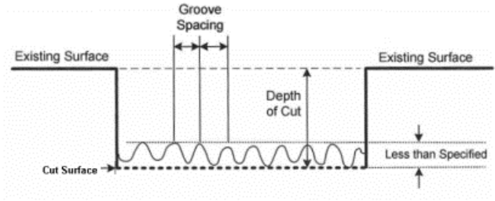
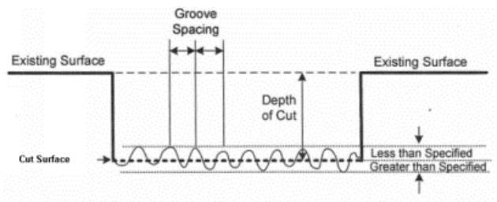

### 14.3 Cold Milling Operation

Set out the cold milling work area as shown on the drawings or as specified by Council’s Representative. Mark all milling depths and locations of any hidden objects or utilities on the road surface.

Perform cold milling to the nominated depth(s), width, length, alignment and road sections as per drawings or as directed by Council’s Representative.

Demonstrate the use of controls to the satisfaction of the Council’s Representative. Control the cold milling machine either by levelling beam or stringline and automatic sensors unless otherwise approved.

There shall be a 5mm maximum difference in levels between adjacent runs, depths and surface levels.

If milling near access chambers or other similar structures, operate the cold milling machine as close as possible to the structure without causing damage to it. Remove the remaining asphalt and base course by hand or other approved method.

#### 14.3.1 Milling to Achieve Specified Depth of Cut

Milling to achieve a specified depth of cut may be directed in one of the following ways:

• Where nil tolerance on depth of cut applies for ‘greater than specified’ refer to Figure 14.1 below.

• Where above and below depth of cut has been specified refer to Figure 14.2 below.

#### 14.3.2 Milling to Retexture a Surface

Groove depths in the existing surface to be between 5 to 10mm depth. Do not fully remove the existing surface. Groove spacing to be 10mm maximum.

#### 14.3.3 Milling to Optimise Final Ride Quality

When the Service Provider is milling to optimise final ride quality, the outcome shall be achieved by cutting to an average depth predetermined by survey and to tolerance as specified in Table 14.1 below. The nominal cutting width must be 2m.

The milling machine must be equipped and operated using a minimum 6m averaging beam or an equivalent non-contact system. The Service Provider must set the milling operations to a constant speed and the cutting sequence must start from the crown and proceed towards the kerb.

The Service Provider shall verify the shape and profile of the milled surface by the use of a 3m straight edge after each cut. The milled surface must not deviate from any point on the bottom of the straight edge by more than 5mm.

#### 14.3.4 Cold Milling over Concrete Structures

Where cold milling is required over existing concrete structures the Service Providers shall undertake a comprehensive investigation to determine the thickness of the existing asphalt over each Concrete Structure.

Carry out the investigation as follows:

• Determine the proposed pattern of milling works and mark on the pavement the lines of movement of the depth sensing foot on each side of the milling machine.

• Investigate the thickness of asphalt by taking small diameter cores (e.g. 25mm), at 3m intervals (over concrete bridge elements) or 20m intervals (over other concrete structures) along each line of movement of a depth sensing foot, at least 24 hours prior to the commencement of milling.

Submit the findings of the investigation to Council’s Representative at least 24 hours before commencement of milling.

The depth of cut shall conform to the requirements of Table 14.1 below.

#### 14.3.5 Temporary Ramps

Where the milled surface is to be temporally opened to traffic the edges of the milled surface shall be tied into the existing road surface.

There are two methods allowed for forming temporary ramps, these are, bevelling and the placement of cold mix asphalt.

When bevelling with the cold milling machine ensuring any lip remaining at the toe or head of the bevel does not exceed 10mm in height. Ensure surface and horizontal tolerance conform to Table

14.2 below.

The use of cold mix asphalt shall conform to the following:

• Apply an emulsion tack coat to the milled surface prior to the placement of cold mix asphalt.

• Maximum thickness and layering of cold mix asphalt shall conform to Table 14.2 below.

• Leave the cold mix asphalt ramp in place no longer than 1 week.

• Maintain the ramp in good condition.

• Compact all cold mix.

#### 14.3.6 Tolerances

#### Table 14.1 Tolerances for Cold Milling Operations

| Nature of Milling Work | Tolerance, Depth of Cut (mm) |  | Groove Spacing (mm) | Surface Texture Depth (mm) |
|---|---|---|---|---|
|  | Greater than specified | Less than specified |  |  |
| Cutting to depth ≤ 40mm | 0 | 8 max | 15 max | 2.5 max |
| Cutting to depth > 40mm where the floor of the cut is asphalt or bound material | 10 max | 5 max | 15 max | Not specified |
| Cutting to depth > 40mm where the floor of the cut is unbound material | 15 max | 5 max | 15 max | Not specified |
| Cutting to depth within nominal 40mm of the surface of a Concrete Structure and/or waterproofing membrane that is to be retained | 0 | 8 max | 10 max | 2.5 max |
| Producing a surface suitable for spray sealing without prior correction | Not specified | Not specified | 10 max | 1.5 max |
| Milling to achieve specified level | 10 max | 0 | Not specified | Not specified |
| Producing a surface to optimise ride quality | 5 max | 5 max | Not specified | Not specified |
| On Concrete Bridge Element | 0 | 8 max | 10 max | 1.5 max |

Depth of cut and other associated terminology is shown in Figure 14.1 and Figure 14.2 below.

Figure 14.1 Where Nil tolerance on depth of cut applies for Greater than specified

> [Picture on page 187: a picture, saved as a picture (images/civil-works-specification-construction-specificati-page-187-6.gif, 150 dpi).]

#### Figure 14.2 Where above and below depth of cut has been specified

> [Picture on page 188: a picture, saved as a picture (images/civil-works-specification-construction-specificati-page-188-2.gif, 150 dpi).]

#### Table 14.2 Tolerances for Cold Milling Operations

| Activity | Limits/tolerances |
|---|---|
| Cuts of cold milling machine |  |
| Difference in levels between adjacent runs, depths and surface levels | < 5mm |
| Temporary ramps |  |
| Dimensions for transverse joints | Speed limit > 60km/h: minimum taper length of 2.5m per 50mm variation in levels. Speed limit ≤ 60km/h: minimum taper length of 1.5m per 50mm |
| Dimensions for longitudinal joints | Provide a ramp of minimum 1.0m length for each 50mm variation in levels |
| Interface with structures | Provide ramps with a minimum taper length of 1.5m for each 50mm depth of cut |
| Methods of forming ramps |  |
| Bevelling | Ensure any lip remaining at the toe or head of the bevel does not exceed 10mm in height |
| Cold mix asphalt | Maximum thickness ≤ 40mm. Where site conditions require greater thickness, place the cold mix asphalt and compact in layers between 25 and 30mm thick |
| Levelling of stockpiles | Height = 2m with uniform shape |
